<div align="center">

# AlgaeCast-7

### 7일 뒤 녹조를 미리 보는 취수원 관제

조류경보제 5개 지점의 유해남조류 세포수를 **7일 앞서 예측**하고,<br>
공식 발령과 AI 예상을 한 화면에 묶어 보여 주는 **녹조 통합관제 상황판**

2026 DATA·AI 분석 경진대회(KISTI) 문제해결 부문 제출작

[](https://algaecast-7.vercel.app)


**[대시보드 열기](https://algaecast-7.vercel.app)** · [방법설명서 PDF](reports/방법설명서.pdf) · [제출 기록](docs/SUBMISSION_FINAL.md) · [동결 모델 T24](models/FROZEN_T24.md) · [데모 영상 안내](demo/README_DEMO.md)

</div>

<p align="center">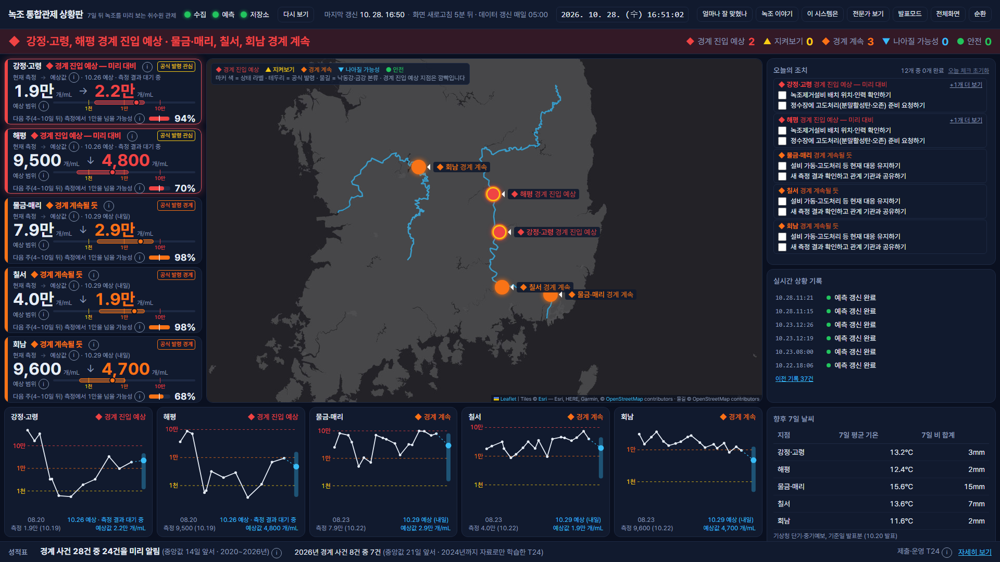</p>
<p align="center"><sub>메인 상황판 — 2026-10-28 16:51 KST 캡처. 기준일은 강정·고령·해평 10월 19일, 물금·매리·칠서·회남 10월 22일입니다.<br>화면 수치는 캡처한 날 기준이며, 매일 05시(KST) 갱신 뒤 바뀝니다.</sub></p>

> [!IMPORTANT]
> 이 시스템의 예상은 **운영 참고용**입니다. 조류경보제의 **공식 발령을 대체하지 않습니다**.

## 한눈에 보기

- **제출·운영 모델:** 2024년까지 자료로만 학습한 모델(T24, 대회 공식 학습 분할). 2026-10-26 13:17 동결(커밋 `a961caf`).
- **2026년(동결 뒤 1회 사후 계산, 블라인드 아님):** 경계 사건 8건 중 7건을 중앙 21일 앞서 감시 단계로 포착했습니다(지속성 2건).
- **2020~2026년 합계:** 28건 중 24건(86%)을 첫 경계 초과 측정 기준 중앙 14일 앞서 포착했습니다(지속성 3건).

용어: **감시 단계** = 화면의 '주의 관찰'(예상 범위 위쪽이 1만에 닿음), **지속성** = 가장 최근 측정값을 7일 뒤 값으로 그대로 쓰는 기준선(화면 '지난주 값 그대로').

| 지표 | 2025 검증<br>(252행) | 2026 사후 계산<br>(124조합) | 지속성<br>(2025 / 2026) | 읽는 법 |
|---|---|---|---|---|
| 로그 R² | **0.778** | 0.502 | 0.649 / 0.242 | 강점. 두 해 모두 지속성보다 높다 |
| 로그 RMSE | **0.712** | 0.731 | 0.896 / 0.902 | 강점. 지속성보다 약 21%·19% 낮다 |
| 원단위 R²(= NSE) | 0.175 | 0.002 | −0.283 / −0.302 | **약점.** 계획 목표 0.60·최소 기준 0.50 모두 미달 |
| 경계 F1@10k(점예측) | 0.705 | 0.818 | 0.727 / 0.841 | **약점.** 지속성보다 조금 낮다 |
| 80% 구간 포함률(PICP80) | 0.845 | 0.718 | — | 목표 0.78~0.82 밖(과대 / 과소) |

> [!NOTE]
> T24 의 2026 결과는 동결 뒤 1회(2026-10-26 13:19 KST) 계산한 **사후 계산이며 블라인드가 아닙니다.** 팀은 v2.1 의 2026 결과를 본 뒤 T24 를 사전등록·동결했습니다.
>
> 28건 합계는 기준이 섞여 있습니다. 2020~2025년(20건 중 17건)은 연도별 교차검증 예측의 q90(보정 전), 2026년(8건 중 7건)은 동결한 T24 의 CQR 보정 q90 입니다.

## 목차

[문제와 접근](#문제와-접근) · [대시보드 둘러보기](#대시보드-둘러보기) · [시스템 구조](#시스템-구조) · [데이터](#데이터) · [모델 T24](#모델-t24) · [성능](#성능) · [투명성](#투명성-누수-수정과-t24-전환) · [빠른 시작과 재현](#빠른-시작과-재현) · [제출 패키지](#제출-패키지) · [저장소 구조](#저장소-구조) · [한계](#한계) · [문서 지도](#문서-지도) · [출처·라이선스·AI 활용](#데이터-출처라이선스ai-활용)

## 문제와 접근

### 무엇을 예측하나

- **대상:** `iem_bgalage_cell_co`. 유해남조류 4속(Microcystis, Anabaena(Dolichospermum), Oscillatoria, Aphanizomenon) 세포수의 합계(cells/mL)입니다.
- **7일 선행:** 기준일(base_date)+7일에 가장 가까운 측정일(±3일, 동률이면 이른 날)의 값을 맞힙니다. 실제 간격은 4~10일이라 `horizon_days` 를 피처로 넣습니다.
- **대회 지표:** log10(세포수+1) RMSE·MAE, 원단위 R²·NSE. 경계(10,000) F1 을 보조 지표로 봅니다.

### 왜 7일 앞서인가

조류경보는 **2회 연속 측정** 규칙으로 발령됩니다. 그래서 2020~2026년 경계 사건 28건 중 26건에서 발령 측정일이 첫 경계 초과 측정일보다 7일 늦었습니다. 한 주 먼저 알면 그만큼 먼저 대비할 수 있습니다.

| 경보 단계(상수원 구간) | 기준(cells/mL, 2회 연속) |
|---|---|
| 관심 | ≥ 1,000 |
| 경계 | ≥ 10,000 또는 조류독소 ≥ 10 μg/L |
| 대발생 | ≥ 1,000,000 (번들 전체 실측 0건, 최댓값 489,500) |
| 해제 | < 1,000 |

### 5개 지점

| 지점 | 코드 | 조사지점 | 수계 · 연계 시설 | 측정(첫 측정) | 경계 초과율 |
|---|---|---|---|---|---|
| 해평 | HP | 2011G26 | 낙동강 · 칠곡보(상류 구미보) | 566건(2016-01) | 4.09% |
| 강정·고령 | GJGR | 2011G56 | 낙동강 · 강정고령보 | 600건(2016-01) | 13.82% |
| 칠서 | CS | 2020G33 | 낙동강 · 창녕함안보 | 624건(2016-01) | 20.81% |
| 물금·매리 | MGMR | 2022G05 | 낙동강 · 하굿둑 상류(창녕함안보 하류) | 366건(2020-05) | 20.64% |
| 회남 | DCHN | 3008G30 | 금강(대청호) · 대청댐 | 783건(2012-04) | 8.65% |

### 공식 발령과 AI 예상을 나눠 본다

AI 예상은 세 단계입니다. 두 조건(p_alert ≥ 0.46, 보정 q90 ≥ 10,000)을 모두 만족하면 '대응 필요'가 우선합니다.

| AI 예상 | 판정 규칙 | 방법설명서 용어 | 권고 조치 |
|---|---|---|---|
| 대응 필요 | 경계 초과 확률 p_alert ≥ 0.46 | 경보 | 녹조제거설비 선제 배치 권고 |
| 주의 관찰 | CQR 보정 q90 ≥ 10,000 | 감시 | 모니터링 강화·설비 준비 점검 |
| 안전 | 둘 다 아님 | 정상 | 평소대로 관리 |

화면은 공식 발령(측정) 배지와 AI 예상 배지를 늘 나란히 두고, 둘을 함께 본 상태 라벨 하나로 정렬·권고합니다. 정렬은 라벨 순위, 같은 순위 안에서는 p_alert 순이며, 어떤 가중치도 곱하지 않습니다.

| 순위 | 공식 발령 | AI 예상 | 상태 라벨 | 권고 |
|---|---|---|---|---|
| 1 | 관심·없음 | 대응 필요 | 경계 진입 예상 — 미리 대비 | 녹조제거설비 선제 배치, 정수장 고도처리 준비 요청 |
| 2 | 관심·없음 | 주의 관찰 | 지켜보기 | 채수 주 2회, 설비 준비 점검 |
| 3 | 경계 이상 | 대응 필요 | 경계 계속될 듯 | 설비 가동·고도처리 등 현재 대응 유지 |
| 4 | 경계 이상 | 주의 관찰·안전 | 나아질 가능성 — 해제 준비 | 해제 판단에 대비해 채수 유지 |
| 5 | 관심·없음 | 안전 | 안전 | 평소대로 관리 |

## 대시보드 둘러보기

주소: **https://algaecast-7.vercel.app** · 서비스명 "녹조 통합관제 상황판" · 1920×1080 한 화면 관제용(모바일도 지원)

<table>
  <tr>
    <td width="50%" valign="top">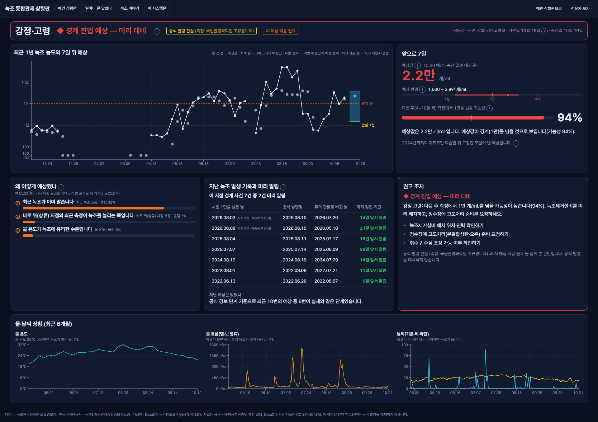<br><b>지점 상세</b> <code>/sites/2011G56</code><br><sub>강정·고령, 2026-10-28 16:51 KST 캡처(기준일·측정일 10월 19일). 예상값 2.2만 개/mL, 예상 범위 1,500~3.8만, 다음 주 1만 넘을 가능성 94%. 근거 세 가지, 지난 경계 사건 기록, 권고 조치, 물·날씨 6개월 그래프.</sub></td>
    <td width="50%" valign="top">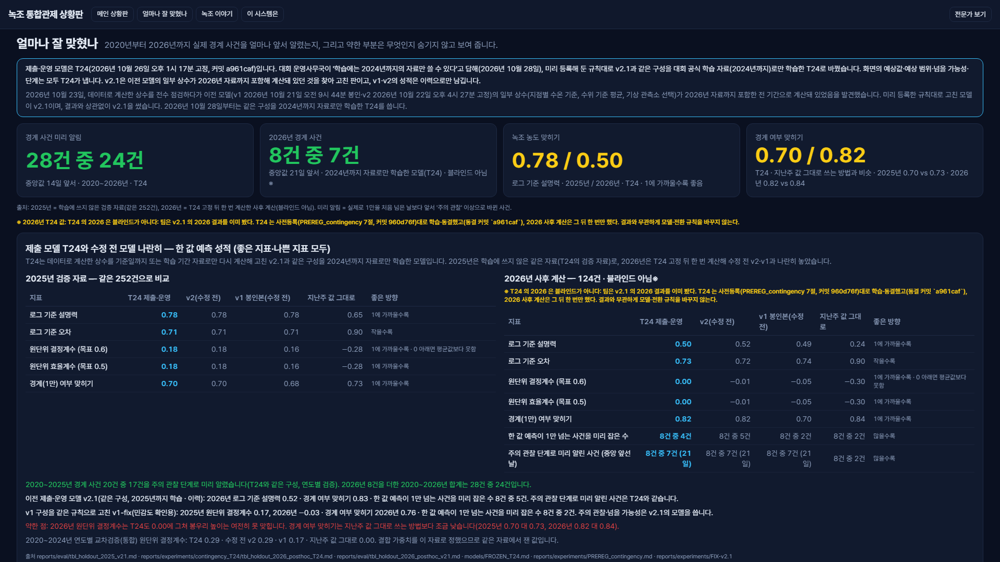<br><b>얼마나 잘 맞혔나</b> <code>/performance</code><br><sub>2026-10-28 16:51 KST 캡처(상단 1080px). 큰 숫자 4개와 T24·이전 모델·지속성 비교표. 2026 열은 '사후 계산·블라인드 아님'으로 표시하고, 약한 점(2026 원단위 결정계수 0.00)을 빨간 글로 밝힙니다.</sub></td>
  </tr>
  <tr>
    <td width="50%" valign="top">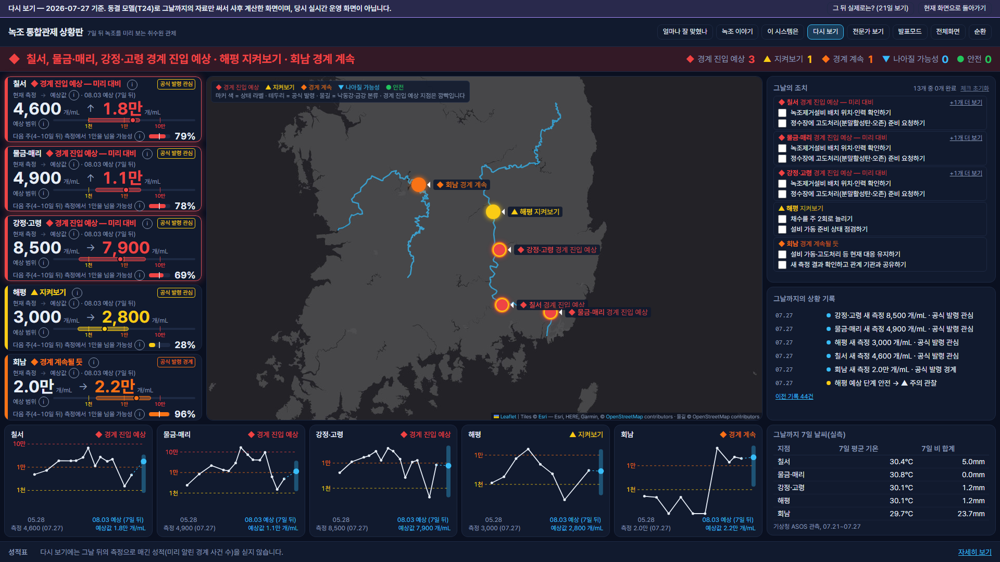<br><b>다시 보기</b> <code>/?asof=2026-07-27</code><br><sub>2026-10-28 16:51 KST 캡처, 기준일 7월 27일. 동결 모델(T24)로 그날까지의 자료만 써서 사후 계산한 화면이며, 당시 실시간 운영 화면이 아닙니다. 고정 run 이라 값이 바뀌지 않습니다.</sub></td>
    <td width="50%" valign="top">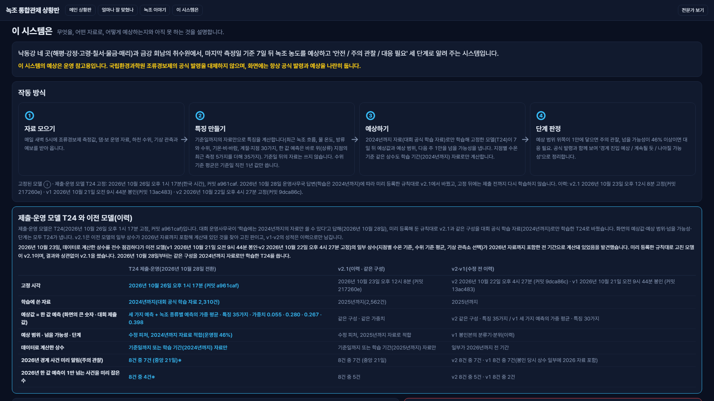<br><b>이 시스템은</b> <code>/about</code><br><sub>2026-10-28 16:51 KST 캡처(상단 1080px). 작동 방식 4단계(자료 모으기 → 특징 만들기 → 예상하기 → 단계 판정)와 T24·이전 모델(이력) 비교.</sub></td>
  </tr>
  <tr>
    <td width="50%" valign="top" align="center">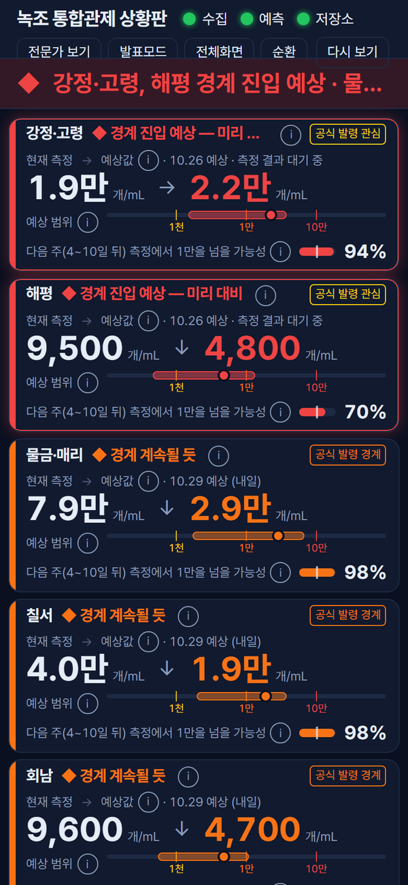<br><sub>모바일 메인(390×844), 2026-10-28 16:51 KST 캡처, 기준일 10월 19일·22일. 지점 타일이 세로로 쌓입니다.</sub></td>
    <td width="50%" valign="top">
      <b>페이지</b>
      <ul>
        <li><code>/</code> 메인 상황판: 상태 표시등, 상황 배너, 위험 순 지점 타일, 지도, 오늘의 조치, 실시간 상황 기록, 5분할 지점 모니터, 성적표 띠. 5분마다 자동 새로고침</li>
        <li><code>/sites/[id]</code> 지점 상세</li>
        <li><code>/performance</code> 얼마나 잘 맞혔나</li>
        <li><code>/insights</code> 녹조 이야기(4편)</li>
        <li><code>/about</code> 이 시스템은</li>
        <li><code>/log</code> 상황 기록(최근 30일)</li>
      </ul>
      <b>보기 옵션</b>
      <ul>
        <li><code>?view=expert</code> 전문가 보기: 쉽게 보기(기본)에서 숨긴 q50·신뢰구간·검정 표를 펼침</li>
        <li><code>?kiosk=1</code> 순환: 내비게이션을 숨기고 30초 타이머로 메인에서 위험 순 지점 상세로 넘김</li>
        <li>발표모드(밝은 테마)·전체화면 버튼</li>
        <li><code>?asof=YYYY-MM-DD</code> 다시 보기(2026-05-04~2026-10-22), <code>&amp;after=1</code> 그 뒤 21일 실측을 분홍 점선으로 겹침</li>
      </ul>
    </td>
  </tr>
</table>

**다시 보기 장면 3개.** 심사 기간(11월)은 녹조 비시즌이라, 시즌 상황을 다시 볼 수 있게 했습니다. 값은 T24 예상값 · 예상 범위 위쪽 · 1만 넘을 가능성입니다.

| 장면 | 기준일 · 지점 | T24 | 주소 |
|---|---|---|---|
| ① 경계 진입 일주일 전 | 2026-07-27 · 강정·고령 | 7,886 · 40,995 · 69% | [`/?asof=2026-07-27`](https://algaecast-7.vercel.app/?asof=2026-07-27) |
| ② 경계 진입일 | 2026-08-03 · 강정·고령 | 24,055 · 121,324 · 98% | [`/?asof=2026-08-03`](https://algaecast-7.vercel.app/?asof=2026-08-03) |
| ③ 미리 알리지 못한 사례 | 2026-07-06 · 회남 | 60 · 918 · 0% | [`/?asof=2026-07-06`](https://algaecast-7.vercel.app/?asof=2026-07-06) |

### 데모 영상

<p align="center">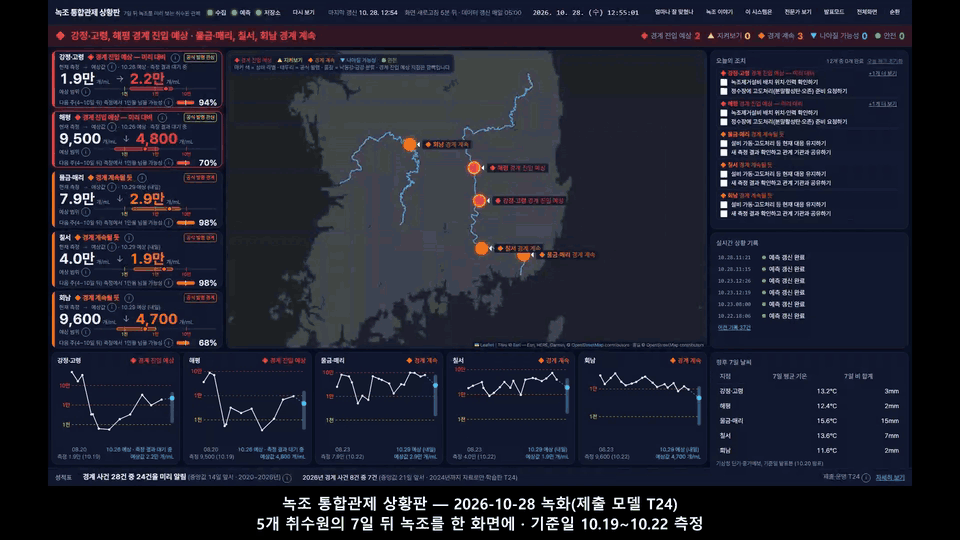</p>
<p align="center"><sub>데모 영상 v7 의 운영 화면 구간(0:51~1:47)을 GIF 로 줄인 것. 2026-10-28 12:55~12:56 녹화(다시 보기 ① 장면만 13:25 재녹화), 제출 모델 T24, 기준일 10.19~10.22 측정.<br>메인 → 배너 → 강정·고령 타일 → 지도 → 지점 상세 → 다시 보기 ①(2026-07-27 기준 사후 계산 화면) 순서입니다.</sub></p>

- 원본 `demo/AlgaeCast_demo.mp4`(v7, 2:28, 약 23 MB, sha256 `5c648ac0…`)는 용량 때문에 **git 밖**에 두고 **제출 패키지에 넣었습니다**(A안 모델자료 zip, B안 문서자료 영상포함 zip).
- 구성과 녹화 방법은 [demo/README_DEMO.md](demo/README_DEMO.md), 콘티는 [demo/script.md](demo/script.md), 장면 캡처 7장은 [demo/captures/](demo/captures/) 에 있습니다.

## 시스템 구조

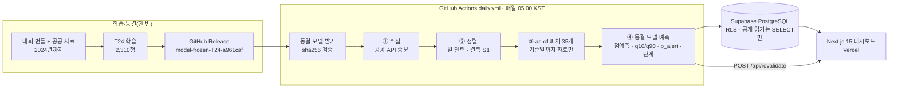

- **3계층:** 수집·추론은 GitHub Actions, 저장은 Supabase PostgreSQL, 표출은 Next.js 15(App Router)·Vercel 입니다. service_role 키는 GitHub Secrets 에만 둡니다. 모든 테이블에 RLS 가 걸려 있고 anon 롤은 SELECT 만 할 수 있습니다.
- **일일 실행:** `daily.yml` 이 Release 의 동결 모델을 받아 [`scripts/verify_frozen.py`](scripts/verify_frozen.py) 로 sha256 을 대조한 뒤 [`scripts/daily_run.py`](scripts/daily_run.py) 를 돌립니다. 수집 → as-of 피처 → 예측 → Supabase 적재 → 관측 upsert·backfill → 벤치마크 결합 → 화면 갱신(revalidate) 순서입니다.
- **실패 처리:** 해시가 다르거나 수온 임계 연도(2024)가 코드 상수와 다르면 그 단계에서 멈춥니다. 실패하면 `model_runs` 에 `status='failed'` 를 남기고 홈 상단에 빨간 배너를 띄우며, 마지막 성공 예측은 유지합니다.
- **보조 워크플로:** `mulmoa_snapshot.yml` 이 KST 06·09·18시에 물모아 AI 녹조 예측 스냅샷(벤치마크 원자료)과 기상청 단기·중기예보 발표분을 쌓고 라이브 벤치마크 표를 갱신합니다(어느 단계가 실패해도 워크플로는 성공으로 끝남).
- **운영 비용:** GitHub Actions 예약 실행, Supabase 무료 플랜, Vercel Hobby 요금제로 돌립니다.

| 영역 | 사용 기술 |
|---|---|
| 모델 | Python 3.11, LightGBM 4.7.0, scikit-learn 1.9.1, pandas 2.3.3, numpy 2.4.6, optuna 5.0.0, shap 0.51.0, statsmodels 0.15.0 (CPU 전용) |
| 웹 | Next.js 15.5.28, React 19.1.0, Tailwind CSS 4, Recharts 3, Leaflet 1.9.4 + react-leaflet 5(Esri Gray Canvas 타일), Radix UI, Pretendard |
| 저장·배포 | Supabase(PostgreSQL, 테이블 13개·뷰 4개), Vercel, GitHub Actions |

## 데이터

**원칙.** 대회 번들이 1차 자료입니다. 외부 자료는 ① 번들 검증, ② 번들 생성일(2026-09-12) 이후 기간 연장, ③ 번들에 없는 변수 보강에만 썼습니다. 원자료는 git 에 올리지 않고 [`data/raw/MANIFEST.md`](data/raw/MANIFEST.md) 만 커밋했습니다. 제출 재현 경로의 조류 자료는 대회 번들만 씁니다.

| id | 자료 | 기간 | 라이선스 | 쓰임 |
|---|---|---|---|---|
| COMP | 대회 번들 `datas_participants.zip`(조류 2,939 · WAMIS 댐 79,964 · ASOS 32,208 · 댐 운영 1,128 · 평가 조합 2,754(eval_pairs: train 2,310·valid 256·test 124·excluded 64)) | 번들 생성 2026-09-12 | 참가신청서 규정 3항 | 1차 자료. 저장소 미포함, 패키지에 심사용으로만 포함 |
| WQ-01 | 국립환경과학원 조류경보제(data.go.kr #15126738) | 2012-04-02~2026-10-15 | 공공누리 1유형 | 번들 검증(겹침 구간 100% 일치)·이후 측정 보강 |
| HY-02 | K-water 수문 운영 정보(#15099110) | 2012-01-01~2026-10-20 | 이용허락범위 제한 없음 | 보 운영 피처 |
| HY-06 | 한강홍수통제소 WAMIS(인증키 없는 개방 API) | 2012-01-01~2026-10-20 | 같은 값이 #3068550·#3040409 에 '제한 없음'으로 등록 | 보 수문, 연속 수위 2025년~ 연장 |
| HY-01 | K-water 다목적댐 운영 정보(#15099049) | 2026-08-21~10-19 | 이용허락범위 제한 없음 | 번들 댐 운영 자료 연장 |
| HY-05 | DataON 「댐유역 하천 일평균수위」(DOI 10.20925/KSRD.74670854.v5) | 2010-01-01~2024-12-31 | CC BY-NC-SA | 연속 수위 피처(관측소 23곳) |
| MT-01 | 기상청 ASOS 일자료(#15059093) | 2012-01-01~2026-10-19 | 공공누리 1유형 | 기상 피처 |

- **쓰지 않은 자료:** 기상청 예보(과거 발표분이 없어 학습 피처에서 제외), 영양염(WQ-02 월자료는 2026년분 없음, 수질측정망 DB WQ-02b(~2026-08-27)로 시험한 R4 실험은 난수 대조군과 구분되지 않아 미채택), AIDA 격자(ASOS 로 대체), 물모아(벤치마크 전용).
- **DataON 기여:** 33피처와 35피처를 비교했더니 블록 부트스트랩 95% 구간이 모두 0을 포함했습니다. 정확도 기여는 확인되지 않았습니다([RESULT](reports/experiments/DATAON-contrib/RESULT.md)).
- 대회 데이터 상세는 [`docs/DATA_CARD_COMPETITION.md`](docs/DATA_CARD_COMPETITION.md), 출처·라이선스는 방법설명서 2장에 있습니다.

<p align="center">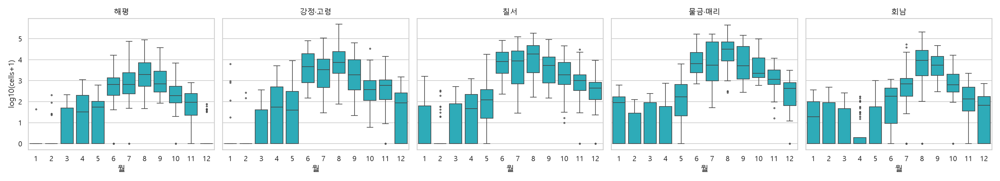</p>
<p align="center"><sub>지점별 월별 유해남조류 세포수 분포(log10). 2012~2026 조류경보제 측정으로 그린 탐색 그림(2026-10-21 생성)이며 모델과 무관합니다. 6~10월에 몰리고, 물금·매리는 11월까지 이어집니다.</sub></p>

<p align="center">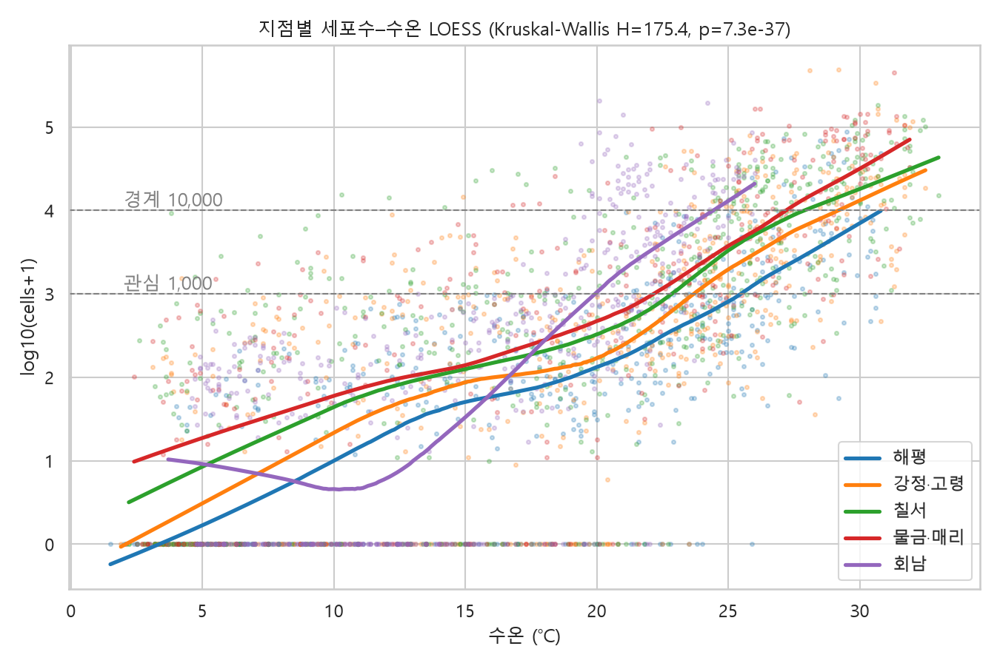</p>
<p align="center"><sub>지점별 세포수–수온 관계(LOESS). 2012~2026 전 기간 탐색 통계(2026-10-21 생성)이며, 모델 상수에는 쓰지 않았습니다. 같은 수온에서도 지점마다 반응이 다릅니다.</sub></p>

## 모델 T24

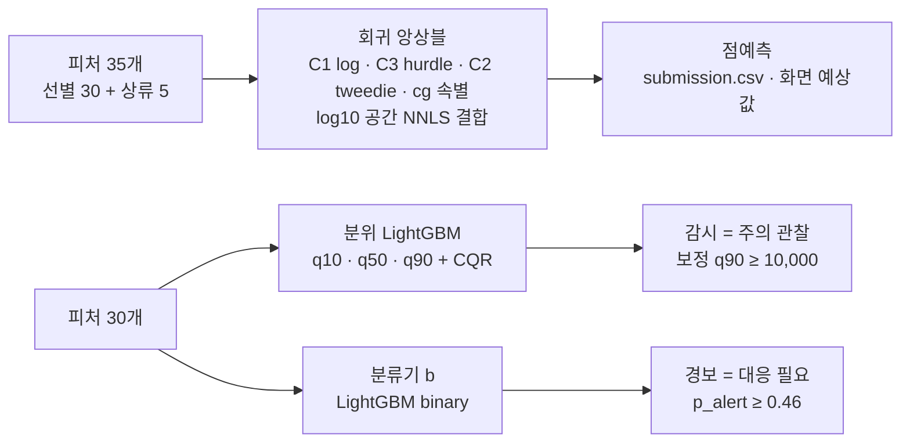

| 항목 | 내용 |
|---|---|
| 학습 범위 | 대회 `eval_pairs.csv` split=train 과 (지점, 기준일, 목표일) 단위로 같은 **2,310행**, 기준일 2012-04-02~2024-12-30 |
| 5행 예외 | 기준일 2024-12-30 → **목표일 2025-01-06** 인 5행(측정 HP 0 · GJGR 0 · CS 1,602 · MGMR 626 · DCHN 97)이 학습 타깃에 들어 있습니다. 이 5행까지 뺀 엄격판 T24S 는 비상안으로 동결만 했습니다 |
| 2025·2026 측정 | 예측 시점의 입력(as-of 피처)으로만 씁니다. 학습 타깃에는 쓰지 않습니다(위 5행 제외) |
| 회귀 결합 가중치 | c1 0.055309 · c3 0.279862 · c2 0.266994 · cg 0.397835 (2020~2024 CV OOF) |
| 분류기 b | 기준일+4~+10일 안에 ≥10,000 측정이 하나라도 있는지 맞힙니다. 운영점 0.46(놓침/헛경보 비용비 3에서 CV 기대비용 최소) |
| 분위·CQR | q10·q50·q90 을 CQR α=0.2 로 보정, q̂ = 0.1646(log10, 2023~2024 OOF, n=531) |
| 수온 임계 | 측정 ≤2024 로 계산(HP 26.0 · GJGR 24.2 · CS 23.6 · MGMR 23.4 · DCHN 20.8℃), `FINAL_THRESHOLD_YEAR = 2024` |
| 시드 · 동결 | 42 · 커밋 `a961caf`, Release `model-frozen-T24-a961caf`, 문서 [`models/FROZEN_T24.md`](models/FROZEN_T24.md) |

**피처.** 6개 그룹 후보 101개에서 시작했습니다. 예보 6개 제외 → 상수 5개 제거 → VIF>10 반복 제거(58개) → Boruta 순서로 30개를 골랐습니다(학습 2,310행에서만). 여기에 바로 위 지점의 최근 측정으로 만든 상류 5열을 더해 회귀는 35개를 씁니다. 분류기·분위 모델은 30개를 씁니다. 목록은 [`config/features.yaml`](config/features.yaml) 에 있습니다.

**누수 방지 규칙**

- 6개 그룹 피처 함수는 `make_<group>_features(df_daily, as_of, site_code)` 형태이고, 상류 피처 `make_upstream_features(algae, as_of, station_id)` 도 첫 줄에서 기준일 이후 행을 버립니다. 모두 `obs_date <= as_of` 행만 씁니다.
- 데이터로 계산하는 상수도 사용 시점 이전 자료만 씁니다. 수위 편차는 관측소별 직전 365일 평균이 기준이고(유효값 180일 미만이면 결측), 수온 임계는 측정 ≤2024 로 계산합니다.
- 2026 정답은 `test_targets_DO_NOT_USE.parquet` 로 격리했습니다. 공통 로더는 이 값을 반환하지 않고, 명시 플래그가 있는 `src/algaecast/eval/live.py` 로만 읽습니다.
- 분할은 연도 단위 expanding-window 만 씁니다(랜덤 KFold 금지).
- 테스트: [`test_no_leakage.py`](tests/test_no_leakage.py) 17개, [`test_derived_constants.py`](tests/test_derived_constants.py) 15개, [`test_no_2026_targets_outside_live.py`](tests/test_no_2026_targets_outside_live.py) 5개, [`test_models_data.py`](tests/test_models_data.py) 의 격리 고정 3건.
- 누수 감사(T24 피처, 2026-10-28): 재계산 표본 300개 불일치 0, 원자료부터 재계산 표본 60개 불일치 0, 124개 조합 누락 0·초과 0.

## 성능

### 회귀 지표

| 지표 | 2025 T24 | 2025 지속성 | 2026 T24(사후) | 2026 지속성 |
|---|---|---|---|---|
| 로그 RMSE ↓ | **0.712** [0.640, 0.780] | 0.896 | **0.731** | 0.902 |
| 로그 MAE ↓ | 0.537 | 0.591 | 0.566 | 0.633 |
| 로그 R² ↑ | **0.778** [0.721, 0.822] | 0.649 | **0.502** | 0.242 |
| 원단위 R²(= NSE) ↑ | 0.175 [0.017, 0.352] | −0.283 | 0.002 | −0.302 |
| F1@10k ↑ | 0.705 [0.581, 0.808] | 0.727 | 0.818 | 0.841 |
| F1@1k ↑ | 0.866 | 0.852 | 0.911 | 0.900 |
| PICP80(CQR 보정) | 0.845 | — | 0.718 | — |

- 2025 는 학습에 쓰지 않은 검증 자료(모델 선택에는 사용, 252행)입니다. 대괄호는 행 부트스트랩 1,000회 95% 구간입니다. T24 는 v2.1 구성의 Final 폴드(기준일 ≤2024 행으로 적합) 그 자체라 2025 252행 값이 v2.1 과 같습니다(저장된 OOF 와의 최대 차 0).
- 지속성(B0)은 가장 최근 측정값을 그대로 7일 뒤 값으로 쓰는 기준선입니다(화면 표기 '지난주 값 그대로'). 예측 구간이 없어 PICP80 칸은 '—' 입니다.
- 2025 분류기 b: PR-AUC 0.7802, Brier 0.0847. 경보(p ≥ 0.46): Precision 0.6825, Recall 0.8431.

### 경계 사건 포착

리드타임 E 는 첫 경계 초과 측정일 기준, D 는 공식 발령일 기준입니다.

| 2026 경계 사건 8건(사후 계산) | 포착 | 중앙 리드 E / D(일) |
|---|---|---|
| 감시(주의 관찰, 보정 q90 ≥ 1만) | **7/8** | 21 / 31 |
| 경보(대응 필요, p ≥ 0.46) | 7/8 | 14 / 21 |
| 점예측 ≥ 1만 | 4/8 | 10.5 / 17.5 |
| q50 ≥ 1만 | 3/8 | 7 / 14 |
| 지속성 | 2/8 | 17.5 / 26 |

- 놓친 1건은 회남 2026-07-13 사건입니다(다시 보기 장면 ③).
- 2020~2025: 20건 중 17건, 중앙 14일(D 21일). 감시 신호 총 270회 중 헛경보 109회, 지속성 1/20.
- 2020~2026 합계: **28건 중 24건(86%)**, 중앙 E 14일 / D 21일, 지속성 3건.
- 관심(1,000) 사건: 2020~2025 48건 중 43건(중앙 14일). 2026 은 공공 API 기준 7건 모두(번들 정답만으로는 5건 모두).
- 2026 운영 규칙 기준: 경계 F1 감시 0.831 · 경보 0.861 · 지속성 0.841. 경계 진입 10건 경보율 감시 0.8 · 경보 0.7 · 지속성 0.

<table>
  <tr>
    <td width="50%" valign="top">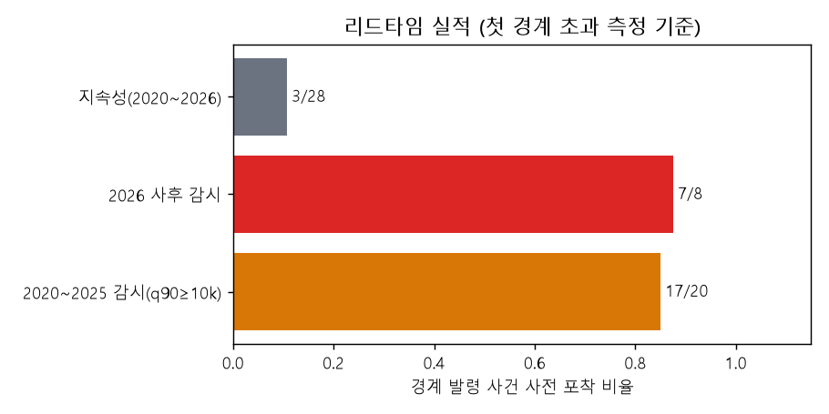<br><sub><b>경계 사건 사전 포착 비율(T24)</b> — 2026-10-28 제출 패키지 노트북 실행 결과, 첫 경계 초과 측정 기준. 2020~2025 감시 17/20(OOF q90, CQR 보정 전), 2026 사후 감시 7/8, 지속성 3/28. 그림 안에는 모델 이름이 없지만 T24 집계입니다.</sub></td>
    <td width="50%" valign="top">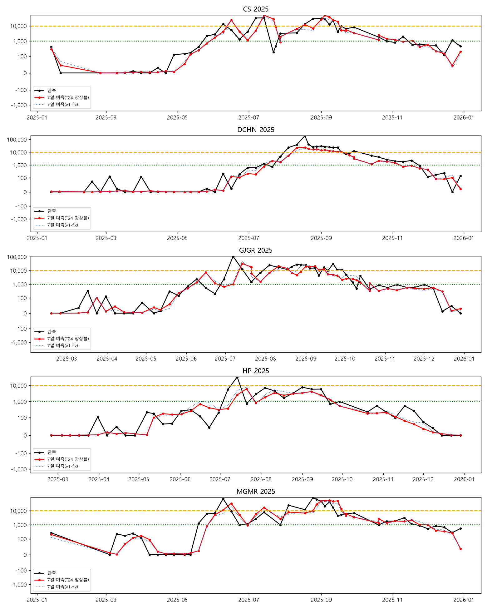<br><sub><b>2025년 검증 자료의 7일 예측과 실측</b> — 2026-10-28 제출 패키지 노트북 실행 결과. 검정은 관측, 빨강은 T24 앙상블, 파란 점선은 비교용 v1-fix 입니다. 패널 CS=칠서, DCHN=회남, GJGR=강정·고령, HP=해평, MGMR=물금·매리. 세로축이 symlog 라 음수 눈금은 축 표시일 뿐입니다.</sub></td>
  </tr>
</table>

### 처음 세운 목표 대비

| 지표 | 최소 / 목표 | 2025 | 2026 | 판정 |
|---|---|---|---|---|
| 원단위 R² | 0.50 / 0.60+ | 0.175(CI 상한 0.352) | 0.002 | 미달 |
| NSE | 0.40 / 0.50+ | 0.175 | 0.002 | 미달 |
| log-RMSE 개선율(지속성 대비) | −15% / −25% | 약 −20.6% | 약 −19% | 목표 −25% 미달 |
| F1@10k | 0.60 / 0.70+ | 0.705 | 0.818 | 두 해 모두 목표 0.70은 넘었으나 지속성(0.727 / 0.841)보다 낮음 |
| PICP80 | 0.70\~0.90 / 0.78\~0.82 | 0.845(과대 커버) | 0.718(과소 커버) | 목표 범위 밖 |

## 투명성: 누수 수정과 T24 전환

| 날짜(2026, KST) | 내용 | 근거 |
|---|---|---|
| 10-21 | **v1 봉인**(동결 `13ac483`, 제출본 태그 `v1-submission`) | [FROZEN.md](models/FROZEN.md) |
| 10-22 | **v2 동결**(`9dca86c`): 회귀에 상류 5열과 속별 cg 추가 | [FROZEN_v2.md](models/FROZEN_v2.md) |
| 10-23 | 참가자 지시("기준일 이후 관측값 사용 금지는 실격 조항")로 15개 항목 전수 점검. **문제 4가지 발견**(데이터 유래 상수 누수 3가지 + 데이터 오류 1가지): 수위 평균을 2026-10-20 까지 전 기간으로 계산, 수온 임계에 2025·2026 세포수 포함, ASOS 선정에 2025·2026 수온 포함(이상 누수), 보현산댐 2025년 이후 수위를 다른 계열에 오프셋 226.89 m 로 이음(데이터 오류) | [PREREG](reports/experiments/FIX-v2.1/PREREG.md) |
| 10-23 11:44 | FIX-v2.1 사전등록(`3e40837`, 결과 계산 전 정정 `c25f28c`) | 같은 문서 |
| 10-23 12:08 | **v2.1 동결**(`217260e`). 결과와 무관하게 채택. 영향: 2020~2025 포착 18→17/20, 합계 25→24/28, 2025 회귀 지표 차이 0.01 안팎 | [RESULT](reports/experiments/FIX-v2.1/RESULT.md) |
| 10-23 17:00 | 비상안 S 모델(기준일 전날까지 자료만) 동결(`130d855`) | [PREREG_contingency](reports/experiments/PREREG_contingency.md) 2·3절 |
| 10-26 11:08 | 운영사무국에 "최종 제출 모델만 2025년 자료까지 포함해 다시 학습해도 되는지" 문의 | [답변 원문](docs/organizer_answers/2026-10-28.md) |
| 10-26 11:50 | T24 규칙 사전등록(`960d76f`) | PREREG_contingency 7절 |
| 10-26 13:17 | **T24 동결**(`a961caf`). 13:19 에 2026 사후 계산 1회 | [FROZEN_T24.md](models/FROZEN_T24.md) |
| 10-28 | 답변 "2. 학습은 24년까지의 데이터만 활용 가능합니다." | [답변 원문](docs/organizer_answers/2026-10-28.md) |
| 10-28 10:28 | 엄격판 T24S 사전등록(`772bcf9`)·동결(`db2b3f2`). 비상안이며 2026 은 채점하지 않음 | PREREG_contingency 8절 |
| 10-28 11:04 | 답변 전에 등록한 규칙(2·7절)대로 **제출·운영 모델을 v2.1 → T24 로 전환**(`7ab18e0`). 대시보드 반영 `51f1b02` | PREREG_contingency 8절(전환 기록) |
| 10-28 | 제출본 태그 `submission-final-T24v`(데모 영상 v7 반영) | [SUBMISSION_FINAL](docs/SUBMISSION_FINAL.md) |

- v1·v2·v2.1 은 **이력**입니다. v1 의 2026 '8건 중 7건'은 누수가 있던 때의 결과라 이력으로만 남깁니다.
- 피처 선별·하이퍼파라미터·상류·cg 채택은 누수 수정 전에 정했습니다. 당시 피처 상수에 2026년 자료가 섞여 있었으므로 간접 영향은 남아 있습니다(방법설명서 5.11 표 5-15).
- 버전별 기록은 [`models/HISTORY.md`](models/HISTORY.md) 와 방법설명서 부록 B 에 있습니다.

## 빠른 시작과 재현

```bash
# Windows: winget install ezwinports.make Python.Python.3.11 후 새 터미널에서
make setup    # .venv(Python 3.11) 생성 → requirements 설치(editable 포함) → pre-commit 훅 설치
make test     # pytest -q (누수 테스트 포함, 2026-10-28 기준 546 passed)
make help     # 그 밖의 타깃(collect·align·features·tune·train·evaluate·submission·reproduce 등)
```

재현에는 외부 API 가 필요 없습니다. 수집(`make collect`)과 일일 운영에만 [`.env.example`](.env.example) 의 키를 `.env` 에 채웁니다.

### (가) 제출 패키지에서 재현 — 권장

모델자료 zip 을 풀고 `AlgaeCast_녹조7일예측_이재행/` 폴더에서 실행합니다(Windows 기준).

```bash
python -m venv .venv && .venv/Scripts/python -m pip install -r requirements.txt
.venv/Scripts/python -m pip install -e . --no-deps
.venv/Scripts/python -m jupytext --to notebook --execute notebooks/01_train_eval.py
```

- 약 20분 걸립니다(대부분 피처 생성, 8코어 CPU 기준). GPU 는 쓰지 않습니다.
- 노트북 순서: 동결 모델 검증(sha256) → 데이터 로드·정렬 → 피처 생성·분할(test 타깃 격리) → 학습(동결 파라미터, train ≤2024) → 2025 홀드아웃 지표 → `submission.csv`(124 조합) → 핵심 그림.
- 셀 단위로 보려면 `.venv/Scripts/jupyter lab notebooks/01_train_eval.ipynb` 를 씁니다. jupyterlab 은 패키지 `requirements.txt` 에 들어 있습니다.
- 2026-10-28 검증: 새 venv 에서 diff 0·노트북 오류 0(11.5분). 오프라인(PIP_NO_INDEX·가짜 프록시)에서도 PASS(11.8분).

### (나) 저장소에서 `make reproduce`

동결 모델로 제출 파일을 다시 만들어 바이트 단위로 비교합니다. **재학습은 하지 않습니다.** help 문구와 달리 실제 순서는 `verify_frozen` → 정렬 S1 → 피처 S1 → 예측 → 비교입니다.

- clone 만으로는 실행할 수 없습니다. 원자료(`data/raw/*`, 대회 번들 포함)와 모델 pickle(`models/**/*.pkl`)이 git 밖이기 때문입니다.
- 모델 pickle 은 Release `model-frozen-T24-a961caf` 의 `models-frozen-*.tar.gz` 로 받습니다. 대회 번들은 라이선스상 저장소에 올리지 않습니다.
- T24 전환 때 저장소에서 피처를 다시 만들고 예측한 결과가 제출본과 바이트 단위로 같았습니다(`057afeee…`, [PROGRESS](docs/PROGRESS.md) 2026-10-28).

| 검증 대상 | sha256 |
|---|---|
| `submission/submission.csv`(124행) | `057afeee93c7a4213bf9176d8696fd9255617641f5c0b0aa35427a8fc1cf3f73` |
| 회귀 `model.pkl`(20261026_131722) | `950dde7fbd1385019363af438a251fe49f901c09afbec7410032c033963b9152` |
| 분류기 `model.pkl` | `496a1a75dd505e2de170461963f8a82bd1b49a3b2a29e8dc6e399e4c68dec696` |
| 분위 `model.pkl` | `9ebc0cef1c306bb5ad24eae06c643a0eb1cbb219289e023e7ebfe61e8a52defe` |

## 제출 패키지

2026-10-27 공지에 따라 제출란은 두 칸(① 문서자료 ② 모델자료)이고, 둘 다 zip 하나에 폴더 하나입니다. 기록은 [`docs/SUBMISSION_FINAL.md`](docs/SUBMISSION_FINAL.md)(태그 `submission-final-T24v`)에 있습니다.

| 안 | ① 문서자료 | ② 모델자료 | 쓰는 때 |
|---|---|---|---|
| **A안(기본)** | `AlgaeCast_문서자료_이재행.zip`(2.5 MB) | `AlgaeCast_모델자료_이재행.zip`(64.9 MB, 영상 포함) | 기본 |
| **B안** | `AlgaeCast_문서자료_영상포함_이재행.zip`(25.3 MB) | `AlgaeCast_모델자료_영상제외_이재행.zip`(42.1 MB) | 모델자료 업로드가 용량 때문에 실패할 때 |

- 모델자료에는 README, data/(대회 번들·DataON 연속 수위 원값 포함, WAMIS 원값 제외), model/(T24 3폴더만), src/, notebooks/, scripts/, demo/, figures/, `submission.csv`, `방법설명서.pdf`(58쪽), requirements.txt 가 들어 있습니다.
- 4종 모두 최상위 폴더 하나, 한글 파일명 UTF-8 플래그, CRC 정상, 민감정보 검사 0건을 확인했습니다. sha256 은 SUBMISSION_FINAL 에 있습니다.

```bash
python scripts/render_method_doc.py                    # 방법설명서 md → pdf (헤드리스 Edge, Windows 전용)
python scripts/build_submission_package.py             # submission_package/ 생성 + 민감정보 검사
python scripts/verify_package.py --update-package      # 새 venv 재현(diff 0·노트북 오류 0) 후 실행본 ipynb 반영
python scripts/build_submission_package.py --zip-only  # 재검사 → 모델자료 zip 2종 → 문서자료 zip 2종
```

빌더는 git 밖의 `demo/AlgaeCast_demo.mp4` 가 sha256 `5c648ac0` 으로 시작하지 않으면 멈춥니다. `--zip-only` 에서는 패키지 PDF 가 `reports/방법설명서.pdf` 와 다르면 멈춥니다.

## 저장소 구조

```text
algaecast/
├── src/algaecast/
│   ├── collect/      # 수집기(대회 번들·조류경보·K-water·WAMIS·DataON·ASOS·예보 등)
│   ├── align/        # 일 달력 정렬·결측 처리
│   ├── features/     # as-of 피처(ar·hydro·water·weather·upstream·time_site 등)
│   ├── models/       # 학습·튜닝·앙상블·분류기·분위·레지스트리·예측
│   ├── eval/         # 지표·통계 검정·전환 분해·사후 계산
│   ├── exp/          # 실험 하네스
│   ├── predict/      # as-of 예측
│   └── db/           # Supabase 적재·관측 백필
├── config/           # sites·features·model·seed.yaml, 유래 상수 json
├── models/           # FROZEN 문서 4종·HISTORY·registry.json·meta.json (pkl 은 Release)
├── notebooks/        # 01_train_eval(.py/.ipynb) 등
├── tests/            # pytest(누수·유래 상수·정답 격리 테스트 포함)
├── web/              # Next.js 15 대시보드
├── supabase/         # migrations 3개, seed.sql
├── scripts/          # 일일 러너·동결 검증·패키지 빌드·재현 검증
├── reports/          # 방법설명서(md/pdf), eda·eval·experiments
├── submission/       # submission.csv(124행)
├── data/             # MANIFEST.md 와 물모아·예보 스냅샷 CSV 만 추적(원자료는 git 밖)
├── demo/             # README_DEMO·script·captures (영상 mp4 는 git 밖)
├── docs/             # 설계 문서 00~13, 제출 기록, 운영사무국 답변, images/
└── .github/workflows/  # daily.yml, mulmoa_snapshot.yml
```

`figures/` 의 그림 2장은 2026-10-21(v1 시기) 판이라 이력입니다. 현행 T24 그림은 `docs/images/` 와 제출 패키지에 있습니다.

## 한계

- **2026 사후 저하:** 로그 R² 0.778 → 0.502, 원단위 R² 0.175 → 0.002. 지점별 로그 R² 는 강정·고령 0.686 → 0.101, 칠서 0.773 → 0.191 로 크게 떨어졌습니다(회남 0.840 → 0.578, 해평 0.757 → 0.569, 물금·매리 0.741 → 0.465).
- **원단위 R²·NSE 목표 미달:** 18개 변형·보정 조합의 최고치도 0.189 입니다. 2025 최대 관측 1건(회남 8/18, 194,194 cells/mL)이 원단위 분산의 43% 를 차지합니다.
- **경계 F1 은 지속성보다 조금 낮습니다**(2025 0.705 대 0.727, 2026 0.818 대 0.841). 그래서 경보는 별도 분류기로 판단합니다.
- **구간 보정:** 2026 PICP80 은 0.718 로 과소 커버였습니다(구간 폭은 2025 와 비슷).
- **헛경보:** 2020~2025 감시(q90 ≥ 1만) 신호 270회 중 109회가 헛경보였습니다. 2026 감시의 유지-미만 헛경보율은 0.325 입니다. 그래서 감시는 저비용 조치에만 연결했습니다.
- **놓친 사건과 불안정한 신호:** 회남 2026-07-13 경계 사건을 놓쳤습니다. 강정·고령 2026-05-18 조기 관심 발령은 관심(1,000) 기준 신호(보정 q90 1,239)가 4/20 기준일에 켜졌다가 다음 두 기준일(4/27·5/4)에 꺼져 안정적인 사전 경보로 보기 어렵습니다.
- **2026 은 블라인드가 아닙니다.** 팀은 v2.1 의 2026 결과를 본 뒤 T24 를 사전등록·동결했고, 2026 은 동결 뒤 1회 사후 계산했습니다. 또 데이터 유래 상수 누수를 사후에 발견해 고쳤으므로, 그 전에 내린 결정(피처 선별·하이퍼파라미터)의 간접 영향이 남아 있습니다.
- **벤치마크:** 물모아와는 녹조 시즌 비교가 불가능합니다(짝지은 표본은 목표일 1개·3지점뿐). 우열을 주장하지 않습니다.
- **운영 수집:** GitHub 러너에서 WAMIS 연결이 실패합니다. 본댐 8개소는 K-water 댐수위로 대체하고 나머지 관측소는 결측으로 둡니다.
- **역할:** 운영 참고용이며 공식 발령을 대체하지 않습니다.

## 문서 지도

| 알고 싶은 것 | 문서 |
|---|---|
| 방법 전체(58쪽) | [reports/방법설명서.pdf](reports/방법설명서.pdf) · 원본 [md](reports/방법설명서.md) |
| 제출본·zip·재현 검증 기록 | [docs/SUBMISSION_FINAL.md](docs/SUBMISSION_FINAL.md) |
| 동결 모델 T24 · 버전 이력 | [models/FROZEN_T24.md](models/FROZEN_T24.md) · [models/HISTORY.md](models/HISTORY.md) |
| T24 사전등록과 전환 기록 | [PREREG_contingency.md](reports/experiments/PREREG_contingency.md)(2·7절 사전등록, 8절 전환 기록) |
| 운영사무국 답변 원문 | [docs/organizer_answers/2026-10-28.md](docs/organizer_answers/2026-10-28.md) |
| 누수 수정(v2.1) | [PREREG](reports/experiments/FIX-v2.1/PREREG.md) · [RESULT](reports/experiments/FIX-v2.1/RESULT.md) · [leakage_audit](reports/eval/leakage_audit.md) |
| 2026 사후 계산 표 | [tbl_holdout_2026_posthoc_T24.md](reports/experiments/contingency_T24/tbl_holdout_2026_posthoc_T24.md) · [_detail](reports/experiments/contingency_T24/tbl_holdout_2026_posthoc_T24_detail.md) |
| 대회 데이터 · 외부 데이터 라이선스 | [DATA_CARD_COMPETITION.md](docs/DATA_CARD_COMPETITION.md) · [MANIFEST.md](data/raw/MANIFEST.md) |
| 배포·일일 자동화 | [docs/DEPLOY.md](docs/DEPLOY.md) · [08_PIPELINE_SPEC.md](docs/08_PIPELINE_SPEC.md) |
| 대시보드 설계 · 화면 문구 원천 | [12_CONTROL_ROOM_UI.md](docs/12_CONTROL_ROOM_UI.md) · [copy.ts](web/src/lib/copy.ts) · [numbers.ts](web/src/lib/numbers.ts) |
| 설계 문서 00~13(계획 단계) | [docs/00_README.md](docs/00_README.md) |
| 개발 규칙(AI 활용) · 진행 기록 | [CLAUDE.md](CLAUDE.md) · [09_DEV_GUIDE_CLAUDE_CODE.md](docs/09_DEV_GUIDE_CLAUDE_CODE.md) · [PROGRESS.md](docs/PROGRESS.md) |

`07_DASHBOARD_SPEC.md` 와 `CLAUDE.md` 의 기술 스택은 설계 시점 기록입니다. 실제 화면 문구는 `copy.ts`, 실제 의존성은 `web/package.json` 을 따릅니다.

## 데이터 출처·라이선스·AI 활용

**데이터 조건**

- 대회 데이터: 참가신청서 경진대회 규정 3항에 따라 승인 목적 외 이용과 제3자 제공을 금지하고, 대회가 끝나면 폐기하며, 출처를 밝힙니다. 저장소에는 올리지 않았고 패키지에는 심사용으로만 넣었습니다.
- 공공데이터포털 자료는 공공누리 제1유형(출처표시) 또는 이용허락범위 제한 없음입니다.
- DataON 「댐유역 하천 일평균수위」(국가참조표준, 생산 한국수자원공사, DOI 10.20925/KSRD.74670854.v5, 2025-12-16 개정)는 CC BY-NC-SA 입니다. DataON 유래 데이터와 그 가공물은 CC BY-NC-SA 로만 재배포할 수 있습니다([LICENSE_DataON.txt](docs/reference/LICENSE_DataON.txt)). 운영사무국 답변(2026-10-28 "1. 가능합니다")에 따라 원값을 모델자료 zip 에 넣었고, 대시보드·Supabase 에는 올리지 않습니다.
- WAMIS 원값은 패키지에서 뺐습니다(회원약관 제15조④ 적용 범위가 불분명). 같은 값은 공공데이터포털 #3068550·#3040409 에서 받을 수 있습니다.

**AI 활용 표기**(방법설명서 부록 C 에서 발췌·요약)

- 기획·설계 검토와 웹 자료 조사 — Claude(claude.ai). 2026-10-20~10-21 오전은 Claude Fable 5.1, 2026-10-21 T4-c(경보 분류) 검토부터 Claude Opus 5.5.
- 구현·실험·문서 작성 — Claude Code(CLI). 2026-10-20~10-21 13시는 Claude Fable 5.1(수집·통계분석·피처·튜닝·평가 등), 2026-10-21 16시부터 Claude Opus 5.5(대시보드·일일 운영·동결 뒤 실험·v2 이식·데이터 유래 상수 누수 점검과 수정(FIX-v2.1)·T24 사전등록 전환·패키징·데모 영상). 구분은 커밋의 공동 작성자 표기 기준입니다.
- 문제 정의·평가 원칙, 입력 데이터 선택, 모든 채택·기각 결정, 사전등록 승인, 누수 전수 점검 지시, 운영사무국 문의는 참가자가 맡았습니다.

**참가자** 이재행 · 과제 「수질·수문·기상 융합 기반 댐·하천 유해남조류(녹조) 7일 예측 AI 모델 개발」

저장소는 비공개이며, 요청하면 열람 권한을 드립니다.
