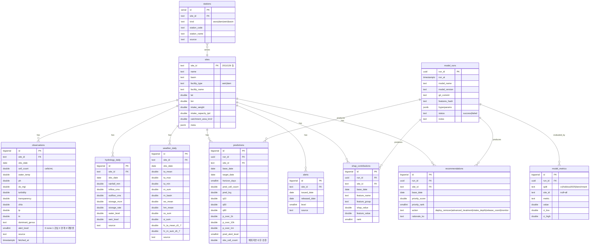

# 05. 데이터베이스 설계 (Supabase / PostgreSQL)

## 1. 설계 원칙
- 대시보드는 **읽기 전용 소비자**. 모든 쓰기는 GitHub Actions 파이프라인이 service_role 키로 수행.
- 원천 관측치(raw)는 DB에 전부 넣지 않는다. 대시보드가 그릴 만큼만(최근 2년 일별 + 전체 수질 측정) 적재. 원천 전체는 parquet로 저장소에.
- 시계열 테이블은 `(site_id, obs_date)` 복합 유니크. upsert 멱등.
- 모든 테이블 RLS 활성화. anon 롤은 SELECT만, service_role은 전체.

## 2. ERD (Mermaid)


## 3. DDL (`supabase/migrations/0001_init.sql`)
```sql
create extension if not exists "uuid-ossp";

create table sites (
  site_id text primary key,
  name text not null,
  basin text not null,
  facility_type text not null check (facility_type in ('weir','dam')),
  facility_name text,
  lat double precision not null,
  lon double precision not null,
  intake_weight double precision not null default 0.5,
  intake_capacity_tpd double precision,
  catchment_area_km2 double precision,
  meta jsonb default '{}'::jsonb
);

create table stations (
  id serial primary key,
  site_id text references sites(site_id) on delete cascade,
  kind text not null check (kind in ('asos','dam','weir','basin','wq')),
  station_code text not null,
  station_name text,
  source text,
  unique (site_id, kind, station_code)
);

create table observations (
  id bigserial primary key,
  site_id text references sites(site_id) on delete cascade,
  obs_date date not null,
  cell_count double precision,
  water_temp double precision, ph double precision, do_mgl double precision,
  turbidity double precision, transparency double precision, chla double precision,
  tp double precision, tn double precision,
  dominant_genus text,
  alert_level smallint check (alert_level between 0 and 3),
  source text,
  fetched_at timestamptz default now(),
  unique (site_id, obs_date)
);
create index on observations (site_id, obs_date desc);

create table hydrology_daily (
  id bigserial primary key,
  site_id text references sites(site_id) on delete cascade,
  obs_date date not null,
  rainfall_mm double precision, inflow_cms double precision, outflow_cms double precision,
  storage_mcm double precision, storage_rate double precision,
  water_level double precision, weir_level double precision,
  source text,
  unique (site_id, obs_date)
);

create table weather_daily (
  id bigserial primary key,
  site_id text references sites(site_id) on delete cascade,
  obs_date date not null,
  ta_mean double precision, ta_max double precision, ta_min double precision,
  rn_sum double precision, rn_basin double precision,
  ws_mean double precision, hm_mean double precision,
  ss_sum double precision, si_sum double precision,
  fc_ta_mean_d1_7 double precision, fc_rn_sum_d1_7 double precision,
  source text,
  unique (site_id, obs_date)
);

create table model_runs (
  run_id uuid primary key default uuid_generate_v4(),
  run_at timestamptz default now(),
  model_name text not null,
  model_version text not null,
  git_commit text,
  features_hash text,
  hyperparams jsonb,
  status text not null default 'success',
  notes text
);

create table predictions (
  id bigserial primary key,
  run_id uuid references model_runs(run_id) on delete cascade,
  site_id text references sites(site_id) on delete cascade,
  base_date date not null,
  target_date date not null,
  horizon_days smallint,
  pred_cell_count double precision, pred_log double precision,
  q10 double precision, q50 double precision, q90 double precision,
  p_over_1k double precision, p_over_10k double precision, p_over_1m double precision,
  pred_alert_level smallint,
  obs_cell_count double precision,
  unique (run_id, site_id, base_date, target_date)
);
create index on predictions (site_id, base_date desc);

create table alerts (
  id bigserial primary key,
  site_id text references sites(site_id) on delete cascade,
  issued_date date not null,
  released_date date,
  level smallint not null,
  source text
);

create table shap_contributions (
  id bigserial primary key,
  run_id uuid references model_runs(run_id) on delete cascade,
  site_id text references sites(site_id) on delete cascade,
  base_date date not null,
  feature_name text not null,
  feature_group text,
  shap_value double precision,
  feature_value double precision,
  rank smallint
);
create index on shap_contributions (run_id, site_id, base_date);

create table recommendations (
  id bigserial primary key,
  run_id uuid references model_runs(run_id) on delete cascade,
  site_id text references sites(site_id) on delete cascade,
  base_date date not null,
  priority_score double precision,
  priority_rank smallint,
  action text,
  rationale_ko text
);

create table model_metrics (
  id bigserial primary key,
  run_id uuid references model_runs(run_id) on delete cascade,
  split text not null,
  site_id text,
  metric text not null,
  value double precision,
  ci_low double precision,
  ci_high double precision
);

-- 최신 성공 run의 예측만 보는 뷰
create view v_latest_predictions as
select p.* from predictions p
join (select run_id from model_runs where status='success' order by run_at desc limit 1) r using (run_id);

create view v_latest_recommendations as
select r.* from recommendations r
join (select run_id from model_runs where status='success' order by run_at desc limit 1) m using (run_id);

-- RLS
alter table sites enable row level security;
alter table stations enable row level security;
alter table observations enable row level security;
alter table hydrology_daily enable row level security;
alter table weather_daily enable row level security;
alter table model_runs enable row level security;
alter table predictions enable row level security;
alter table alerts enable row level security;
alter table shap_contributions enable row level security;
alter table recommendations enable row level security;
alter table model_metrics enable row level security;

do $$ declare t text;
begin
  foreach t in array array['sites','stations','observations','hydrology_daily','weather_daily','model_runs','predictions','alerts','shap_contributions','recommendations','model_metrics']
  loop
    execute format('create policy "%s_read" on %I for select to anon, authenticated using (true);', t, t);
  end loop;
end $$;
-- 쓰기는 service_role만 (RLS 우회)
```

## 4. 시드 데이터 (`supabase/seed.sql`)
```sql
insert into sites (site_id,name,basin,facility_type,facility_name,lat,lon,intake_weight,intake_capacity_tpd) values
('2011G26','해평','낙동강','weir','칠곡보',36.17,128.40,0.5,null),
('2011G56','강정·고령','낙동강','weir','강정고령보',35.84,128.46,0.8,null),
('2020G33','칠서','낙동강','weir','창녕함안보',35.41,128.52,0.5,null),
('2022G05','물금·매리','낙동강','weir','낙동강하굿둑 상류',35.31,128.98,1.0,840000),
('3008G30','대청호 회남','금강','dam','대청댐',36.42,127.57,0.7,null);
-- 좌표는 T0에서 조사지점 공식 좌표로 교체
```

## 5. 데이터 적재 규칙
- 파이프라인 → `supabase-py` upsert, 배치 1,000행, `on_conflict="site_id,obs_date"`
- `observations.obs_cell_count` 사후 채움: 예측 run 후 실제 측정값 도착 시 `predictions.obs_cell_count` 업데이트 (사후 검증 차트용)
- 보존: predictions는 run 기준 최근 30개 run만 유지(cron 삭제), model_metrics는 전부 유지
