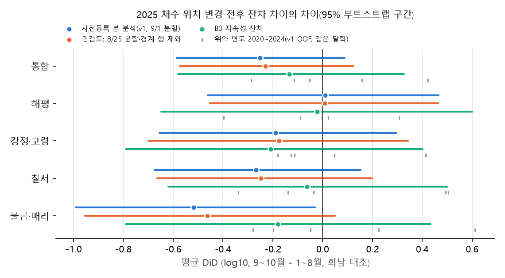

# EXP-005(2차) P0 — 2025-08 채수 위치 변경 진단

2026-10-22. 코드 `src/algaecast/exp/r2nd_p0_location.py`(재실행: `python -m algaecast.exp.r2nd_p0_location`, 약 10초).
사전등록 `reports/experiments/EXP-005/PREREG_P2.md` 2절 정의를 그대로 따랐다. 자동 생성 표 전체는 [`tables.md`](tables.md), 수치 전체는 [`results.json`](results.json)에 있다(손으로 고치지 않음).
행 단위 중간물: `data/processed/exp/EXP-005b/P0/`(v1 잔차, 모델과 무관한 잔차, 짝 차이). 2026 자료는 계산하지도 열람하지도 않았다.

## 0. 결론 요약

| 질문 | 답 | 확신 |
|---|---|---|
| a) 변경일 | 4지점 모두 **2025-08-25**(공식 문서·보도로 확인되는 "2025-08 말"의 첫 정기 채수일). 일 단위 날짜는 문서에 없고, 자료에도 단절이 보이지 않아 규칙으로 정했다. | 월 단위는 높음, 일 단위는 중간(±1주: 08-21~09-01) |
| b) v1 잔차 DiD(사전등록) | 통합 평균 DiD **−0.251 [−0.585, +0.088]**. 지점별로는 해평 +0.010, 강정·고령 −0.190, 칠서 −0.267, 물금·매리 −0.518로 부호가 엇갈린다. 분산 DiD +0.79 [−0.09, +1.89] | — |
| **P2 적용 조건** | 부호가 일치하지 않고(해평만 +) 통합 CI가 0을 포함한다. 따라서 **미적용(조건 미충족)** | 사전등록 규칙대로 기계적으로 판정 |
| c) 추가 대조군 | 위치가 바뀌지 않은 낙동강 보 관찰지점 8곳을 대조로 쓰면 수준 DiD는 **+0.034 [−0.253, +0.324]**이고, 2020~2024 위약 연도 분포 안에 든다(z = +0.3). | 중간 |
| d) 새 위치의 수준·변동성 | 4지점을 합쳐 보면 **수준·변동성 모두 옛 위치와 구별되지 않는다**. 지점별로는 물금·매리만 새 위치가 더 낮게 측정될 가능성이 있다. | 통합: 중간. 물금·매리: 낮음~중간 |
| 첫 질문(2026 현상과의 관련) | 새 위치에서 측정한 첫 두 달(2025-09~10, 낙동강 n=48)에는 v1이 지속성(B0)보다 나았다: rmse_log 0.371 vs 0.417, r2_log 0.646 vs 0.551, F1@10k 0.800 vs 0.778, 구간 적중 0.875. 같은 달 과거 5년(rmse_log 0.52~0.64, 적중 0.52~0.81)보다도 좋았다. **"위치 변경이 원인"이라는 증거는 2025 자료에 없다.** 다만 2026 평가 구간(5~10월, 증식기 포함)과 같은 국면은 아직 관측된 적이 없다. | 낮음~중간 |

## 1. 목적·설정

- **질문.** 2025-08 조류경보제 개편으로 낙동강 4지점(해평·강정·고령·칠서·물금·매리)의 채수 위치가 취수구 상류 2~4 km에서 취수구 50 m 이내로 옮겨졌다. 2026에서 로그 R²·예측구간 적중률이 떨어지고 지속성 방법의 경계 F1이 더 높았던 현상이 이 변경과 관련 있는가?
- **자료.** 조류경보제 API 원자료는 R5에서 수집한 전국 82지점(`data/raw/nier_algae_all/`)과 우리 5지점(`data/raw/nier_algae/`)을 썼고, 대회 번들은 `algae_measure.csv`·`stations.csv`·README, 매뉴얼은 조류경보제 운영 매뉴얼(2025.8, water.or.kr PDF)을 썼다. 보도는 이투데이(2025-08-19)와 정책브리핑(2025-08-21)이다. 원자료는 읽는 즉시 2025-12-31 이후 측정을 버렸다.
- **잔차.** v1은 harness 기준 OOF(`data/processed/exp/baseline/oof.parquet`)의 `ens`를 썼다. "2025 행"은 2025 폴드(기준일 2025, 학습 ≤2024)의 행이다. 기준일 2025-12 → 목표일 2026-01 행은 버렸다. B0 = 10^cell_log_t0 − 1이다.
- **대조 지점(c).** 낙동강 보 관찰지점 8곳: 상주보 도남, 낙단보 낙단, 구미보 선산, 칠곡보 칠곡, 강정고령보 다사, 달성보 논공, 합천창녕보 덕곡, 창녕함안보 함안. 매뉴얼 표3에 따르면 보 상류 300~500 m에서 낙동강물연구소가 조사하고, 2025-08 개편 대상이 아니다. API 주소 필드도 2012년 이후 한 값이다. 2025-05 "친수구간 시범운영(낙단)" 지점은 별도 코드 2009G10(낙단보 수상레저)이라 2009A05는 영향을 받지 않는다. 그래서 8곳 모두 포함했다. 대청호 추동·문의도 같은 호수의 변경 없는 대조로 함께 썼다.
- **부트스트랩.** 지점×기간 층별로 5,000회, `np.random.default_rng(20261022)`, 백분위 95% 구간이다.
- **위약(placebo) 연도.** 같은 정의(9~10월 − 1~8월)를 위치 변경이 없던 2020~2024 각 연도에 적용해, 2025 값이 평소 계절 변동 범위 밖인지 본다. 판정에는 쓰지 않는다.
- **입력 오류 처리.** 수온 211.7℃(7777A76), pH 75(2009A05), DO 97.7(9999A99) 같은 물리적으로 불가능한 값은 결측으로 처리했다. 범위는 수온 −1~40, pH 4~13, DO 0~30이다.

## 2. a) 채수 위치 변경일

### 2.1 필드·문서 근거

- **API 필드.** 캐시된 응답 41개 파일의 ≤2025 item 51,895개를 보면 태그는 20종이다. `swmnDetailNm`·`detailAdres`는 있지만 **좌표 필드는 없다**. 5지점의 `swmn_detail_nm`·`detail_adres`는 첫 측정부터 2025-12-29까지 **각 1개 값**이다. 해평 "상류 2km칠곡보 상류 22km", 강정·고령 "상류 2km강정고령보 상류 7km", 칠서 "상류 4km창녕함안보 상류 12km", 물금·매리 "취수구3km"로, 2025-09 이후에도 **옛 위치 서술 그대로**다. 대회 번들 `algae_measure.csv`도 같다(5지점 각 1개 값, ≤2025). 즉 위치 변경은 어떤 필드에도 반영되지 않았다. 학습·평가 자료만으로는 행이 어느 위치에서 측정됐는지 구별할 수 없다.
- **운영 매뉴얼(2025.8).**
  - 연혁 20): "2025.08 녹조 신속 분석 체계(해평, 강정·고령, 칠서, 물금·매리) 운영 — 채수지점 이동(취수구 2~4km 상류→취수구 인근), 발령일자(채수 3일차 오후→채수 당일)".
  - 표2 주석: ①해평 해평취수구 상류 2 km→취수구 인근 50 m, ②강정·고령 **고령**취수구 상류 2 km→**매곡**취수구 인근 50 m, ③칠서 칠서취수구 상류 4 km→50 m, ④물금·매리 매리취수구 상류 3 km→50 m.
  - 표2의 새 위치 좌표: 해평 36.1695N 128.3873E, 강정·고령 35.8474N 128.4517E, 칠서 35.3821N 128.4822E, 물금·매리 35.3353N 128.9524E. 옛 위치 좌표는 이 매뉴얼에 없다.
  - 2.5.1.1.2(채수 방법): 새 지점은 경보 단계와 관계없이 취수구 쪽 하안에서 수직 3층을 혼합한다. 옛 방식은 단면 최심부의 수직 혼합이었고, '경계' 이상이면 좌·중·우 × 수심별로 혼합했다. **위치뿐 아니라 횡단 위치(하도 중앙 → 취수구 쪽 하안)와 경계 시 3지점 혼합 여부도 바뀌었다.**
- **보도.** 이투데이 2025-08-19 12:00 "이달 말 즉시 추진". 정책브리핑 2025-08-21: 해평·칠서는 이동형 분석차량, 매곡·매리는 국립환경과학원·낙동강물환경센터에서 당일 분석한다.
- `config/sites.yaml` location 메모도 같은 내용이다. "해평취수구 인근 50 m 채수, 2025-08~", "매리취수장 전면 50 m(2025-08 채수지점 조정)". sites.yaml 좌표는 해평·강정·고령·칠서가 매뉴얼 새 좌표와 0~1.4 km 차이다. 물금·매리는 4.4 km 차이인데, 근사 좌표이고 sites.yaml은 고치지 않았다.

### 2.2 자료 단절

- **채수 일정.** 08-25 전후로 요일·간격이 바뀌지 않았다(월요일 정기, '경계' 시 목요일 추가). 목요일 비율은 2025-08-25~10-31에 늘었지만 대조인 회남도 똑같이 늘었다(0.07→0.33). 위치가 아니라 경보 단계에 따른 주 2회 채수다.
- **인근 보 대비 짝 차이.** 2025-06~12, 08-25 분할로 보고, 같은 달력의 2016~2024 위약 연도와 비교했다(tables.md a-5).
  - log 세포수는 4지점·7개 짝 모두 |z| < 2다(z −1.24~+1.41, 위약 연도 중 |이동| ≥ 2025인 비율 0.22~1.0).
  - 물리 변수에서 |z| ≥ 2인 조합은 해평−선산 DO(z 2.8), 강정·고령−칠곡 Chl-a(2.3), 강정·고령−다사 투명도(2.7), 물금·매리−함안 수온(4.0, +1.4℃, 최적 분할 09-01)이다. 그러나 **위치가 바뀌지 않은 회남(대청호 추동·문의 대비)에서도 3/14 조합이 |z| ≥ 2**였다. 낙동강은 4지점 합해 4/49 조합이다. 위치 고유의 흔적이라고 보기 어렵다.
  - 월평균 그림(`paired_monthly.png`)에서도 2025-09~12의 짝 차이는 2020~2024 평균 ± SD 띠 안에 있다.

### 2.3 확정 변경일(near_intake 정의에 쓸 값)

| 지점 | 확정 변경일 | 근거 등급 | 8월 중순~9월 초 채수일 | 자료 단절 지지 |
|---|---|---|---|---|
| 해평(HP) | 2025-08-25 | 공식 문서·보도(월 단위 "2025-08 말") + 일 단위는 규칙 | 08-18, **08-25**, 09-01 | 없음(세포수 |z|≥2 0/2) |
| 강정·고령(GJGR) | 2025-08-25 | 〃 | 08-14, 08-18, 08-21, **08-25**, 08-28, 09-01, 09-04 | 없음(0/2) |
| 칠서(CS) | 2025-08-25 | 〃 | 08-18, **08-25**, 08-28, 09-01, 09-04 | 없음(0/2) |
| 물금·매리(MGMR) | 2025-08-25 | 〃 | 08-18, 08-21, **08-25**, 08-28, 09-01, 09-04 | 없음(0/1). 수온 짝 차이만 09-01 전후 +1.4℃ |

규칙은 "08-19 발표('이달 말 즉시 추진') 이후 '8월 말'에 해당하는 첫 정기(월요일) 채수일"이다. 강정·고령·물금·매리의 08-21(목) 채수가 새 위치였을 가능성과 09-01 시작 가능성이 남는다. 그래서 b)에서 09-01 분할(사전등록 본 분석)과 08-25 분할(민감도)을 둘 다 보고했고, 결론은 같다.

### 2.4 2016-04 채수 방식 변경 표시

- 매뉴얼 연혁 14): "2016.04 채수방법 변경(상수원: 층별 통합채수, 친수활동: 표층채수), 분석항목에 투명도·탁도 추가".
- 자료의 흔적: 해평·강정·고령·칠서·회남의 수온·투명도·탁도·Chl-a 첫 측정이 모두 **2016-04-04**다. 물금·매리는 2020-05-11 편입부터 전 항목이 있다. 세포수는 해평·강정·고령·칠서가 2016-01-04, 회남이 2012-04-02부터다. 보 관찰지점은 투명도·탁도가 2020-05-11(관찰지점 편입)부터다.
- v1 학습 행 중 2016-04 이전 기준일 행: 해평 10, 강정·고령 10, 칠서 11(모두 2016-01~03 겨울), 회남 207(2012-04~2016-03), 물금·매리 0.
- 2013-02~2015-12 낙동강 시범 코드(2011A26 구미광역취수장, 2011A56 고령광역취수장, 2020A33 창원칠서취수장)는 지금 지점과 주소 필드가 같지만, 대회 번들과 v1 학습에는 없다.
- 서술용 짝 차이(6~10월, 처리 − 인근 보, tables.md a-7):

| 지점 | 2013~2015 | 2016-04~2019 | 2020~2024 |
|---|---|---|---|
| 해평 | −0.455 | −0.610 | −0.333 |
| 강정·고령 | +0.186 | −0.269 | −0.061 |
| 칠서 | −0.074 | −0.371 | −0.144 |

  층별 통합채수 이후 0.15~0.46 log10 낮아진 모양이다. 하지만 보 지점의 방식 변화(2020-05)와 연도 차가 섞여 있어 **인과 추정치가 아니다**(확신 낮음). v1에 영향을 주는 행은 겨울 31행과 회남 207행뿐이다.

## 3. b) v1 잔차 DiD(사전등록 본 분석)

목표일 기준으로 변경 전은 2025-01-01~08-31, 변경 후는 2025-09-01~10-31이다. 대조는 회남이다. e = log10(관측+1) − log10(예측+1).

| 대상 | n 전/후 | 처리 평균 변화 | 대조(회남, n 34/13) 평균 변화 | **평균 DiD [95% CI]** | 분산 DiD ln비 [95% CI] |
|---|---|---|---|---|---|
| 통합(4지점) | 112/48 | −0.015 | +0.236 | **−0.251 [−0.585, +0.088]** | +0.79 [−0.09, +1.89] |
| 해평 | 27/8 | +0.246 | +0.236 | +0.010 [−0.460, +0.466] | +0.18 [−1.76, +1.53] |
| 강정·고령 | 30/16 | +0.046 | +0.236 | −0.190 [−0.655, +0.296] | +0.79 [−0.46, +2.09] |
| 칠서 | 29/12 | −0.031 | +0.236 | −0.267 [−0.675, +0.153] | +0.53 [−0.80, +1.91] |
| 물금·매리 | 26/12 | −0.282 | +0.236 | −0.518 [−0.991, −0.031] | +0.70 [−0.66, +2.04] |

**P2 적용 조건(사전등록): 미적용(조건 미충족).** 지점별 Δ_s 부호는 해평 +, 강정·고령 −, 칠서 −, 물금·매리 −로 일치하지 않는다. 통합 Δ의 95% CI [−0.585, +0.088]도 0을 포함한다. 두 조건 모두 충족하지 못했다. 해평의 +0.010은 0에 가깝지만, 통합 CI 조건만으로도 미충족이다.

**민감도(판정에 쓰지 않음).**

| 분석 | 통합 평균 DiD [95% CI] | 분산 DiD [95% CI] | 지점별(HP, GJGR, CS, MGMR) |
|---|---|---|---|
| S1 08-25 분할 | −0.154 [−0.492, +0.197] | +1.07 [+0.16, +2.13] | +0.012, −0.128, −0.173, −0.300 |
| S2 08-25 분할, 위치 경계를 건너는 행(기준일 < 08-25 ≤ 목표일) 제외 | −0.229 [−0.574, +0.124] | +0.83 [−0.06, +1.92] | +0.009, −0.175, −0.248, −0.463 |
| S3 B0 잔차(09-01 분할) | −0.134 [−0.580, +0.326] | +1.20 [+0.24, +2.49] | −0.023, −0.209, −0.063, −0.180 |
| S4 B0, 08-25 분할, 경계 행 제외 | −0.082 [−0.546, +0.383] | +1.19 [+0.24, +2.50] | +0.021, −0.163, −0.013, −0.112 |

**위약 연도(같은 정의, 각 연도 폴드 행)** — 평균 DiD, v1 앙상블:

| 연도 | 통합 | 해평 | 강정·고령 | 칠서 | 물금·매리 | 분산 DiD |
|---|---|---|---|---|---|---|
| 2020 | +0.423 | +0.307 | +0.413 | +0.493 | +0.612 | −1.06 |
| 2021 | −0.051 | +0.022 | +0.047 | −0.036 | −0.197 | +1.46 |
| 2022 | −0.115 | −0.090 | −0.180 | −0.140 | −0.048 | +1.24 |
| 2023 | −0.287 | −0.396 | −0.112 | −0.338 | −0.280 | +1.12 |
| 2024 | +0.158 | −0.003 | −0.127 | +0.504 | +0.226 | +1.26 |
| **2025** | **−0.251** | +0.010 | −0.190 | −0.267 | −0.518 | +0.79 |

- 2025의 통합 평균 DiD(z −1.0)와 분산 DiD(z −0.0)는 위치 변경이 없던 해들의 범위 안에 있다. 2023(−0.287)은 2025보다 더 음수였다. 분산 DiD가 양수인 것은 매년 나타난다. 가을에 회남의 잔차 분산이 낙동강보다 더 많이 줄어드는 계절 현상이지 위치 효과가 아니다.
- 물금·매리 −0.518만 5개 위약 연도 범위 밖이다(최소 −0.280, z −1.6).
- B0 잔차 DiD(−0.134)는 위약 범위 [+0.045, +0.427] 밖이다(z −2.4). 그러나 대조를 같은 강의 보 관찰지점 8곳으로 바꾸면 같은 종류의 7일 지속성 잔차 DiD가 +0.074로 위약 범위 [+0.024, +0.269] 안이다(z −0.5). **이 이상치는 대조인 회남 쪽에서 왔다.** 2025 가을 대청호에서 녹조가 오래 지속됐기 때문이다(회남 9~10월 목표 13건 중 8건 ≥10k, v1 평균 잔차 +0.314).

## 4. c) 위치가 바뀌지 않은 추가 대조군(모델과 무관한 잔차)

모든 지점에 같은 방식으로 만들 수 있는 두 잔차를 썼다.
- **기후 편차**: log10(세포수+1) − 지점·월 평균(2020~2024)이다. 측정일 기준이다. 수준 이동을 직접 잰다.
- **7일 지속성 잔차**: 대회 매칭 규칙(+7일 ±3, 동률은 이른 날)으로 짝지은 log10(목표) − log10(기준)이다. 목표일 기준이다. 주간 변동을 재고, 수준 이동은 경계를 건너는 짝에만 나타난다.

| 잔차 | 대조 | 통합 평균 DiD [95% CI] | 위약 범위(2020~2024) / z | 분산 DiD [95% CI] |
|---|---|---|---|---|
| 기후 편차 | 낙동강 보 관찰지점 8 (n 215/62) | **+0.034 [−0.253, +0.324]** | [−0.268, +0.146] / +0.3 | −0.22 [−0.67, +0.22] |
| 기후 편차 | 회남 | +0.050 [−0.360, +0.456] | [−0.450, +0.446] / +0.1 | +0.81 [+0.13, +1.85] |
| 기후 편차 | 대청호 추동·문의 | +0.136 [−0.162, +0.443] | [−0.330, +0.380] / +0.4 | −0.27 [−0.83, +0.34] |
| 7일 지속성 | 낙동강 보 관찰지점 8 | +0.074 [−0.225, +0.380] | [+0.024, +0.269] / −0.5 | −0.82 [−1.47, −0.11] |
| 7일 지속성 | 회남 | −0.091 [−0.550, +0.369] | [+0.107, +0.457] / −2.3 | +1.25 [+0.32, +2.54] |

지점별, 바로 위·아래 보 대조(기후 편차, 수준):

| 지점 | 대조 | DiD [95% CI] | 위약 범위 / z |
|---|---|---|---|
| 해평 | 구미보 선산·칠곡보 칠곡 | −0.108 [−0.634, +0.446] | [−0.351, +0.328] / −0.3 |
| 강정·고령 | 칠곡보 칠곡·강정고령보 다사 | −0.160 [−0.728, +0.437] | [−0.526, +0.497] / −0.4 |
| 칠서 | 합천창녕보 덕곡·창녕함안보 함안 | −0.420 [−1.022, +0.176] | [−0.650, +0.223] / −1.0 |
| 물금·매리 | 창녕함안보 함안 | −0.702 [−1.438, +0.072] | [−0.345, +0.670] / −1.9 |

같은 강의 변경 없는 보 지점을 대조로 쓰면, 4지점 통합의 수준·주간 변동은 위치 변경이 없던 해들과 구별되지 않는다. 물금·매리만 v1 잔차, 보 대비 기후 편차, 시범 자료(5절)가 모두 "새 위치가 더 낮게 측정"하는 방향이다. 어느 것도 위약 범위를 크게 벗어나지 않는다. 바로 위 보(함안)는 40 km 이상 상류이고, 처리·대조 모두 12행 남짓이다.

## 5. d) 새 위치 측정의 수준·변동성

**결론.** 새 위치(2025-09~10)의 측정은 **4지점 통합으로는 수준·변동성 모두 옛 위치와 구별되지 않는다**(확신 중간). 크기로 말하면, 통합 수준 이동이 log10 ±0.3(약 2배)을 넘는다는 증거는 없다. 지점별로는 **물금·매리가 0.4~0.7 log10 낮게 측정될 가능성**이 있다(확신 낮음~중간). 칠서는 같은 방향이지만 더 약하다. 해평은 0에 가깝고, 강정·고령은 대조에 따라 부호가 바뀐다.

근거:
1. **수준.** 기후 편차 DiD는 보 8곳 대비 +0.034 [−0.253, +0.324]이고 위약 연도 안이다. v1 잔차 DiD는 −0.251 [−0.585, +0.088]이고 역시 위약 연도 안이다. 위 4절의 지점별 표도 같다.
2. **변동성.** 주간 변동(7일 지속성 잔차 SD, 9~10월)은 2025에 모든 집단에서 과거보다 작았다. 해평 0.415 vs 0.733, 강정·고령 0.487 vs 0.795, 칠서 0.236 vs 0.552, 물금·매리 0.365 vs 0.408로 줄었고, **대조도** 회남 0.221 vs 0.582, 보 8곳 0.539 vs 0.728, 대청호 0.194 vs 0.293으로 함께 줄었다. 2025 가을이 전반적으로 잠잠했던 것이지 위치 고유의 변화가 아니다. v1 잔차의 분산 DiD(+0.79)도 위약 연도와 같은 크기다(z −0.0).
3. **0값 비율.** 2025-09~10에는 5지점과 대조 모두 0%였다. 과거 같은 달은 0~2.3%다.
4. **2022~2023 시범 자료(취수구 500 m 상류, 같은 날 짝, n 37~38).**
   - 고령 지점 혼합 − 강정·고령(옛 위치): log10 **−0.981 [−1.373, −0.585]**(중앙값 −0.70).
   - 매리 지점 혼합 − 물금·매리(옛 위치): **−0.420 [−0.665, −0.183]**(중앙값 −0.33).
   - 같은 시범 지점에서 표층 − 혼합은 +0.06(고령), +0.19(매리)로 작았다.
   - "취수구 가까이에서 뜨면 더 높다"는 예상과 반대로, 시범 위치가 더 낮았다.
   - 다만 고령 시범은 **고령**취수구 앞이고, 새 강정·고령 위치는 **매곡**취수구 앞이다(다른 지점). 2025 실측의 강정·고령 기후 편차는 보 8곳 대비 +0.23이라 시범 결과가 옮겨오지 않는다.
   - 매리 시범은 새 위치(매리취수구 50 m)와 가까운 조건이다. 2025 물금·매리의 음의 신호와 방향이 같다.
5. **물리 변수.** 물금·매리−함안 수온 짝 차이가 09-01 전후 +1.4℃ 바뀌었다(위약 z 4.0). 하안 취수구 쪽 표층 수온 차이일 수 있지만, 같은 검사에서 위치가 바뀌지 않은 회남도 |z| ≥ 2 조합이 3개 나와 단독 근거로 쓰기 어렵다.

## 6. 첫 번째 질문 — 2026 현상과의 관련(2025 자료로만 판단)

v1 앙상블과 B0를 연도·구간별로 비교했다. 낙동강 4지점이고, 목표일 기준이며, 각 연도 폴드 행이다.

| 연도 | 9~10월 n | rmse_log 앙상블 / B0 | r2_log 앙상블 / B0 | F1@10k 앙상블 / B0 | 구간 적중(q10~q90) |
|---|---|---|---|---|---|
| 2020 | 31 | 0.615 / 0.666 | −0.109 / −0.300 | 0 / 0(양성 0) | 0.613 |
| 2021 | 34 | 0.519 / 0.587 | −0.721 / −1.203 | 0 / 0(양성 0) | 0.735 |
| 2022 | 35 | 0.564 / 0.611 | 0.128 / −0.023 | 0.000 / 0.800 | 0.600 |
| 2023 | 36 | 0.560 / 0.643 | 0.325 / 0.108 | 0 / 0(양성 0) | 0.806 |
| 2024 | 48 | 0.644 / 0.660 | 0.526 / 0.503 | 0.769 / 0.744 | 0.521 |
| **2025(새 위치)** | 48 | **0.371 / 0.417** | **0.646 / 0.551** | **0.800 / 0.778** | **0.875** |

- 새 위치의 첫 두 달에 v1은 rmse_log·r2_log·F1@10k 모두 B0보다 나았다. 구간 적중률(0.875)과 평균 잔차(+0.003)는 과거 같은 달보다 좋았다. 2026에서 본 현상(로그 R²·구간 적중 하락, B0의 경계 F1 우위)은 **2025-09~10에 재현되지 않았다.**
- 따라서 "위치 변경 → 측정 수준·변동성 변화 → 모델 열화"를 지지하는 증거는 2025 자료에 없다. 지속성이 경계 F1에서 앞선 해는 위치 변경 전인 2022에도 있었다(9~10월 0.000 vs 0.800, 1~8월 0.611 vs 0.871). 이 현상은 위치와 무관하게 발생할 수 있다.
- **배제하지 못하는 경로**:
  1. 새 위치의 2025 자료는 녹조 감소기 두 달(n=48)뿐이다. 2026 평가 구간인 5~10월의 증식·발생 국면은 새 위치에서 관측된 적이 없다.
  2. 이동형 분석차량의 당일 분석이 고농도에서 계수에 미치는 영향은 분리할 수 없다.
  3. 물금·매리의 지점 단위 하향 가능성이 있다.
  4. 2026은 규칙상 보지 않았다.

## 7. 한계

- 변경일은 일 단위 공식 근거가 없어 규칙(08-25)으로 정했다. 08-21(강정·고령·물금·매리 목요일 채수)이나 09-01일 수 있다. 사전등록 본 분석은 09-01 분할이라 이 불확실성에 강하다.
- 변경 후 표본이 작다. 처리 48행(지점별 8~16), 회남 13행이다. 지점별 CI 폭이 ±0.45 안팎이라, 지점 단위 이동은 0.5 log10 미만이면 검출하기 어렵다.
- 대조 회남은 2025 가을에 이례적이었다(긴 녹조). 그래서 같은 강의 보 관찰지점으로 교차 확인했다. 보 지점도 다른 지점이라 하천 구간별 차이(보 체류 vs 취수구)가 잔차에 남는다. 위약 연도 비교로 그 크기를 가늠했다.
- 기후값(2020~2024)은 위약 연도에서 표본 안 값이다. 위약 z는 연도 5개로 계산한 거친 값이다.
- 2016-04 효과 표는 보 지점의 방식 변화(2020-05)와 섞인 서술용이다.
- 수온 211.7℃ 등 입력 오류 4건은 결측 처리했다(수온 1, pH 2, DO 1. 2025의 우리 5지점은 해당 없음).

## 8. 점검

- 2026: 원자료는 읽는 즉시 `obs_date ≤ 2025-12-31`만 남겼다. 번들 `algae_measure.csv`는 `chck_de ≤ 2025-12-31`, API 캐시 태그 집계는 `chckDe ≤ 2025-12-31` item만 셌다. v1 잔차는 `harness.load_baseline()`(기준일 ≤2025)에서 목표일 > 2025-12-31 행을 버렸다. `test_targets_DO_NOT_USE.parquet`·`posthoc_2026*`는 읽지 않았다.
- 보호 파일: `python scripts/exp_check_protected.py` → "보호 파일 38개 중 변경 0개".
- 수정한 기존 파일은 없다. 새 파일은 `src/algaecast/exp/r2nd_p0_location.py`와 이 폴더, `data/processed/exp/EXP-005b/P0/`뿐이다. ruff·black(줄 길이 110) 통과.
- 새 피처는 만들지 않았다(진단만). P2가 미적용이라 near_intake 피처도 만들지 않는다.

## 9. 소요 시간

약 0.4시간(11:37~12:00, 상한 4시간). 모듈 재실행은 10초 안팎이다.

## 10. 산출물

- `README.md`(이 문서), `tables.md`(자동 표 전체), `results.json`(DiD 값·CI·n·부트스트랩 분산 v_s·P2 판정·위약 연도·지점별 확정일)
- `did_forest.png`(평균 DiD와 95% CI, 위약 연도 점), `paired_monthly.png`(인근 보 대비 월평균 짝 차이, 집계)
- `data/processed/exp/EXP-005b/P0/`: `v1_residuals_2020_2025.parquet`, `modelfree_residuals.parquet`, `paired_diffs.parquet`(행 단위, git 제외)
