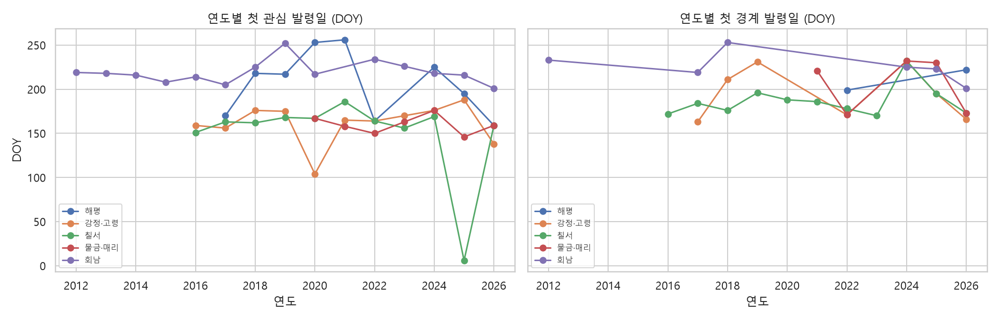
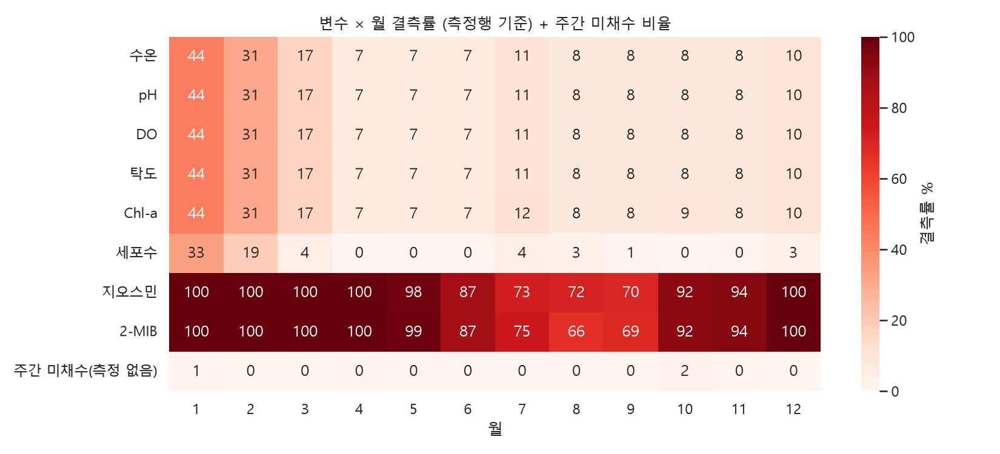
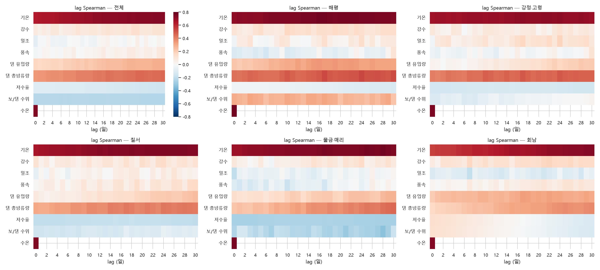
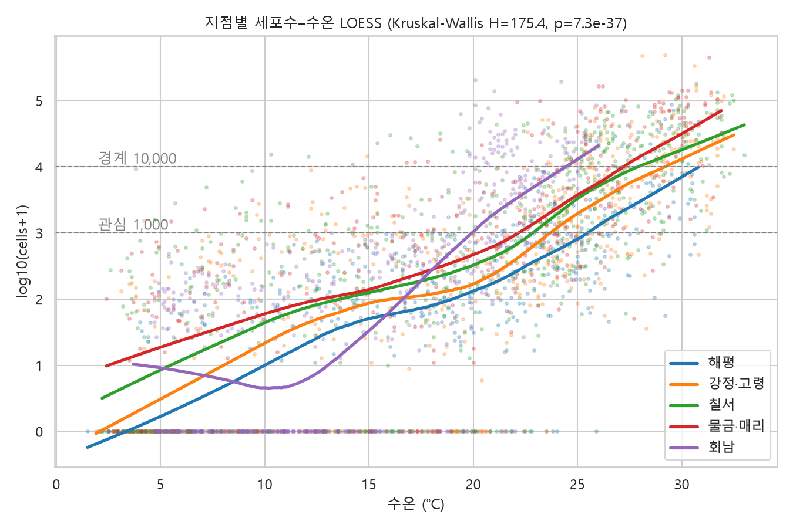
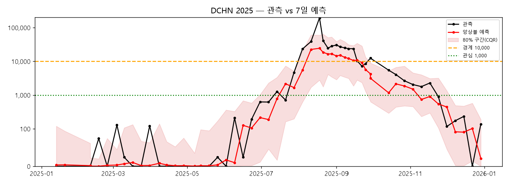
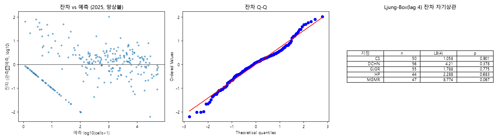
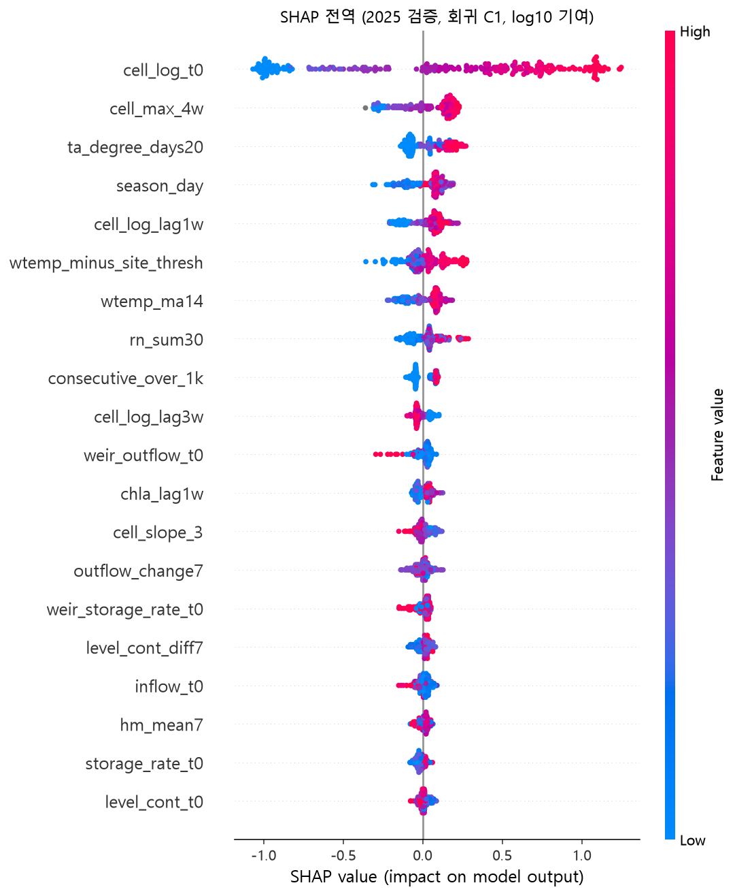
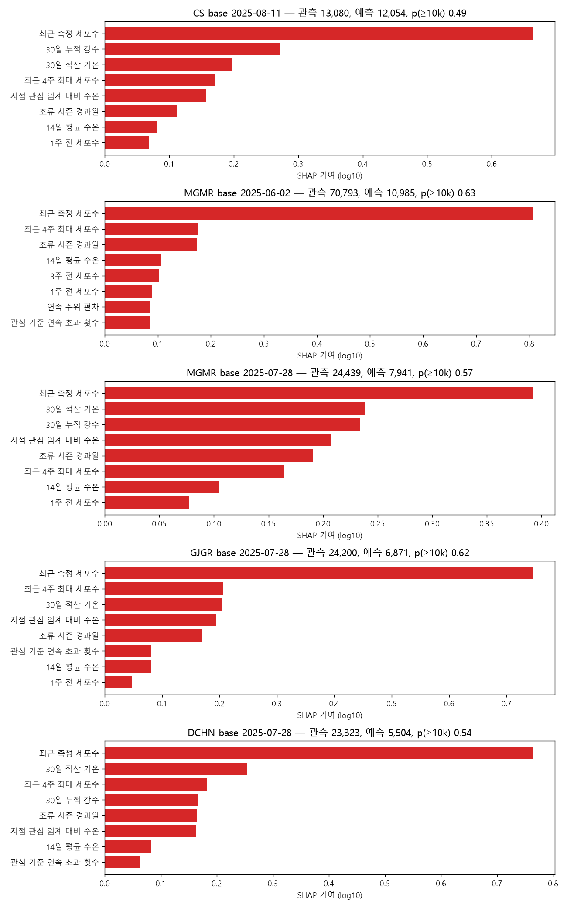
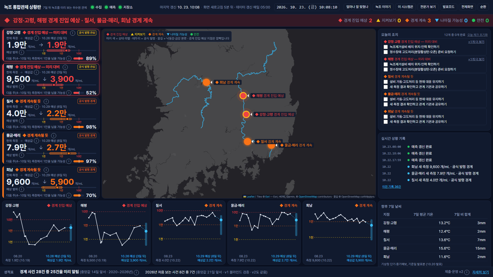

# AlgaeCast-7 방법설명서

<div class="sub">수질·수문·기상 융합 기반 댐·하천 유해남조류(녹조) 7일 예측 AI 모델과 취수원 운영 의사결정 대시보드</div>

<div class="meta">대회: 2026 DATA·AI 분석 경진대회(KISTI) 문제해결 부문<br>참가자: 이재행<br>작성일: 2026-10-22(v2 반영)<br>제출·운영 모델: v2, 동결 커밋 9dca86c (2026-10-22)<br>블라인드 검증 모델: v1, 동결 커밋 13ac483 (2026-10-21 09:43:57 KST)<br>대시보드: https://algaecast-7.vercel.app</div>

<div class="head"><strong>2020~2026년 경계 사건 28건 중 25건(89%)을 첫 경계 초과 측정 기준 중앙 14일 앞서 감시 단계로 포착했다(지속성 3건).</strong><br><strong>v1 모델 봉인(2026-10-21 09:44 KST) 후 처음 보는 2026년 경계 사건 8건 중 7건을 중앙 21일 앞서 포착했다(지속성 2건).</strong><br><span style="font-size:9pt;color:#444">감시 = CQR 보정 q90 ≥ 10,000 cells/mL, 경보 = 분류기 p ≥ 0.52. 2020~2025년은 교차검증 OOF 예측, 2026년은 v1 동결 모델의 블라인드 사후 검증이다. 제출·운영 모델 v2(2026-10-22 동결)는 v1의 분위·분류기·운영점을 그대로 써서 감시·경보 결과가 v1과 같다(1.5절·5.9절·6.4절·6.11절).</span></div>

## 1. 배경·목표

### 1.1 문제 정의

폭염 장기화와 강우 패턴 변화로 상수원 녹조가 확대되고 있다. 낙동강 물금·매리의 조류경보 발령일수는 2022~2025년 연 146~196일이었다. 물금취수장은 부산 먹는물의 약 33%(84만 톤/일)를 맡고, 남조류 독소 마이크로시스틴(MC-LR)은 IARC Group 2B 물질이다.[^c1-1]

과제는 조류경보제 상수원 구간 5개 지점에서 기준일(base_date)의 7일 뒤 유해남조류 4속 세포수(cells/mL)를 예측하는 회귀 문제다. 정답은 base_date+7일에 가장 가까운 측정일(±3일) 값이고, log10(세포수+1) RMSE·MAE와 원단위 R²·NSE로 평가하며 경계(10,000 cells/mL) F1을 보조로 쓴다. 분할은 학습 ~2024년, 검증 2025년, 평가 2026년이다.[^c1-1]

| 지점 | 수계 | 조사지점코드 | 연계 수문 시설 | 측정 건수(첫 측정) | 경계 초과율 |
|---|---|---|---|---|---|
| 해평 | 낙동강 | 2011G26 | 칠곡보(상류 구미보) | 566 (2016-01) | 4.09% |
| 강정·고령 | 낙동강 | 2011G56 | 강정고령보 | 600 (2016-01) | 13.82% |
| 칠서 | 낙동강 | 2020G33 | 창녕함안보 | 624 (2016-01) | 20.81% |
| 물금·매리 | 낙동강 | 2022G05 | 낙동강하굿둑 상류(창녕함안보 하류) | 366 (2020-05) | 20.64% |
| 회남 | 금강(대청호) | 3008G30 | 대청댐 | 783 (2012-04) | 8.65% |

*표 1-1. 대상 지점. 측정 건수는 타깃 결측 행을 포함한 행 수이고, 경계 초과율은 단일 측정 기준(타깃 결측 제외)이다.*[^c1-2]

### 1.2 7일 선행 예측이 필요한 이유

K-water는 녹조제거설비 22대, 물환경설비 431대, 조류차단막 59개소를 운영하며, 녹조제거설비는 '경계' 발령 시 가동이 원칙이다.[^c1-1] 경보 단계는 2회 연속 측정으로 판정하므로(관심 ≥1,000, 경계 ≥10,000 cells/mL), 이 규칙으로 산출한 2020~2026년 경계 사건 28건 중 26건에서 발령 측정일이 첫 경계 초과 측정일보다 7일 늦었다.[^c1-3] 증식도 빠르다. 강정·고령은 2026년 8월 13일 49,400에서 8월 18일 483,021 cells/mL로 5일 만에 약 10배 늘었고,[^c1-1] 연속 측정 간격 7일 이내에 10배 이상 늘고 급증 후 1,000 cells/mL 이상이 된 급증 사건은 62건이었다.[^c1-4] 발령 후 가동으로는 늦다. 수요기관이 밝힌 목적도 7일 선행 예측으로 설비 선제 배치 리드타임을 확보하는 것이며, 고도정수 전환·취수 심도 조정 등 의사결정 지원도 함께 요구된다.[^c1-1]

### 1.3 2026년 조기 발령과 장기 추세

문제 설명서에 따르면 2026년 강정·고령의 첫 경보(관심)는 5월 18일 발령돼 최근 3년 첫 발령(6월 말~7월 초)보다 약 2개월 빨랐다.[^c1-1] 2회 연속 규칙으로 산출한 첫 관심 발령일로는 DOY 138로, 2016년 이후 2020년(DOY 104) 다음으로 이르다.[^c1-5]

그러나 장기 조기화 추세는 유의하지 않았다. 지점 평균을 제거한 잔차(2016~)의 통합 검정에서 첫 관심 발령일 Sen 기울기는 −1.04일/년(Mann-Kendall p=0.64), 첫 경계 발령일은 −0.88일/년(p=0.76)이었고, 지점별 검정 9개(관심 5개, 경계 4개, 해평 경계는 표본 부족으로 제외)도 모두 추세가 없었다. 연도별 중앙값 단순 통합은 관심 −3.67일/년(p=0.01)이지만, 2012~2015년에 발령이 늦은 회남만 포함된 지점 구성 변화의 영향이다.[^c1-5] 따라서 2026년은 이례적 해로 보며, 달력상 계절성이 아니라 기준일의 수온·기상·수문 상태로 위험을 읽어야 한다. 동결 모델(v1·v2 공통 분위 모델)도 이 사건은 관심 기준 감시가 첫 초과 측정일(5월 11일) 당일에야 켜져 사전 포착하지 못했다(10장).[^c1-6]



*그림 1-1. 연도·지점별 첫 관심(왼쪽)·경계(오른쪽) 발령일. 칠서 2025년 관심 DOY 6은 2024년 12월 23일 2회 연속 초과로 산출된 관심 상태가 해제(2회 연속 미만)되지 않은 채 2025년 첫 측정일(1월 6일, 1,602 cells/mL)까지 이어져 계산된 값이다.*[^c1-5]

### 1.4 목표와 2단계 운영 체계

정량 목표는 2025년 검증 기준 원단위 R² 0.60·NSE 0.50, log-RMSE 지속성 대비 −25%, F1@10k 0.70, PICP80 0.78~0.82였다. 결과는 log 척도 오차가 지속성보다 줄었으나(log-RMSE 0.708 대 0.891로 약 20.6% 감소, log R² 0.780 대 0.652) 원단위 R²·NSE는 0.166, F1@10k는 0.682(지속성 0.727)로 목표에 미달했고, PICP80은 CQR 보정 후 0.859로 목표 범위를 넘었다(과대 커버). 이상은 v1(256행) 값이다. 제출 모델 v2도 같은 252행 비교에서 원단위 R² 0.176, F1@10k 0.705, log-RMSE 0.710(v1 0.164·0.682·0.709)으로 원단위 목표에 미달했다(6.2절). 원단위 지표는 극값에 좌우된다(2025년 최대 관측 1건이 분산의 43%).[^c1-7] 점추정만으로는 경계 판단이 불안정하므로, 분위·확률 예측을 두 단계로 운영한다.

| 단계 | 판정 규칙 | 권고 조치 |
|---|---|---|
| 감시(watch) | CQR 보정 q90 ≥ 10,000 cells/mL | 모니터링 강화·설비 준비 점검 |
| 경보(alert) | 분류기(b): base_date+4~+10일 경계 초과 확률 p ≥ 0.52 | 녹조제거설비 선제 배치 권고 |
| 정상(normal) | 둘 다 해당 없음 | — |

*표 1-2. 2단계 운영 체계.*[^c1-8]

임계 0.52는 놓침/헛경보 비용비 r=3에서 교차검증 기대비용을 최소화한 운영점이다(2025 Recall 0.824, Precision 0.677). q90 ≥ 10,000 규칙은 2020~2025년 교차검증 예측(OOF, CQR 보정 전 q90)에서 경계 사건 20건 중 18건을 앞서 잡았지만 헛경보도 116회로 비교 방식 중 가장 많아, 감시 단계는 점검 수준 조치에만 연결했다.[^c1-8]

### 1.5 헤드라인

블라인드 검증 모델 v1의 모델·임계·피처·운영점은 동결 커밋 13ac483(2026-10-21 09:43:57 KST)에서 고정했고, v1의 2026년 결과는 모델 선택·튜닝에 쓰지 않은 블라인드 사후 검증이다.[^c1-9]

> **2020~2026년 경계 사건 28건 중 25건(89%)을 첫 경계 초과 측정 기준 중앙 14일 앞서 감시 단계로 포착했다(지속성 3건). v1 봉인 후 처음 보는 2026년 경계 사건 8건 중 7건을 중앙 21일 앞서 포착했다(지속성 2건).**

2020~2025년만 보면 20건 중 18건, 중앙 14일이다. 이 구간 수치는 교차검증 OOF q90(CQR 보정 전) ≥ 10,000 기준이고, 2026년은 v1 동결 모델의 CQR 보정 q90 기준이다. 발령 측정일 기준 중앙 리드는 2020~2025년 21일, 2026년 31일이다. 2026년 채점 조합 124건에서 v1 점추정의 F1@10k는 0.705로 지속성(0.841)보다 낮았지만, 경계 진입 10건의 경보율은 지속성 0, 감시 0.9, 경보 0.7이었다. 본 체계의 가치는 고농도 유지 구간이 아니라 진입 시점의 선행 포착에 있다.[^c1-10]

**제출·운영 모델은 v2다.** v2는 v1 로그 앙상블에 상류 지점 피처 5열과 속별 구성원을 더한 회귀 모델로, 사전등록 확인 실험(EXP-confirm)을 통과해 2026-10-22 커밋 9dca86c에 동결했다(5.9절). 분위·분류기·CQR·운영점은 v1 동결본 그대로여서 위 감시·경보 헤드라인은 v2에서도 같다. v2가 바꾼 것은 제출 점예측이다. 2026 test 124조합에서 v2는 rmse_log 0.717·로그 R² 0.521·원단위 R² −0.010·F1@10k 0.824 로 v1(0.742·0.488·−0.054·0.705)보다 나았고, 점예측 ≥1만의 경계 사건 선행 탐지는 8건 중 5건(v1 2건)이었다. 다만 v2의 2026 수치는 블라인드가 아니다. 모델 선택에 2026을 쓰지 않았지만, 팀은 v1의 2026 결과를 이미 본 뒤 v2를 선택했다(6.11절).[^c1-11]

[^c1-1]: docs/01_PROJECT_PLAN.md §1.1·§1.2(대회 문제 설명서 인용·요약)·§2.3(수요기관 요구 기능), docs/00_README.md(용어: 타깃 변수)
[^c1-2]: docs/01_PROJECT_PLAN.md §1.3, docs/DATA_CARD_COMPETITION.md §2·§3
[^c1-3]: docs/00_README.md(용어: 경보 단계), reports/eval/tbl_leadtime.md(사건 목록)
[^c1-4]: reports/eda/SUMMARY.md(S9), reports/eda/tbl_bloom_events.md
[^c1-5]: reports/eda/tbl_onset_trend.md, reports/eda/tbl_onset_dates.md, src/algaecast/collect/nier_algae.py(two_consecutive_levels: 2회 연속 발령·해제 규칙), 대회 algae_measure.csv(칠서 2024-12~2025-01 측정값)
[^c1-6]: reports/eval/tbl_holdout_2026_posthoc.md(강정·고령 2026-05-18 절), docs/04_MODELING_SPEC.md(한계)
[^c1-7]: docs/01_PROJECT_PLAN.md §2.2, reports/eval/tbl_holdout_2025.md
[^c1-8]: docs/04_MODELING_SPEC.md(2단계 경보 운영 체계), models/FROZEN.md, reports/eval/tbl_operating_points.md, reports/eval/tbl_leadtime.md, src/algaecast/eval/transitions.py(리드타임 표의 q90 = OOF 분위 예측, CQR 미적용)
[^c1-9]: models/FROZEN.md, git log -1 13ac483(커밋 시각)
[^c1-10]: reports/eval/tbl_leadtime.md, reports/eval/tbl_holdout_2026_posthoc.md, docs/07_DASHBOARD_SPEC.md
[^c1-11]: models/FROZEN_v2.md, reports/experiments/EXP-confirm/RESULT.md, reports/eval/tbl_holdout_2025_v2.md, reports/eval/tbl_holdout_2026_posthoc_v2.md(1절 전체 지표·3절 리드타임)

## 2. 데이터(출처·라이선스·MANIFEST)

### 2.1 원칙과 기록 방식

대회 제공 번들을 1차 자료로 썼다. 외부 자료는 세 가지 목적에 썼다. 첫째는 번들 검증, 둘째는 번들 생성일(2026-09-12) 이후 기간 연장, 셋째는 번들에 없는 변수 보강이다. 이 밖에 물모아 AI 녹조 예측은 모델 입력이 아니라 벤치마크 비교에만 썼다(2.5절). 외부 자료는 공공데이터포털 자료(공공누리 제1유형 또는 '이용허락범위 제한 없음')와 DataON 국가참조표준 수위 자료(CC BY-NC-SA)다. 모든 외부 자료가 공공누리·이용 제한 없음인 것은 아니며, 출처별 라이선스는 2026-10-22에 각 출처 페이지에서 다시 확인했다(MANIFEST '라이선스 확인' 절). 수집한 모든 자료는 `data/raw/MANIFEST.md`에 데이터명·기관·엔드포인트·기간·수집 일시·행 수·라이선스·sha256(앞 16자리)을 적었다. 수집 원본은 git에 올리지 않고 MANIFEST만 커밋했다. 예외는 소량 공공 자료인 기상예보 발표분 CSV와 물모아 예측 스냅샷 CSV 두 가지다(2.6절).[^c2-1]

### 2.2 출처·라이선스

| 구분 | 기관 | 자료 | 기간 | 주기 | 라이선스 | 용도 |
|---|---|---|---|---|---|---|
| 대회 번들 | KISTI·K-water (원출처 NIER·WAMIS·기상청) | 조류 측정·댐 일자료(15개소)·ASOS(6개소)·댐 운영 API·채점 조합 | 조류 2012-04-02~2026-09-10, 댐·ASOS 2012-01-01~2026-09-11 | 주 1~2회 / 일 | 참가신청서 규정 3항(승인 목적 외 이용·제3자 열람·제공·대여·판매 금지, 대회 후 폐기, 성과물 출처 명시)·저장소 커밋 안 함·패키지에는 심사용으로만 | 타깃, 채점 조합, 기본 피처 |
| WQ-01 | 국립환경과학원 | 조류경보제 조회서비스(data.go.kr #15126738) | 2012-04-02~2026-10-15 | 주 1~2회 | 공공누리 1유형 | 번들 검증, 이후 측정 보강 |
| HY-02 | K-water | 수문 운영 정보(#15099110), 본댐 11·보·하굿둑 9 | 2012-01-01~2026-10-20 | 일 | 이용허락범위 제한 없음 | 보 운영 피처, 번들 이후 보강 |
| HY-06 | 환경부 한강홍수통제소 | WAMIS 댐·보 일자료, 수위관측소 일수위 | 2012-01-01~2026-10-20 | 일 | 이용허락범위 제한 없음(공공데이터포털 #3068550 한강홍수통제소 수자원 정보 = WAMIS 등록분; #3040409 도 같음) | 보 수문, 연속 수위 2025년~ 연장 |
| HY-01 보조 | K-water | 다목적댐 운영 정보 API(#15099049) 최근 60일 | 2026-08-21~2026-10-19 | 일 | 이용허락범위 제한 없음 | 번들 댐 운영 자료 연장 |
| HY-05 | K-water (DataON 등재) | 댐유역 하천 일평균수위(국가참조표준, DOI 10.20925/KSRD.74670854.v5) | 2010-01-01~2024-12-31 | 일 | CC BY-NC-SA(저작자표시-비영리-동일조건변경허락) | 연속 수위 피처 |
| MT-01 | 기상청 국가기후데이터센터 | ASOS 일자료(#15059093), 후보 관측소 11개 | 2012-01-01~2026-10-19 | 일 | 공공누리 1유형 | 기상 피처 |

[^c2-2]

### 2.3 대회 번들과 외부 자료의 관계

번들(`datas_participants.zip`, sha256 `91fa7321637bbce1`)은 다음 자료로 구성된다.

- 지점 5개
- 조류 측정 2,939행
- WAMIS 댐 일자료 79,964행
- ASOS 일자료 32,208행
- 다목적댐 운영 API 1,128행
- 채점 조합 2,754행
- 제출 양식 124행

타깃 `iem_bgalage_cell_co`(유해남조류 4속 합, cells/mL)의 분포는 결측 5.4%, 0값 25.6%, 경계(≥10,000) 12.9%, 최댓값 489,500이었다. 정답 매칭 규칙(base_date+7일에 가장 가까운 측정일, ±3일)을 재구현했고, 결과는 채점 조합 2,754건과 모두 일치했다. 분할은 train 2,310건, valid 256건, test 124건, excluded 64건이다.[^c2-3]

수질 변수의 결측률은 수온·pH·DO·투명도·탁도 13.7%, 세포수 5.4%였다. 지오스민·2-MIB·MC-LR은 89.6~90.7%가 비어 있다. 결측은 1~3월에 몰린다. 1월에는 수질 항목의 44%, 세포수의 33%가 비어 있다. 반면 5~10월 세포수 결측은 0~4%로 거의 없다. 주간 미채수(측정 없음) 비율은 연중 0~2%였다(그림 2-1). '정량한계미만'·'분석중' 토큰만 결측으로 바꾸고 플래그(`*_below_loq`, `*_pending`)를 남겼다. 그 밖의 문자열이 나오면 로더가 멈춘다. ASOS 무강수 빈칸은 기온·습도가 관측된 날에만 0으로 채웠다.[^c2-4]



외부 자료는 두 방식으로 받았다. 조류·기상은 번들과 같은 원출처 API로 다시 수집했다. 수위는 K-water 수문 운영 정보라는 독립 소스로 받았다. 어느 쪽이든 겹치는 구간을 번들과 대조한 뒤에만 연장에 썼다.

- **조류경보제 API**: 번들 기간 안에서는 5개 지점 모두 세포수가 100.0% 일치했다. API 2,979행 중 번들(2,939행)에 없는 행은 번들 생성 이후 측정분뿐이었다.
- **ASOS**: 번들과 겹치는 5개 관측소의 5,368일에서 비교한 10개 변수 모두 100.0% 일치했다.
- **수위**: 번들 `dam_daily`와 K-water 수문 운영 정보의 본댐 수위 일치율은 97.28~99.72%(허용오차 ±0.01 EL.m)였다. 낙동강 보·하굿둑 9개소 수위의 WAMIS–K-water 일치율은 99.7~99.85%였다.

이 대조 결과를 근거로 대회 번들 없이 공공 API만으로 기준일 시점 피처를 다시 계산할 수 있었다. 최근 12개 기준일의 35개 (지점, 기준일) 조합 × 30개 피처, 총 1,050값을 비교했고 재현 일치율은 95.9%(상대차 ≤1%)였다.[^c2-5]

기상 관측소는 번들 지정값(구미·대구·의령군·부산·대전)을 그대로 쓰지 않고 다시 골랐다. 지점별 후보 관측소 3곳 가운데 7일 평균기온과 수질 수온의 Spearman 상관이 가장 큰 곳을 주 관측소로 정했다. 해평은 결과가 번들과 같은 구미였다.

- 해평·강정고령: 구미(279), ρ=0.9766·0.979
- 칠서: 밀양(288), ρ=0.981
- 물금·매리: 양산시(257), ρ=0.9823
- 회남: 청주(131), ρ=0.7883

회남은 호소 수온이라 상관이 전반적으로 낮다. 일사량은 결측이 적은 관측소를 지점별로 따로 지정했다(대구 143, 창원 155, 양산시 257, 대전 133).[^c2-6]

### 2.4 DataON 국가참조표준 연속 수위

**자료 확보.** 문제 설명서가 권장한 DataON 국가참조표준 「댐유역 하천 일평균수위」(K-water 생산, DOI 10.20925/KSRD.74670854.v5, 2025-12-16 개정)를 썼다. 국가참조표준센터에 로그인해 연도별 xlsx 7개를 내려받았다. 이를 long 형식 926,051행(관측소 187개, 2010-01-01~2024-12-31)으로 변환했다. 5개 지점 상류의 본댐·방수로·조정지·하굿둑·하천 관측소 24개소는 `config/sites.yaml`의 `dataon_stations`로 매핑했다. 이 관측소들의 결측률은 0.0~0.3%였다. 이 자료에는 번들 댐 일자료에 없는 방수로·하굿둑 관측소 수위가 들어 있다.[^c2-7]

**연속화와 오프셋 보정.** DataON 자료는 2024년 말에 끝난다. 2025년부터는 같은 관측소 코드의 WAMIS 일수위(`wl_dtdata`)로 이었다. 2020~2024년 겹침 구간(관측소당 1,811~1,827일)에서 DataON−WAMIS 차의 중앙값(오프셋)과 MAD를 비교했다.

- **본댐·하굿둑 내측 11개소**: 오프셋 0~0.03 m, MAD ≤0.03 m로 같은 기준면이다. 일치율 63.2~86.2%는 일평균 산출·반올림 차이로 판단했다.
- **나머지 13개소**: 아래 표와 같이 처리했다. 보정값은 `wl_adj` = WAMIS + 오프셋이다.

결측은 수문·기상 공통 규칙으로 메웠다. 3일 이하 공백은 앞값으로 채우고, 그보다 긴 공백은 같은 달의 과거 중앙값으로 채운 뒤 `<var>_missing` 플래그를 남겼다.[^c2-8]

| 관측소(코드) | 오프셋 m | MAD m | 처리 |
|---|---|---|---|
| 대청조정지댐(3008680) | −0.257 | 0.163 | 오프셋 보정 |
| 대청댐방수로(3008685) | −0.26 | 0.17 | 오프셋 보정 |
| 남강댐방수로(2018698) | 0.1 | 0.1 | 오프셋 보정 |
| 임하댐방수로(2002675) | 0.06 | 0.06 | 오프셋 보정 |
| 양산시(대리)(2021650)·합천조정지방수로(2016640) | 0.0 | 0.0·0.01 | 기준면 차이 없음(보정량 0) |
| 안동·임하·합천 방수로·조정지 5개소 | 0.0 | 0.08~0.199 | 산출 방식 차이로 2025년~ 참고용 |
| 보현산댐(2012607) | 226.89 | 3.78 | WAMIS가 다른 계열이라 2025년~ 결측 처리 |
| 낙동강하구언 외측(2022697) | 0.0 | 0.139 | 조석 영향, 피처 제외(`use: false`) |

**모델 기여.** 연속 수위로 기준일 수위(`level_cont_t0`)와 7일 변화(`level_cont_diff7`) 피처를 만들었다. 학습기간의 단변량 Spearman은 둘 다 −0.032로 약했다. 그러나 Boruta에서 hits 89·96으로 confirmed 판정을 받아 최종 30개 피처에 포함됐다. 이 둘을 포함한 수문 그룹(30→20개)을 제거하면 rmse_log가 CV에서 0.819→0.835, 2025년 홀드아웃에서 0.713→0.732로 나빠졌다. 반면 경계 진입 Recall은 제거 시 CV 0.212→0.333으로 오히려 올랐다. 따라서 수문 융합의 기여는 세포수 회귀 정확도 측면에 한정해 서술한다.[^c2-9]

**운영 시 대체.** 일일 추론 러너에서는 WAMIS 연결이 실패했다. 그래서 본댐 8개소의 수위를 K-water 댐수위로 대체했다. 최근 30건(지점×기준일 조합, 기준일 2026-09-07~10-15)에서 동결 모델 예측을 비교한 결과, |Δlog q50|는 평균 약 0.0004, 최대 약 0.011이었고 단계 일치율은 100%였다. 비본댐 관측소는 수집 실패분이 남았고, 이 때문에 as-of 재현에서 `level_cont_*` 일치율은 80.0%에 그쳤다.[^c2-10]

### 2.5 사용하지 않은 데이터

| 자료 | 상태 | 조치 |
|---|---|---|
| AIDA 정규격자(지상관측·레이더·MAPLE) | 계획했으나 미사용. 격자 추출기(`collect/aida_grid.py`)만 작성 | 기상 입력은 ASOS 관측소로 대체. 유역 평균 격자 입력은 향후 과제(10장) |
| 유역 면적강수량(기상청 #15133499·#15152903) | CSV 미수령. odcloud #15068582는 2020-08-01 단일 일자 스냅샷이라 시계열로 쓸 수 없음 | 파서만 두고 수집 단계에서 건너뜀. 유역강수·토양수분 피처 보류 |
| 다목적댐 관리현황 CSV(K-water #15083337) | 미수령 | 번들 `dam_daily`와 HY-02로 댐 운영 변수 충당 |
| 수질측정망 영양염(WQ-02) | 2016-01~2025-12 월자료 확보. 2026년분 없음(물모아 Open API 키 승인 대기) | 총인·총질소 피처 보류 |
| 기상청 단기·중기예보(MT-05·06) | 과거 발표분 미제공, 2026-10-20 이후 발표분만 누적 | 학습 피처 후보에서 제외(101→95개) |
| 물모아 AI 녹조 정밀 예측(WQ-04) | 서버가 지점당 최근 3회분만 보관해 2026-10 이전 발표분 확보 불가 | 모델 입력으로 쓰지 않고 벤치마크로만 사용. 2026-10-20부터 스냅샷 |

AIDA 정규격자 자료는 유역 평균 기온·강수로 관측소 1곳 의존을 줄이려고 계획했다. 그러나 제출 모델에는 쓰지 않았고, 기상 입력은 ASOS 관측소로 대체했다.[^c2-11]

### 2.6 데이터 보호와 재현 경로

**대회 번들.** 대회 자료는 저장소에 커밋하지 않았다. 참가신청서 경진대회 규정 3항은 승인 목적 외 이용 금지, 제3자 열람·제공·대여·판매 금지, 대회 완료 후 폐기, 성과물 발생 시 출처 명시를 정한다(MANIFEST 에 기록). 제출 패키지에는 심사용으로만 넣고, `data/raw/competition/README_심사용_공개시제외.txt`에 공개 시 제외·대회 종료 후 폐기를 적었다. `data/raw/` 이하 원본은 MANIFEST와 아래 두 예외 폴더를 빼고 git 추적에서 제외했다. git 이력 전체를 확인한 결과, `data/` 아래에 커밋된 자료는 MANIFEST, 빈 폴더 표시용 `.gitkeep`, 소량 공공 자료인 기상예보 발표분 CSV·물모아 예측 스냅샷 CSV뿐이다. EDA 노트북 출력은 커밋 전에 nbstripout으로 지웠고, 그림과 표만 `reports/`로 내보냈다.

**DataON 파일.** 라이선스는 CC BY-NC-SA(저작자표시-비영리-동일조건변경허락)다. 생산자는 한국수자원공사 오재우·이영창·이재용, 발행은 국가참조표준센터이며 DOI는 10.20925/KSRD.74670854.v5(제·개정 2025-12-16)다. 원 배포 파일(연도별 xlsx)은 git에 넣지 않았다(원자료 비커밋 원칙). 기본 제출 패키지(zip 2종)에는 DataON 원값을 넣지 않고 수위 피처 2열 가공 파일(`data/processed/level_cont_features_S1.parquet`)만 넣었으며, 같은 폴더에 `LICENSE_DataON.txt`를 붙였다. 원값(연속 시계열)이 든 대체 zip(`_with_dataon`)은 운영사무국이 허용할 때만 쓴다. DataON 유래 데이터와 그 가공물은 CC BY-NC-SA로만 재배포할 수 있다. 대시보드·Supabase에는 DataON 유래 수위값을 올리지 않는다(2026-10-23 `hydrology_daily.water_level` 3,655행을 비우고 업로드 코드에서 뺐다).

**재현 절차.** 저장소에서 재현할 때는 대회 zip을 `data/raw/competition/`에 둔다. DataON 원자료가 없으면 수위 피처 2열을 가공 피처 파일로 채우며, 결과는 원자료가 있을 때와 같다(9.1절). DataON 원자료부터 다시 만드는 경로는 `data/raw/dataon/README_GET_DATAON.md`에 적었다. 나머지 공공 API 자료는 `.env`의 인증키로 다시 수집된다(WAMIS는 키가 필요 없다).[^c2-12]

[^c2-1]: data/raw/MANIFEST.md; docs/02_DATA_SPEC.md (1절); docs/DATA_CARD_COMPETITION.md; .gitignore
[^c2-2]: data/raw/MANIFEST.md(첫 표 라이선스 칸·'라이선스 확인' 절, 2026-10-22 출처 페이지 확인); docs/02_DATA_SPEC.md (2~5절); docs/reference/LICENSE_DataON.txt
[^c2-3]: docs/DATA_CARD_COMPETITION.md (1·3·6절); data/raw/MANIFEST.md (COMP-bundle)
[^c2-4]: docs/DATA_CARD_COMPETITION.md (3·4절); reports/eda/fig_missing.png; docs/02_DATA_SPEC.md (9절)
[^c2-5]: reports/eda/nier_algae_match.md; reports/eda/asos_station_choice.md; reports/eda/hydro_match.md; reports/eval/tbl_asof_reproduction.md
[^c2-6]: reports/eda/asos_station_choice.md; config/sites.yaml (asos_candidates, asos_primary, asos_by_var); docs/DATA_CARD_COMPETITION.md (2절); data/raw/MANIFEST.md (MT-01)
[^c2-7]: data/raw/MANIFEST.md (HY-05); reports/eda/dataon_level_coverage.md; config/sites.yaml (dataon_stations); docs/PROGRESS.md (T1-d, T1 보충)
[^c2-8]: reports/eda/dataon_level_coverage.md; docs/02_DATA_SPEC.md (HY-05); config/sites.yaml (wamis_ok, use); docs/03_FEATURE_ENGINEERING.md (T3 구현 메모)
[^c2-9]: reports/features/feature_catalog.md; reports/features/tbl_feature_select.md; reports/eval/tbl_ablation.md
[^c2-10]: reports/eval/tbl_level_source_compare.md; reports/eval/tbl_asof_reproduction.md; docs/PROGRESS.md (T8 실행, 운영 보완)
[^c2-11]: docs/02_DATA_SPEC.md (3~6절); data/raw/MANIFEST.md; reports/eda/hydro_match.md; docs/03_FEATURE_ENGINEERING.md (T3 구현 메모); reports/features/tbl_feature_select.md; docs/PROGRESS.md (T1-c, T1 보충)
[^c2-12]: data/raw/MANIFEST.md; docs/02_DATA_SPEC.md (HY-05); docs/10_SUBMISSION_CHECKLIST.md; docs/08_PIPELINE_SPEC.md; .gitignore; git 이력 확인(`git log --all --name-only`)

## 3. 통계분석

통계분석은 docs/04에 정의한 S1~S10 10개 항목으로 구성했고 `notebooks/02_stats.py`(`02_stats.ipynb`와 jupytext 페어링)로 재현된다. S10 가운데 VIF·Boruta는 피처 선별 단계(`src/algaecast/features/select.py`, 4장)에서 수행했다. 대상은 조류경보제 5개 지점(해평, 강정·고령, 칠서, 물금·매리, 회남)의 측정 2,979건(2012-04-02~2026-10-15)이며, 이 중 세포수가 기록된 2,819건을 타깃 분석에 썼다. 아래에는 항목별 결과와 그 결과가 반영된 설계 요소를 함께 적었다. 탐색 분석은 2026년 측정을 포함한 전 기간 자료로 수행했으므로, 여기서 정한 설계 요소(창 길이, 지점별 관심 도달 수온 임계)에는 2026년 자료가 일부 반영됐다. 모형 선택·튜닝에는 2026년을 쓰지 않았으나, 2026 사후 검증은 이 점을 감안해 해석해야 한다.[^c3-1]

### 3.1 타깃 분포·계절성·정상성 (S1·S2·S5)

**S1 타깃 분포.** 세포수는 0값이 25.3%이고 중앙값 273 cells/mL, P95 37,979 cells/mL, 최댓값 489,500 cells/mL로 우측 꼬리가 길었다. 원단위 Anderson-Darling 통계량은 670(5% 임계 0.75)으로 정규성이 기각됐고, 양수 표본을 log10 변환하면 12.2로 크게 줄었으나 여전히 기각됐다. 이에 타깃을 log10(x+1)로 변환했고, 0값 비중을 반영해 출현 여부 분류 × 양수 조건부 회귀의 hurdle 구조를 후보 모형에 넣었다(5장).[^c3-2]

**S2 계절성.** 세포수는 6~10월에 집중했고, 물금·매리는 11월까지 이어졌으며 회남은 8~9월 단봉이었다. 주 단위 log 세포수의 STL 분해(주기 52주, robust)에서 계절 성분 분산비는 지점별 83.6~85.5%, 추세 성분은 1.8~4.7%였다. 결측 주(1.7~9.4%)를 선형 보간했으므로 계절 성분은 다소 과대 추정됐을 수 있다. 이에 계절 위치(season_day)와 20℃ 기준 적산온도(ta_degree_days20)를 피처로 두었고, 두 피처 모두 최종 30개에 선별됐다.[^c3-3]

**S5 정상성.** 주 단위 log 세포수에 대해 ADF는 5개 지점 모두 단위근을 기각했고(p≤0.0025), KPSS는 모두 정상성을 기각하지 못했다(p≥0.1, 절단값). 따라서 차분 없이 수준(level)을 예측하고, 강한 계절성은 S2의 계절 피처로 설명하도록 설계했다.[^c3-4]

### 3.2 선행 관계와 선행연구 재현 (S3·S4)

**S3 lag 상관.** log 세포수와 기상·수문 변수의 0~30일 lag Spearman 상관을 전체·지점별로 계산했다(그림 3-1, 표 3-1). 전체 구간에서 기온 상관은 lag0 0.637에서 lag30 0.727로 커져 누적 열량 효과를 보였고, 지점별로는 대청댐 호소 지점인 회남이 0.547→0.736으로 증가 폭이 가장 컸다. 측정일 수온 상관(lag0만 계산)은 전체 구간 0.74로 설명변수 중 가장 높았다. 전체 구간에서 총방류량(0.348→0.457)·유입량(0.171→0.29)은 약~중간 수준의 양의 상관, 저수율·보/댐 수위는 약한 음의 상관이었고, 강수는 |ρ|≤0.136으로 약했다. 상관이 단기부터 30일 lag까지 유지되므로 수질 이동평균·강수 누적·유량 누적 창을 7·14·30일 세 가지 모두 채택했다.[^c3-5]

**표 3-1. log 세포수와의 lag Spearman 상관(전체 구간, 회남 기온 병기)**[^c3-t1]

| 변수 | lag0 | lag7 | lag14 | lag30 | \|ρ\| 최대 lag의 ρ (lag) |
|---|---|---|---|---|---|
| 기온 | 0.637 | 0.677 | 0.707 | 0.727 | 0.733 (28일) |
| 댐 총방류량 | 0.348 | 0.387 | 0.424 | 0.457 | 0.462 (24일) |
| 댐 유입량 | 0.171 | 0.191 | 0.222 | 0.29 | 0.293 (29일) |
| 보/댐 수위 | -0.221 | -0.224 | -0.227 | -0.233 | -0.234 (27일) |
| 저수율 | -0.096 | -0.104 | -0.118 | -0.167 | -0.167 (30일) |
| 강수 | 0.079 | 0.068 | 0.097 | 0.117 | 0.136 (24일) |
| 기온(회남) | 0.547 | 0.603 | 0.659 | 0.736 | 0.736 (30일) |



**S4 선행연구 재현.** 송찬영 외(2023)가 보고한 상관(수온 0.63, 월 0.374, 유입량 0.188, 방류량 0.187)을 같은 변수로 재계산했다. 원단위 Pearson은 극단값에 좌우돼 수온 0.337, 월 0.095에 그쳤으나, log 변환 후에는 수온 0.721(지점별 0.708~0.76), 월 0.448로 선행연구 수준 이상이었다. 반면 댐 유입·방류(낙동강 4개 지점은 상류 본댐 합산, 회남은 대청댐)의 원단위 Pearson은 전체 0.006·0.035로 사실상 0이었고, 낙동강 4개 지점의 8개 값 중 7개가 음수였다. 이에 낙동강 4개 지점은 보 자체 유량·방류·수위를 1차 수문 피처로 쓰고 본댐 합산은 보조로 낮췄으며, 보 피처 4개를 빼면 CV log-RMSE가 0.8281에서 0.8426으로 나빠져 유지했다. 선행연구는 낙동강 보 구간 자료여서 지점·기간 정의가 달라 직접 비교에는 한계가 있다.[^c3-6]

### 3.3 지점 이질성 (S6)

log 세포수 분포는 지점 간에 유의하게 달랐다(Kruskal-Wallis 전 기간 H=175.4, p=7.33e-37; 6~9월 H=139.3, p=3.99e-29). 지점별 세포수–수온 LOESS(그림 3-2)에서 같은 25℃의 추정 log 세포수는 해평 2.91부터 회남 4.11까지 1 log 이상 차이 났고, 관심 단계(1,000 cells/mL)에 도달하는 수온은 회남 20.0℃부터 해평 25.5℃까지 5.5℃ 벌어졌다(표 3-2). 회남은 log 중앙값(2.14)이 낮은 편이지만 20℃·25℃의 LOESS 추정치(3.02·4.11)는 가장 높았다. 이 결과로 지점별 관심 도달 수온을 `config/features.yaml`에 임계로 두고 현재 수온과 임계의 차(wtemp_minus_site_thresh)를 보호 피처로 지정했으며, 시설 유형·수계 범주형 피처를 함께 썼다.[^c3-7]

**표 3-2. 지점별 수온 반응(LOESS, log10 세포수)**[^c3-t2]

| 지점 | n | log 중앙값 | LOESS@20℃ | LOESS@25℃ | 관심 도달 수온(℃) |
|---|---|---|---|---|---|
| 해평 | 509 | 2.04 | 2.12 | 2.91 | 25.5 |
| 강정·고령 | 545 | 2.61 | 2.23 | 3.29 | 23.7 |
| 칠서 | 595 | 2.85 | 2.52 | 3.52 | 22.9 |
| 물금·매리 | 354 | 2.99 | 2.68 | 3.58 | 22.2 |
| 회남 | 574 | 2.14 | 3.02 | 4.11 | 20.0 |



### 3.4 추세·결측·급증·공선성 (S7~S10)

**S7 조기화 추세.** 연도·지점별 첫 관심·경계 발령일(2회 연속 규칙, 연 20회 이상 측정 연도)에 Mann-Kendall 검정과 Sen 기울기를 적용했다. 지점별로는 표본이 부족한 해평 경계를 제외하고 모두 유의한 추세가 없었다(MK p 0.26~1.0). 연도별 중앙값을 단순 통합하면 관심 단계의 Sen 기울기가 -3.67일/년(p=0.01)으로 조기화된 것처럼 보이나, 2012~2015년에는 발령이 늦은 회남만 포함돼 지점 구성 변화가 추세로 잡힌 교란이었다. 지점 평균을 제거한 잔차(2016~)로 검정하면 관심 -1.04일/년(p=0.64), 경계 -0.88일/년(p=0.76)으로 유의하지 않았다. 연도(year) 피처도 Boruta에서 기각돼(적중 0회) 연도 추세는 모형에 포함되지 않았다.[^c3-8]

**S8 결측 구조.** 결측의 대부분은 겨울(12~3월) 비채수였고 하절기 세포수 결측은 거의 없었다. 주 1회 채수가 유지돼 미채수 사건이 드물었으므로, 4~11월 측정 간격 9일 이상(지연 채수)을 종속변수로 로지스틱 회귀를 적합했다. 간격 2,023개 중 지연은 46개였고, 유입량(log1p 1단위) OR 1.444(p=0.0072), 3일 누적강수(10 mm) OR 0.997(p=0.935)로 '유량 증가 시 채수 지연'이라는 MNAR 가설을 약하게 지지했다. 이에 결측 지시 변수(`<var>_missing`)를 후보 피처로 유지하고 결측 처리 전략 3종(전진채움·보간·모델기반)을 비교했다(4장). 결측 지시 계열 피처는 상수이거나(weir_inflow_missing7·inflow_missing7 등) Boruta에서 기각돼(cells_missing_t0·rn_missing7 등 적중 0회) 최종 30개 피처에 남지 않았다. 세 전략의 CV log-RMSE는 0.817(보간)~0.819(전진채움·모델기반)로 차이가 0.002에 그쳤으며, 최종 모형은 전진채움(S1)으로 동결했다.[^c3-9]

**S9 급증 사건.** 주 1회 채수 때문에 '5일 내 10배' 정의로는 4건뿐이어서, 연속 측정(간격 7일 이하) 사이 10배 이상 증가하고(이전 세포수가 100 cells/mL 미만이면 100을 기준으로 함) 증가 후 1,000 cells/mL 이상인 사건으로 확장해 62건을 추출했다. 사건 직전 7일 평균기온 중앙값은 24.2℃로 전체 측정일 기준(지점별 16~19℃)보다 높아 고온 선행 패턴을 보였고, 선행 7일 강수합·일조합 중앙값은 7 mm·52 h였다. 다만 회남(5건)은 선행 7일 강수합 중앙값이 70.8 mm로 낙동강 4개 지점(0.8~8.9 mm)과 달리, 선행 7일 평균유입 133.3~935.0 m³/s의 강우·유입 뒤에 급증했다. 고온 선행 패턴은 Boruta에서 확정된(적중 100회) 적산온도(ta_degree_days20) 피처와 부합했고, 강수 누적은 30일 합(rn_sum30)이 확정된 반면 7일·14일 합(rn_sum7·rn_sum14)은 기각됐다.[^c3-10]

**S10 공선성.** 측정일 기준 Spearman 상관행렬에서 |ρ|≥0.7인 쌍은 4개였다(log 세포수–수온 0.74, 수온–DO -0.71, 수온–기온 7일 평균 0.92, DO–기온 7일 평균 -0.75). 수온·기온·DO가 같은 열 신호를 공유하므로, 피처 선별에서는 후보 101개 중 예보 피처 6개를 뺀 95개에서 상수 5개와 VIF>10 변수 32개를 반복 제거해 58개로 줄였다. 이어 Boruta(100회, perc 75)를 적용해 confirmed 18개·tentative 8개에 보호·범주형 피처 4개를 더한 최종 30개를 확정했다(4장).[^c3-11]

[^c3-1]: reports/eda/SUMMARY.md, reports/eda/tbl_target_dist.md, data/raw/MANIFEST.md(WQ-01), docs/04_MODELING_SPEC.md(§1 T2 실행 메모), notebooks/02_stats.py(데이터 적재: 연도 필터 없음), src/algaecast/features/select.py, config/features.yaml(site_caution_wtemp), models/FROZEN.md, reports/eval/tbl_missing_strategy.md(test 2026 미접근)
[^c3-2]: reports/eda/tbl_target_dist.md, reports/eda/SUMMARY.md, config/features.yaml(target.transform), docs/04_MODELING_SPEC.md(hurdle 후보)
[^c3-3]: reports/eda/captions.md(fig_seasonal_month), reports/eda/tbl_stl.md, config/features.yaml(degree_day_base_c, selected)
[^c3-4]: reports/eda/tbl_stationarity.md
[^c3-5]: reports/eda/tbl_lag_corr.md, reports/eda/SUMMARY.md(수온 0.74), reports/eda/tbl_corr_matrix.md, config/sites.yaml(DCHN river_lake: 호소), config/features.yaml(windows)
[^c3-t1]: reports/eda/tbl_lag_corr.md (전체 표: 6개 구간 × 8개 변수)
[^c3-6]: reports/eda/tbl_corr_vs_prior.md, docs/03_FEATURE_ENGINEERING.md(T2 반영), config/features.yaml(hydro.primary), reports/features/tbl_feature_select.md(보 피처 ablation)
[^c3-7]: reports/eda/tbl_site_response.md, config/features.yaml(site_caution_wtemp, selected), reports/features/tbl_feature_select.md(보호 피처)
[^c3-t2]: reports/eda/tbl_site_response.md (LOESS@28℃ 열 포함 전체 표)
[^c3-8]: reports/eda/tbl_onset_trend.md, docs/04_MODELING_SPEC.md(§1 T2 실행 메모), reports/features/tbl_feature_select.md
[^c3-9]: reports/eda/tbl_mnar.md, reports/eda/captions.md(fig_missing), docs/03_FEATURE_ENGINEERING.md(§3), config/features.yaml(selected), reports/features/tbl_feature_select.md(제거 목록), reports/eval/tbl_missing_strategy.md, docs/PROGRESS.md(T4-b), models/FROZEN.md
[^c3-10]: reports/eda/tbl_bloom_events.md, reports/eda/SUMMARY.md, notebooks/02_stats.py(S9 사건 정의·전체 측정일 기준), docs/04_MODELING_SPEC.md(§1 T2 실행 메모), reports/features/tbl_feature_select.md
[^c3-11]: reports/eda/tbl_corr_matrix.md, reports/eda/SUMMARY.md, reports/features/tbl_feature_select.md, config/features.yaml(selection_meta)

## 4. 융합·결측·피처

### 4.1 지점별 일 단위 달력 정렬

조류·수질은 주 1회(경보 발령 중 주 2회) 측정되고 수문·기상은 일 단위로 관측된다. 주기가 다른 자료를 하나의 학습 표로 합치기 위해 5개 지점마다 2012-01-01~2026-10-21(5,408일)의 일 단위 달력을 기준 테이블로 두고, 모든 자료를 날짜 키로 조인했다.[^c4-1]

- **수문**: 낙동강 4개 보 지점(해평·강정고령·칠서·물금매리)은 보 자체의 유입·방류·수위·저수율을 1차 피처로, 상류 본댐 합산 유입·방류를 보조 피처로 붙였다. 탐색 단계(T2)에서 본댐 합산 유입·방류의 원단위 상관이 0에 가까웠기 때문이다. 회남은 대청댐 본댐 운영자료를 1차로 썼다.
- **연속 수위**: DataON 국가참조표준 '댐유역 하천 일평균수위'(DOI 10.20925/KSRD.74670854.v5, 2010~2024)를 같은 관측소 코드의 WAMIS 자료로 2025년 이후까지 연장했다. 겹침 구간(2020~2024)에서 구한 기준면 오프셋을 보정해 `level_cont_*` 계열을 만들었다. 원 배포처 약관(제3자 제공 금지)에 따라 원자료 파일은 재배포하지 않는다.
- **기상**: 변수별로 지정한 ASOS 관측소 일자료를 붙였다. AIDA 정규격자 자료는 계획했으나 사용하지 않았고, ASOS 관측소 자료로 대체했다.
- **수질·조류**: 측정일 행에만 값을 두고 원값을 `*_obs` 열에 따로 보존했다. 구현 중 S3 보완값이 타깃에 섞이는 버그를 발견해, 타깃은 항상 이 원값에서 만들도록 고쳤다.[^c4-2]

### 4.2 결측 진단과 처리 전략

세포수 결측은 대부분 겨울(12~3월) 비채수에서 생기고 하절기에는 거의 없었다. 측정은 주 1회가 유지되어 '미채수' 사건이 드물었다. 그래서 '유량 증가 시 미채수(MNAR)' 가설은 4~11월 측정 간격 9일 이상(지연 채수)을 종속변수로 한 로지스틱 회귀(지점 더미 포함)로 검정했다. 지연 채수는 2,023개 간격 중 46건뿐이었지만, 유입량(log1p 1단위당)의 오즈비가 1.444(p=0.0072)로 유의해 가설을 약하게 지지했다. 3일 강수(10 mm당)는 유의하지 않았다(OR 0.997, p=0.935).[^c4-3] 결측 자체가 고유량 정보를 담을 수 있으므로 모든 전략에서 결측 지시 변수(`<var>_missing`)를 유지했다.

세 전략은 수질 채움 방식만 다르다. 수문·기상은 세 전략 모두 3일 이하 공백은 전진채움으로, 그보다 긴 공백은 같은 달 과거 중앙값으로 채웠다. 채택 모델 변형·하이퍼파라미터와 피처 세트(perc75)를 고정하고 전략만 바꿔 비교했다.[^c4-4]

| 전략 | 수질·세포수 채움 | CV rmse_log | CV R²(log) | 2025 rmse_log | 2025 R²(log) | 2025 F1@10k |
|---|---|---|---|---|---|---|
| **S1 전진채움(채택)** | 최근 측정값 유지(LOCF) + 측정 경과일 | 0.819 | 0.666 | **0.713** | 0.777 | 0.682 |
| S2 보간 | 과거 두 측정점 사이 선형보간 + 결측 플래그 | 0.817 | 0.667 | 0.715 | 0.776 | 0.733 |
| S3 모델기반 | IterativeImputer, 연도별 과거 창으로만 적합 | 0.819 | 0.666 | 0.717 | 0.775 | 0.697 |

CV는 연도 단위 확장 창 5폴드(학습 ≤2019~2023 → 검증 2020~2024)의 평균이다. 2025 열은 ≤2024 자료로 학습해 2025년을 검증한 값이다. 전략 간 rmse_log 차이는 CV 0.002, 2025 0.004 이내로 거의 없었다. F1@10k 순위는 CV(S3>S1>S2)와 2025(S2>S3>S1)에서 서로 달라 판단 근거로 쓸 수 없었다. 성능이 같으면 설계 단계에서 기본값으로 정한 단순하고 보수적인 방법(LOCF)이 낫다고 보고 S1을 채택했다. S1은 2025 rmse_log도 가장 낮았다. 한편 S2는 기준일이 측정일일 때만 기준일 이후 점을 쓰지 않는다. 그래서 모든 전략에서 학습 샘플의 기준일을 측정일로 한정했다.[^c4-4]

### 4.3 피처 6개 그룹

후보 피처는 6개 그룹 101개다. 모든 피처는 기준일까지의 자료로만 계산한다(4.5절).[^c4-5]

| 그룹 | 후보 | 주요 피처 | 최종 |
|---|---|---|---|
| 자기회귀 | 15 | 최근 세포수 log10(x+1), 1~3회 전 측정값, 최근 3회 기울기, 28일 최대·평균, 1,000 cells/mL 연속 초과 횟수, 우점 속(범주), Chl-a | 8 |
| 수온·수질 | 14 | 수온 7·14·30일 이동평균·7일 변화, 지점별 관심 도달 수온 대비 편차, 20℃ 적산온도, pH·DO·탁도·투명도 | 4 |
| 수문 | 35 | 보·댐 유입·방류·저수율, 체류시간 대리(저수량/방류 7일 평균), 방류 7일 변화율, 상류 본댐 합산, 연속 수위·7일 변화 | 10 |
| 기상 | 17 | 기온 이동평균·20℃ 적산온도, 7·14·30일 누적강수, 무강우 경과일, 일조·일사, 풍속, 습도 | 4 |
| 예보 | 6 | 기준일 발표 +1~+7일 기온·강수 예보 | 0 |
| 시간·지점 | 14 | 월·연중일 주기, 조류 시즌 경과일(5/1 기준), 예측 간격(horizon_days), 수계·시설 유형·정적 제원 | 4 |
| 합계 | 101 | | 30 |

학습 기간(≤2024) 타깃과의 Spearman 상관은 자기회귀 피처가 가장 높았다. 최근 세포수 0.836, 28일 최대 0.793, 28일 평균 0.785, 직전 측정값 0.764였다. 수온 14일 평균(0.735), 관심 도달 수온 대비 편차(0.731), 기온 20℃ 적산온도(0.692)도 높았다. 수온·수질 측정값 기반 피처의 결측률은 8.4~8.6%였다.[^c4-5] 관심 도달 수온은 T2에서 지점별 LOESS 곡선이 1,000 cells/mL에 이르는 수온으로 정했다. 해평 25.5℃, 강정고령 23.7℃, 칠서 22.9℃, 물금매리 22.2℃, 회남 20.0℃다.[^c4-6]

예보 피처는 기상청 API가 과거 발표분을 제공하지 않아 2026-10-20부터 매일 발표분을 직접 누적하고 있다. 예보 피처는 2026-10-21 이후 기준일에만 쓸 수 있다. 그 이전 기준일은 모두 결측(`fc_available=0`)이므로 선별에서 제외했고, 제출 모델의 성능 주장에도 포함하지 않는다.[^c4-7]

### 4.4 피처 선별

선별은 S1 학습 자료 2,310행에서만 수행했다.[^c4-8]

1. 예보 피처 6개를 빼고(95개) 상수 피처 5개를 제거했다. 측정 경과일(`days_since_obs`)은 기준일이 항상 측정일이어서 0으로 고정되었다. 나머지 4개는 수문 결측·가용 플래그(`weir_inflow_missing7`, `weir_outflow_missing7`, `inflow_missing7`, `hydro_fac_available`)였다.
2. VIF > 10인 피처를 반복 제거해 32개를 덜어내고 58개를 남겼다. 이때 핵심 피처 5개(최근 세포수, 수온 14일 평균, 관심 수온 대비 편차, 보 방류 7일 평균, horizon_days)는 보호했다.
3. Boruta(LightGBM, shadow 100회, 백분위 75)로 confirmed 18·tentative 8·rejected 32를 판정했다. confirmed·tentative 26개에 보호 피처 horizon_days와 범주형 3개(우점 속·수계·시설 유형)를 더해 최종 30개를 확정했다. 상한(학습 행 수/20 = 115)보다 훨씬 적다.

| 피처 세트 | 피처 수 | CV rmse_log | CV F1@10k | 2025 rmse_log | 2025 R²(원단위) |
|---|---|---|---|---|---|
| **perc75(채택)** | 30 | 0.819 | 0.496 | 0.713 | 0.109 |
| perc100 | 15 | 0.834 | 0.476 | 0.743 | −0.318 |
| vif58 | 58 | 0.819 | 0.421 | 0.693 | 0.083 |

Boruta 기본 기준(백분위 100)에서는 14개만 살아남았다. 보호 피처 horizon_days를 더한 15개 세트는 rmse_log가 CV와 2025 모두 나빠졌고 2025 원단위 R²가 음수였다. 다만 2025 F1@10k는 0.772로 세 세트 중 가장 높았다. VIF 후 58개를 모두 쓰면 2025 rmse_log는 가장 낮았지만, CV F1@10k가 0.421로 가장 낮았고 피처 수도 약 두 배였다. 그래서 perc75의 30개를 채택했다.[^c4-9]

보 자체 피처 4개는 선별 단계의 별도 ablation(5폴드 LightGBM)에서 성능을 높였기 때문에 유지했다. CV rmse_log는 포함 시 0.8281, 제외 시 0.8426(Δ −0.0145)이었다. 다만 이 비교의 CV F1@10k는 제외한 쪽이 높았다(0.4609 대 0.4032).[^c4-10]

| 그룹 | 최종 피처(30개, `config/features.yaml` selected) |
|---|---|
| 자기회귀 | cell_log_t0, cell_log_lag1w, cell_log_lag3w, cell_max_4w, cell_slope_3, consecutive_over_1k, chla_lag1w, dominant_genus |
| 수온·수질 | wtemp_ma14, wtemp_minus_site_thresh, wtemp_diff7, ph_t0 |
| 수문 | weir_outflow_t0, weir_outflow_ma7, weir_storage_rate_t0, weir_residence_proxy, inflow_t0, outflow_t0, outflow_change7, storage_rate_t0, level_cont_t0, level_cont_diff7 |
| 기상 | ta_degree_days20, rn_sum30, hm_mean7, ws_mean7 |
| 시간·지점 | season_day, horizon_days, basin, facility_type |

### 4.5 as_of 규칙과 누수 감사

모든 피처 함수는 `make_<group>_features(df_daily, as_of, site_code)` 형태다. 함수에 들어가자마자 `obs_date <= as_of` 행만 남기고 계산한다. 예외는 예보 피처 하나다. 기준일 06:00 KST까지 발표된 예보에 한해 미래 날짜의 예보값을 쓸 수 있다.

`tests/test_no_leakage.py`에는 17개 테스트가 있다. 그중 12개는 6개 피처 함수 각각에 대해 기준일 2개를 놓고, as_of 이후 행을 난수로 바꾸거나 지워도 출력이 같은지 확인한다. 나머지 5개는 잘라낸 달력과의 결과 일치, 자기회귀 값의 출처, 집계 창, 예보 발표시각 규칙, 타깃 매칭 규칙을 검사한다.[^c4-11]

`scripts/leakage_audit.py`로 전략 S1 피처 파일의 전 샘플을 다시 검사했다. 결과는 다음과 같고 결론은 '이상 없음'이었다.[^c4-12]

| 검사 항목 | 결과 |
|---|---|
| 기준일까지 잘라낸 달력으로 재계산한 값 = 저장 피처 | 2,979 샘플, 불일치 0 |
| target_date ≤ base_date 행 / horizon 4~10일 이탈 행 | 0 / 0 |
| sample_submission 124 조합의 평가 샘플 존재 | 124 (누락 0, 초과 0) |
| 2026-10-21 이전 기준일의 예보 사용(fc_available=1) | 0 |
| 이름에 target·future 포함 피처 / train 타깃과 \|r\|>0.98 피처 | 없음 / 없음 |

### 4.6 타깃 매칭과 평가 타깃 격리

타깃은 기준일 이후 측정일 가운데 기준일+7일에 가장 가까운 날(차이 3일 이내, 동률이면 이른 날)의 log10(세포수+1)이다. 따라서 예측 간격은 4~10일이고, 이 값을 horizon_days 피처로 넣었다. 평가(2026)에는 sample_submission의 (지점, base_date, target_date) 조합을 바꾸지 않고 그대로 썼다. 학습·검증 샘플도 같은 규칙으로 만들었다.

측정일 기준 샘플 2,979개는 다음과 같이 나뉜다.

- 학습(≤2024): 2,310개
- 검증(2025): 256개
- 평가(2026): 124개
- 타깃 없음·제외: 289개

학습·검증·평가 쌍의 수는 대회 eval_pairs와 정확히 일치했고, 세 결측 전략에서 모두 같았다.[^c4-13]

평가 타깃은 물리적으로 격리했다. T3 누수 감사 시점에는 2026 측정값이 피처 파일에 보관만 되어 있었고 학습에는 쓰이지 않았다. 그 뒤 실수로도 평가 타깃에 접근할 수 없도록 다음 안전장치를 더했다.[^c4-14]

- 평가 타깃을 `data/processed/test_targets_DO_NOT_USE.parquet`로 분리하고, 피처 파일의 평가 행 타깃은 비웠다(NaN).
- 공통 로더(`src/algaecast/models/data.py`)는 학습·검증 행만 반환하고, 평가 피처는 타깃 열을 제거해 반환한다. 평가 타깃은 명시적 플래그가 있어야 열리는 사후 검증 함수(`src/algaecast/eval/live.py`)로만 읽을 수 있다. `tests/test_models_data.py`의 테스트 3건이 이 동작을 고정한다. 각각 로더가 평가 타깃을 반환하지 않는지, models 패키지가 평가 타깃 파일을 참조하지 않는지, 사후 검증 로더에 명시 플래그가 필요한지 확인한다.
- 피처 세트(perc75, 30개)와 결측 전략(S1)을 포함한 v1 모델은 동결 커밋 13ac483(2026-10-21 09:43:57 KST)에서 고정했다. 따라서 v1의 2026 결과는 모델 선택·튜닝에 쓰지 않은 사후 검증이다. 제출 모델 v2는 같은 30개에 상류 피처 5열을 더한 35개를 쓴다(5.9절).

[^c4-1]: config/features.yaml(calendar.start); docs/PROGRESS.md(T3-a/T3-b, 2012-01-01~2026-10-21, 5,408일); reports/eda/tbl_mnar.md(측정 주기: 주 1회, 발령 중 주 2회)
[^c4-2]: docs/03_FEATURE_ENGINEERING.md §4.3(T2 반영)·§6(T3 구현 메모); docs/02_DATA_SPEC.md(HY-05, §6 AIDA 결과: 계획했으나 미사용, ASOS 대체); data/raw/MANIFEST.md(HY-05); docs/PROGRESS.md(T1 보충, T3-a/T3-b)
[^c4-3]: reports/eda/tbl_mnar.md; reports/eda/captions.md(fig_missing, 겨울 12~3월 비채수); reports/eda/SUMMARY.md(S8); docs/04_MODELING_SPEC.md(T2 실행 메모: 지연 채수 종속변수, '약하게 지지')
[^c4-4]: reports/eval/tbl_missing_strategy.md; config/features.yaml(imputation); docs/03_FEATURE_ENGINEERING.md §2.2(LOCF '단순, 보수적. 기본값')·§3.2·§6; models/FROZEN.md(결측 전략 S1)
[^c4-5]: reports/features/feature_catalog.md(그룹·결측률·타깃 Spearman); reports/features/tbl_feature_select.md(최종 피처)
[^c4-6]: config/features.yaml(site_caution_wtemp, degree_day_base_c); reports/eda/SUMMARY.md(S6)
[^c4-7]: docs/03_FEATURE_ENGINEERING.md §4.5; docs/PROGRESS.md(T1-d/T1-e/T1-g, data/raw/kma_forecast/2026-10-20.csv부터 누적); config/features.yaml(forecast.available_from); reports/features/tbl_feature_select.md(제거 목록)
[^c4-8]: reports/features/tbl_feature_select.md(제거 목록·Boruta 결과); config/features.yaml(selected, excluded, selection_meta)
[^c4-9]: reports/eval/tbl_feature_sets.md; docs/PROGRESS.md(T3-c, perc 100은 14개만 생존); src/algaecast/models/train.py(feature_sets: perc100 = 1차 실행 생존 피처 + 보호 horizon_days)
[^c4-10]: reports/features/tbl_feature_select.md(보 피처 ablation); docs/PROGRESS.md(T3-c, 5폴드 LGBM)
[^c4-11]: docs/03_FEATURE_ENGINEERING.md §1·§4.5; tests/test_no_leakage.py(17건); docs/PROGRESS.md(T3-a/T3-b)
[^c4-12]: reports/eval/leakage_audit.md(전략 S1)
[^c4-13]: config/features.yaml(target, splits); docs/03_FEATURE_ENGINEERING.md §2.3·§6; reports/features/feature_catalog.md; docs/PROGRESS.md(T3-a/T3-b)
[^c4-14]: docs/PROGRESS.md(안전장치); reports/eval/leakage_audit.md §1; tests/test_models_data.py; models/FROZEN.md; 동결 시각은 git log 13ac483(2026-10-21 09:43:57 +0900)

## 5. 모델·튜닝

### 5.1 검증 설계: 연도 단위 확장 창

표본 단위는 (지점, base_date)이고, base_date가 같은 지점들은 항상 같은 폴드에 둔다. 무작위 KFold는 시간 누수를 일으키므로 쓰지 않았다. 대신 학습 구간을 연도 단위로 늘려 가는 5개 폴드(F1~F5)와 2025년 홀드아웃(Final)을 고정했다. 모델과 보정 방식은 F1~F5 폴드 평균(이하 CV)으로 골랐다. 임계값, 앙상블 가중치, 구간 보정량은 F1~F5의 검증 예측을 모은 OOF(2020~2024, 이하 CV OOF)로 정했다. 2025년 Final은 선택이 끝난 뒤 성능을 보고하는 데에만 썼다. 제출용 모델은 같은 설정으로 2025년까지의 자료 전체를 재학습해 2026년을 예측했다. 2026년 타깃은 피처 생성 단계에서 별도 파일로 격리했고, 학습·튜닝용 로더는 이 값을 반환하지 않는다.[^c5-1]

| 폴드 | 학습 | 검증 | n 학습 | n 검증 |
|---|---|---|---|---|
| F1 | ≤2019 | 2020 | 1,032 | 229 |
| F2 | ≤2020 | 2021 | 1,261 | 247 |
| F3 | ≤2021 | 2022 | 1,508 | 271 |
| F4 | ≤2022 | 2023 | 1,779 | 248 |
| F5 | ≤2023 | 2024 | 2,027 | 283 |
| Final | ≤2024 | 2025 | 2,310 | 256 |
| 제출 | ≤2025 | 2026(5~10월 124조합) | – | – |

물금·매리는 자료가 2020-05부터 있다. 그래서 F1에서는 학습 표본 없이 검증에만 나온다. 지점별 표에서는 이 지점을 별도 행으로 나눴다.[^c5-1]

### 5.2 기준선과 LightGBM 변형

기준선은 B0 지속성(최근 측정값), B1 지점×월 학습기간 중앙값, B2 최근 3회 기울기 외삽, B4 ElasticNet(전체 피처 선형)이다. B3 물모아 AI 정밀예측은 경보 단계만 공개한다. 서버도 지점당 최근 3회 발표분만 보관하므로 과거 기간으로는 비교할 수 없다. 그래서 B3는 2026년 라이브 벤치마크에서만 비교하도록 했다. 이 표는 아직 누적 중이다(현재 n=0).[^c5-2]

주력 모델은 LightGBM이다. 입력은 선별된 피처 30개와 결측 전략 S1이다. 피처 가운데 범주형 3개(우점 속·시설 유형·수계)는 LightGBM 범주형 분할로 처리했다. 세포수는 오른쪽으로 크게 치우쳐 있고 낮은 값이 많다(0값 25.3%). 이를 다루려고 다음 변형을 비교했다.[^c5-3]

- **C1 log+가중**: log10(y+1)을 타깃으로 한 L2 회귀다. 표본 가중치 w = 1 + α·log10(y+1)로 고농도 표본의 비중을 높였고, α는 튜닝으로 정했다.
- **C2 tweedie**: 원단위 타깃에 tweedie 또는 poisson 목적함수를 쓴다. 목적함수와 분산지수는 튜닝으로 정했다.
- **C3 hurdle**: 관심 기준(1,000 cells/mL)을 넘을 확률 p를 내는 분류기에 구간별 조건부 log 회귀를 결합한다. E[y] = p·E[y|>1k] + (1−p)·E[y|≤1k]이다.
- **C4**: C1과 C2의 원단위 예측을 가중 평균한다. 혼합 가중치는 튜닝으로 정했다.

### 5.3 하이퍼파라미터 튜닝(Optuna)

Optuna TPE 샘플러(시드 42, multivariate)와 MedianPruner를 썼다. 각 trial은 F1~F5를 차례로 학습하면서 폴드마다 누적 평균을 보고한다. 성적이 나쁜 trial은 중간에 가지치기했다. 탐색 대상은 공통 파라미터 10개와 변형별 파라미터(위 5.2)다. 공통 파라미터는 트리 수, 학습률, 잎 수, 최대 깊이, 잎 최소 표본, 특성 비율, 배깅 비율, L1, L2, 최소 분할 이득이다. 목적함수는 두 가지를 썼다. 하나는 CV 평균 log-RMSE다. 다른 하나는 원단위 R²도 함께 반영하는 복합 점수 J = 0.5·rmse_log/0.83 + 0.5·(1 − clip(r2_raw))다.[^c5-4]

| 변형 | 목적 | 완료/가지치기 | 소요(분) | 최적값 |
|---|---|---|---|---|
| C1 log+가중 | J | 187/113 | 7.4 | 0.8789(rmse_log 0.8191, r2_raw 0.229) |
| C1 log+가중 | rmse_log | 169/131 | 6.2 | 0.8111 |
| C2 tweedie | J | 116/84 | 5.0 | 0.9130 |
| C2 tweedie | rmse_log | 264/36 | 30.9 | 0.8096 |
| C3 hurdle | rmse_log | 119/31 | 3.7 | 0.8142 |
| C4 C1·C2 | rmse_log | 143/7 | 11.6 | 0.8019 |

우연히 좋게 나온 trial 하나를 고르는 일을 피하려고, 스터디마다 상위 5개 trial을 시드 42·7·2026으로 다시 학습했다. 3시드 평균 CV rmse_log는 스터디 안에서 좁은 범위에 머물렀다(C1 복합 0.817~0.821, C4 0.804~0.805, C3 0.814~0.816). 따라서 선택 결과는 시드에 따른 우연에 좌우되지 않았다.[^c5-5]

### 5.4 역변환 편향 보정과 회귀 모델 선택

log 예측을 10^ŷ − 1로 되돌리면 조건부 평균이 체계적으로 작게 추정된다. 이를 보정하는 세 방식을 비교했다.

- 보정 없음
- Duan smearing: 학습 잔차 e에 대한 10^e의 평균을 예측에 곱한다.
- isotonic: 이전 폴드 OOF로 log 예측에서 원단위 관측으로 가는 단조 회귀를 적합한다.

log 계열 변형에서는 isotonic이 모두 성능을 떨어뜨렸다(2025 rmse_log 0.868~0.888, r2_raw −0.434~−0.501). 그래서 isotonic은 쓰지 않았다. 원단위 타깃인 C2에서는 보정 방식에 따른 차이가 없었다. 채택한 C1(복합 목적)에 smearing을 적용하면 CV r2_raw는 0.183에서 0.229로 올랐다. 그러나 2025 r2_raw는 0.157에서 0.109로 내려갔다. 선택 기준이 CV이므로 결과를 바꾸지 않고 그대로 보고한다. isotonic을 뺀 모든 변형·보정 조합의 2025 원단위 결정계수는 0.109~0.188이었다.[^c5-6]

단일 모델로는 CV 복합점수 J가 가장 작은 C1 log+가중(복합 목적)+smearing을 골랐다(J 0.8789). 파라미터는 아래와 같다(유효숫자 3자리로 반올림).

- 트리 700개, 학습률 0.0100, 잎 33, 깊이 12, 잎 최소 표본 34
- 특성 비율 0.727, 배깅 비율 0.857
- L1 0.0964, L2 0.0833, 최소 분할 이득 0.0796, α 0.0590

이어서 C1(smearing), C3(스터디 최적값), C2(rmse_log 스터디 최적값)의 F1~F5 OOF 예측을 log 공간에서 NNLS로 결합했다. 가중치는 음수가 될 수 없고 합이 1이 되도록 제약했다. 채택 규칙은 'CV OOF rmse_log가 단일 C1보다 0.002 이상 좋아지면 채택'이었다. 가중치는 C1 0.15, C3 0.38, C2 0.47이었다. CV OOF rmse_log가 0.8180에서 0.8046으로 줄어 앙상블을 회귀 모델로 채택했다. 아래 표의 CV 값은 폴드 평균이라 OOF 값과 소수 셋째 자리에서 다를 수 있다.[^c5-7]

| 모델 | CV rmse_log | CV r2_log | CV F1@10k | 2025 rmse_log | 2025 r2_log | 2025 r2_raw | 2025 F1@10k |
|---|---|---|---|---|---|---|---|
| B0 지속성 | 0.926 | 0.574 | 0.497 | 0.891 | 0.652 | −0.280 | 0.727 |
| B1 지점×월 중앙값 | 1.114 | 0.381 | 0.187 | 0.907 | 0.639 | 0.028 | 0.189 |
| B2 기울기 외삽 | 1.072 | 0.424 | 0.444 | 1.072 | 0.496 | −12.746 | 0.673 |
| B4 ElasticNet | 0.833 | 0.651 | 0.440 | 0.734 | 0.764 | 0.240 | 0.706 |
| C1 log+가중(smearing) | 0.819 | 0.666 | 0.496 | 0.713 | 0.777 | 0.109 | 0.682 |
| C2 tweedie | 0.810 | 0.676 | 0.504 | 0.727 | 0.768 | 0.132 | 0.683 |
| C3 hurdle | 0.814 | 0.671 | 0.545 | **0.708** | **0.780** | 0.188 | 0.674 |
| **NNLS 앙상블(채택)** | **0.805** | **0.679** | 0.512 | **0.708** | **0.780** | 0.166 | 0.682 |

앙상블의 CV rmse_log는 0.805 ± 0.042로, B0(0.926 ± 0.033)보다 낮았다. 2025 원단위 결정계수만 보면 B4가 0.240으로 더 높았다. 그러나 B4는 CV rmse_log가 0.833으로 앙상블보다 나빴다. CV 평균 r2_raw도 −2.668(F1 폴드 −14.271)로 폴드마다 크게 흔들렸다. 선택 기준은 CV이므로 B4는 고르지 않았다. 회귀 예측이 10,000 cells/mL를 넘는지로 경보를 판정하면 2025 F1이 0.682로, 지속성(0.727)에 못 미쳤다. 그래서 경보 판단은 별도 분류기로 보강했다.[^c5-7]

### 5.5 경계(≥10,000 cells/mL) 분류기

타깃은 두 가지로 정의했다.

- **(a) 대회 매칭**: target_date 측정값이 10,000 이상인지를 본다.
- **(b) 운영 정의**: base_date 이후 +4~+10일 안의 측정 가운데 하나라도 10,000 이상인지를 본다.

분류기는 LightGBM binary에 scale_pos_weight를 적용했다. Optuna 150 trial로 CV 평균 PR-AUC를 최적화했다. 임계값은 CV OOF에서 F1이 가장 큰 지점으로 고정했다((a) 0.64, (b) 0.83). 2025년에는 이 임계값을 그대로 적용해 평가만 했다.[^c5-8]

| 방식 | 타깃 | CV PR-AUC | CV F1 | 2025 PR-AUC | 2025 Brier | 2025 F1 |
|---|---|---|---|---|---|---|
| 분류기(a) | a | 0.701 | 0.693 | 0.782 | 0.082 | 0.724 |
| 분류기(b) | b | 0.791 | 0.717 | 0.803 | 0.083 | 0.695 |
| 분류기+회귀 스태킹 | a | 0.828* | 0.783* | 0.799 | 0.110 | 0.703 |
| 분위 q90 ≥10k | a | 0.467 | 0.652 | 0.568 | 0.129 | 0.727 |
| 분위 q90 ≥10k | b | 0.496 | 0.677 | 0.609 | 0.117 | 0.758 |
| B0 지속성 | a | 0.519 | 0.702 | 0.576 | 0.105 | 0.727 |
| B0 지속성 | b | 0.562 | 0.732 | 0.606 | 0.102 | 0.745 |

CV 열은 F1~F5 OOF 전체(2020~2024, n=1,278) 기준이다. \* 표시 값은 in-sample 적합 값(n=802)이므로 참고용으로만 본다.

F1만 보면 타깃 (a)에서는 2025년에 지속성(0.727)을 넘은 방식이 없었다. 분위 q90 규칙이 0.727로 같았을 뿐이다. 타깃 (b)에서는 분위 q90 규칙(0.758)만 지속성(0.745)을 넘었다. 반면 확률의 품질은 좋아졌다. 타깃 (a)에서 PR-AUC는 0.576에서 0.782로 올랐고, Brier는 0.105에서 0.082로 내려갔다.

CV F1 규칙으로는 스태킹이 뽑혔다. 그러나 스태킹의 CV 값은 in-sample 적합에서 나온 것이고, 2025 F1(0.703)도 지속성보다 낮았다. 최종 경보 확률은 분류기 (b)에서 가져오기로 했다. (b)의 타깃(+4~+10일 창)은 수일 앞서 설비를 배치하는 운영 정의와 같다. PR-AUC도 단독 분류기 (a)보다 높았다(CV OOF 0.791 대 0.701, 2025 0.803 대 0.782). 다만 두 분류기는 타깃 정의가 달라 직접 비교에는 한계가 있다.

운영 임계값은 놓침과 헛경보의 비용비 r ∈ {1, 2, 3, 5}마다 CV 기대비용이 가장 작은 값으로 구했다. 기본 운영점은 r = 3일 때의 0.52로 고정했다. 이 운영점의 2025 성능(타깃 (b))은 Precision 0.677, Recall 0.824, F1 0.743, 진입 Recall 0.462다. 같은 타깃에서 지속성의 2025 F1은 0.745였다. 지속성은 직전 측정이 10,000 미만인 진입 구간에서는 정의상 경보를 낼 수 없다. 이 확률 기준(p ≥ 0.52)이 2단계 운영 체계의 '경보' 기준이다.[^c5-9]

### 5.6 분위 회귀와 CQR 구간 보정

80% 예측구간은 LightGBM 분위 회귀(분위 수준 α ∈ {0.1, 0.5, 0.9})로 만들었다. C1의 파라미터와 표본 가중치는 고정하고 분위 수준만 바꿨다. 보정 전 구간은 실제 포함률이 명목 80%에 못 미쳤다(PICP80: CV OOF 0.625, 2025 0.66). 그래서 Conformalized Quantile Regression(CQR, α = 0.2)으로 구간을 보정했다. 비순응 점수는 log10 공간에서 s = max(q10 − y, y − q90)로 정의했다. 이 점수의 (1−α)(1+1/n) 분위 q̂만큼 구간을 양쪽으로 넓혔다. 보정 표본은 '직전 2개년(2023~2024)'으로 한다는 규칙을 미리 정해 두었으므로, 보정에 2025년 자료는 쓰지 않았다.[^c5-10]

| 구간 | n | 보정 | PICP80 | MPIW80_log |
|---|---|---|---|---|
| 보정 표본 2023~2024 | 531 | 전 | 0.652 | 1.439 |
| 보정 표본 2023~2024 | 531 | CQR 후(q̂ = 0.157) | 0.802 | 1.718 |
| 2025 | 256 | 전 | 0.66 | 1.375 |
| 2025 | 256 | CQR 후(q̂ = 0.157) | 0.859 | 1.658 |

보정 후 2025년 PICP80은 0.859로 목표 범위(0.78~0.82)를 넘었다. 구간이 필요보다 넓어진 과대 커버다. 2020~2024 전체로 보정했다면 q̂는 0.209, 2025 PICP80은 0.875로 구간이 더 넓어졌을 것이다. 보정된 q90이 10,000 이상이면 2단계 운영 체계의 '감시' 기준을 충족한다.[^c5-10]

### 5.7 시드·재현성·모델 동결

난수 시드는 config/seed.yaml에 정한 42를 쓴다. LightGBM random_state, Optuna 샘플러, 부트스트랩이 모두 여기에 해당한다. 예외는 선택의 안정성을 확인하려고 시드 42·7·2026을 쓴 5.3의 재검증뿐이다.

**v1 동결(블라인드 검증 모델).** 동결 대상은 T5에서 확정한 레지스트리 모델 3종, 즉 회귀 앙상블, 분류기 (b), 분위 모델이다. 임계값, CQR q̂, 운영점(clf_b, r = 3, 0.52), 피처 30개도 함께 동결했다. 동결 시점은 커밋 13ac483(2026-10-21 09:43:57 KST)이고, 모델 묶음은 Release `model-frozen-13ac483`에 올렸다. 이 커밋 이후 v1의 모델·임계값·피처·운영점 파일은 바꾸지 않았다. v1의 2026년 결과는 이 봉인 뒤 처음 계산한 블라인드 사후 검증이다. v1 제출본은 `dist/v1/submission_v1.csv`와 태그 `v1-submission`에 보존했다.[^c5-11]

**v2 동결(제출·운영 모델).** 2026-10-22 회귀 모델만 최종 모델 C로 바꿔 커밋 9dca86c에 동결했다(`models/FROZEN_v2.md`, 동결 시각 16:27:48 KST, Release `model-frozen-v2-9dca86c`). 분류기·분위·CQR·운영점은 v1 동결본을 그대로 쓴다. 구성과 채택 절차는 5.9절에 적었다. `scripts/verify_frozen.py`가 두 동결 문서(FROZEN.md·FROZEN_v2.md)의 sha256과 현재 파일을 대조하고, 레지스트리 current가 v2 버전인지 확인한다. 일일 파이프라인은 해시가 맞지 않으면 실행을 멈춘다.[^c5-15]

| 모델 | 버전 | sha256(model.pkl, 앞 16자) | 크기(bytes) | 2025 홀드아웃 |
|---|---|---|---|---|
| 회귀 v1(NNLS 앙상블, 보존) | 20261021_091108 | `dc45d72bb878e863…` | 15,402,662 | rmse_log 0.7079, r2_log 0.7802 |
| **회귀 v2(제출·운영)** | 20261022_162747 | `d696f6933eff0413…` | 20,430,437 | rmse_log 0.7102, r2_log 0.7794(252행) |
| 분류기(b) | 20261021_091109 | `81e913ad85a2ec58…` | 1,658,726 | PR-AUC 0.8034, Brier 0.0828 |
| 분위(q10·q50·q90) | 20261021_091110 | `3b26c445d5b72823…` | 7,947,776 | PICP80 0.6602(CQR 전) |

'2025 홀드아웃' 열은 같은 설정을 2024년까지의 자료로 학습한 Final 폴드의 성능이다(v1 256행, v2 목표일 ≤ 2025-12-31 인 252행). 동결된 model.pkl은 제출·운영을 위해 2025년까지의 자료 전체로 다시 학습한 파일이다. 분류기·분위 행은 v1·v2 공통이다.[^c5-11][^c5-15]

### 5.8 동결 뒤 원단위 고도화 실험(EXP-004~011, EXP-confirm)

동결 뒤(2026-10-21~22) 원단위 R²·NSE 를 높이려고 문헌에서 유의하다고 보고된 인자 7종을 같은 실험 틀로 시험했다. 선택은 2020~2024 CV OOF 로만 했고, 2025 는 확인용, 2026 은 미사용이다. 채택 기준은 CV r2_raw +0.10 이상, rmse_log 악화 0.01 이내, 리드타임 감소 없음이다. 실험마다 독립 검증을 거쳤고 규칙 위반은 없었다.[^c5-12]

**표 5-1. 고도화 실험(시드 42, 각 실험이 CV 로 고른 변형)**

| 실험 | 내용 | CV r2_raw | 2025 r2_raw | 판정 |
|---|---|---|---|---|
| v1(동결) | C1·C3·C2 로그 공간 NNLS 앙상블 | 0.173 | 0.166 | 기준 |
| R1 | 분위 기반 분산 반영 원단위 복원·폭 보정 | 0.308 | −0.657 | 통과, 2025 붕괴 |
| R2 | 상류 지점 특징(해평→강정·고령→칠서→물금·매리) | 0.275 | 0.160 | 경계선 통과 |
| R3 | 속별 모델(Microcystis + 나머지) | 0.303 | 0.161 | 통과, 이득은 점예측 방식 |
| R4 | 영양염(수질측정망 DB) | 0.212 | 0.155 | 미달(난수 대조군과 구분 안 됨) |
| R5 | 전국 82개 경보지점 통합 학습 | 0.263 | 0.169 | 미달 |
| R6 | 수질자동측정망 7일 추세 | 0.178 | 0.183 | 미달 |
| R7 | 희소 사건(>10,000) 재표본·가중 | 0.176 | 0.168 | 미달 |

CV 원단위 R² 는 잡음이 크고, 원단위 이득의 대부분은 점예측 방식에서 나와 2025 에서 유지되지 않았다(6.2절). 누적 결합에서 규칙상 후보가 된 B(R5 낙동강·금강 통합 학습 + C1 단독 점예측)는 시드 평균 CV r2_raw 0.348(+0.150)이었으나, 2025 확인이 −0.220(v1 0.166)이라 참가자가 기각했다. 새 정보 계열(영양염·자동측정망·전국 통합)은 2025 에서 효과가 없었다.

견고성 대안 C(v1 로그 앙상블 + R2 상류 피처 + R3 속별 구성원, 분위 v1 고정)는 실행 전에 조건을 등록한 확인 실험 1회(새 시드 5개, 난수 대조군)로 판정했다. CV r2_raw 시드 평균 +0.116(95% CI [+0.053, +0.141], 대조군 대비 +0.084)이었다. 2025 는 r2_raw 0.166, rmse_log 0.713, F1@10k 0.687, 리드타임 18/20 으로 비열등 조건을 충족했다. 누수 테스트도 통과해 채택 조건을 모두 충족했다. 다만 2025 원단위 R² 는 v1 과 같아 개선은 CV 에서만 확인됐다. 참가자는 이 C 를 제출·운영 모델 v2 로 동결했다(5.9절).[^c5-13]

이어 C 를 기준 모델로 2차 고도화(EXP-005: 채수 위치 변경 진단, 변화량 타깃·성장 기작, 과거 단기예보, 칼만 상태공간, 국면·아날로그, 상류 댐 부하)를 사전등록 기준으로 시험했으나 기준을 넘은 구성이 없었다(5.10절).[^c5-14]

### 5.9 제출·운영 모델 v2: 구성과 사전등록 채택 절차

v1(2026-10-21 동결)은 블라인드 검증 모델로 남기고, 제출·운영 모델은 v2(2026-10-22 동결, 커밋 9dca86c)로 바꿨다. v2는 5.8절의 견고성 대안 C, 곧 최종 모델 C다. 바뀐 것은 회귀 모델뿐이다. 분류기·분위·CQR·운영점은 v1 동결본 그대로이므로 감시·경보 단계와 리드타임은 v1과 같다. 2026 base_date 261행에서 v1 대비 q90_cqr 최대 차는 0, 경보 불일치는 0행이었다. 달라지는 것은 제출 점예측(submission.csv)이다.[^c5-15]

**표 5-2. v1·v2 구성 비교**

| 항목 | v1(블라인드 검증) | v2(제출·운영, 최종 모델 C) |
|---|---|---|
| 동결 | 커밋 13ac483(2026-10-21 09:43:57 KST), Release `model-frozen-13ac483` | 커밋 9dca86c(2026-10-22), Release `model-frozen-v2-9dca86c` |
| 회귀 구성원 | C1 smearing·C3 hurdle·C2 tweedie | 같은 3구성원(v1 하이퍼파라미터) + 속별 구성원 cg(G2 = Microcystis + 나머지 3속, 부분별 log 회귀·smearing) |
| 피처 | 30개(perc75, 결측 전략 S1) | 35개 = 30개 + 상류 5열(up1_cell_log, up1_slope3, up1_wtemp, up1_days, up1_diff). 바로 위 지점(해평→강정·고령→칠서→물금·매리)의 기준일까지 최근 측정이며, 해평·회남은 NaN |
| 결합(log10 공간 NNLS, 합 1) | c1 0.15 · c3 0.38 · c2 0.47 | c1 0.000 · c3 0.266 · c2 0.373 · cg 0.361(2020~2024 CV OOF, 시드 42) |
| 최종 학습 | 기준일 ≤ 2025, 2,566행 | 기준일·목표일 ≤ 2025-12-31 학습·검증 2,562행(목표일 2026-01-05 인 4행 제외), 시드 42 |
| 분류기(b)·분위·CQR·운영점 | 동결본 | v1 동결본 그대로(sha256 동일) |
| submission.csv(124행) sha256 | `182f4cb8…`(`dist/v1/submission_v1.csv`) | `0c77ac8e…` |

**채택 절차(AI 제안 → 참가자 결정).** 순서는 다음과 같다.

1. 5.8절 결과를 보고 참가자가 정했다. 규칙상 후보 B는 기각하고, v1을 기본으로 두며, C는 실행 전에 조건을 등록한 확인 실험 1회로만 판정한다.
2. 사전등록(`EXP-confirm/PREREG.md`)을 실행 전에 커밋했다. 내용은 새 시드 5개(101·202·303·404·505), 상류 피처 5열을 같은 결측 위치의 난수로 바꾼 대조군 K, 채택 조건 (a)~(c), '하나라도 못 미치면 v1 유지', '2026은 판정 커밋 뒤 채택 모델에 한해 1회 계산하고 그 결과로 판정을 번복하지 않음'이다.
3. 판정은 표 5-3과 같이 모든 조건을 충족해 채택이었다. 독립 검증이 판정 값 7개를 다시 계산했고, 1e-16 이내로 일치했다.
4. C를 기준으로 2차 고도화(5.10절)를 같은 방식의 사전등록 기준 (a)~(d)로 시험했다. 기준을 넘은 구성이 없었고, 마지막 P3 재시도도 미통과여서 최종 모델을 C로 확정해 v2로 동결했다.

**표 5-3. EXP-confirm 판정(C 대 v1, 시드 5개 평균)**

| 조건(사전등록) | 문턱 | 결과 |
|---|---|---|
| (a1) CV r2_raw 시드별 (C − v1) 평균 | ≥ +0.08 | +0.116 |
| (a2) (연도·지점) 블록 부트스트랩 95% 하한 | > 0 | +0.053(95% [+0.053, +0.141]) |
| (a3) 난수 대조군 대비 (C − K) | ≥ +0.04 | +0.084 |
| (b1) 2025 r2_raw | ≥ 0.1458(v1 0.1658 − 0.02) | 0.1659 |
| (b2) 2025 rmse_log | ≤ 0.7179(v1 0.7079 + 0.01) | 0.7129 |
| (b3) 2025 F1@10k | ≥ 0.6624(v1 0.6824 − 0.02) | 0.6866 |
| (b4) 리드타임 포착(2020~2025) | ≥ 18/20 | 18/20 |
| (c) 누수 테스트 | 전부 통과 | 67개 통과(전체 289개) |

이 판정이 확인한 것은 CV 개선과 2025 비열등이다. 2025 원단위 R²는 0.166으로 동결 v1과 같았고, rmse_log는 0.713으로 v1(0.708)보다 조금 나빴다. 난수 대조군 K의 2025 r2_raw(0.193)가 C보다 높았으므로 2025 원단위 R² 차이는 잡음 범위다.[^c5-13]

**2026과의 관계.** 모델 선택에는 2026을 쓰지 않았다. 그러나 v1의 2026 사후 결과는 2026-10-21에 이미 계산돼 있었다. 또 사전등록 규칙에 따라 판정 커밋(299968d) 뒤 C의 2026도 1회 계산했다. 팀은 이 결과를 본 뒤 제출 모델을 v2로 바꿨으므로, v2의 2026 수치는 블라인드 검증이 아니다(6.11절).[^c5-15]

### 5.10 원단위 고도화 2차(EXP-005) 결과 요약

C를 기준 모델로 두고 원단위 R²를 더 높일 수 있는지 6개 계열(P0~P6)을 시험했다. 종합 채택 기준은 실험 전에 사전등록했다(`PREREG_FINAL.md`).

- (a) CV r2_raw에서 시드별 (후보 − C) 평균 ≥ +0.08, 블록 부트스트랩 95% 하한 > 0, 난수 대조군 대비 ≥ +0.04
- (b) 2025 비열등: r2_raw ≥ C − 0.02, rmse_log ≤ C + 0.01, F1@10k ≥ C − 0.02, 리드타임 ≥ 18/20
- (c) 2025년 9~10월(새 채수 위치) rmse_log가 C보다 나쁘지 않을 것
- (d) 누수 테스트 전부 통과

탐색은 시드 11~55와 CV만으로 했다. 판정은 미리 고정해 커밋한 후보 하나를 판정 시드 1001~5005로 계산했다. 2025 지표는 목표일 ≤ 2025-12-31인 252행만 썼고, 2026은 계산하지 않았다.[^c5-16]

**표 5-4. EXP-005 2차 실험 결과(탐색 시드 평균, C 대비)**

| 실험 | 내용 | ΔCV r2_raw | 대조군 대비 | 결과 |
|---|---|---|---|---|
| P0 | 2025-08-25 낙동강 4지점 채수 위치 변경 진단 | – | – | 무효과. v1 잔차 DiD −0.251 [−0.585, +0.088], 보 관찰지점 대조 +0.034로 수준·변동성 변화가 검출되지 않아 P2 보정은 미적용 |
| P1 | 변화량 타깃·성장 기작(수온 성장률·희석률 등) | +0.011 | +0.030 | 미미 |
| P3 | 기상청 단기예보 격자 과거 발표분(재시도) | T −0.005, TS −0.027, TSR −0.021 | +0.003, +0.010, +0.020 | 판정 미통과 |
| P4 | 칼만 상태공간 7일 예측 구성원 | +0.042 | +0.061 | 최종 후보, 기준 미충족 |
| P5 | 국면·아날로그·씨앗 | +0.009 | +0.009 | 미미 |
| P6 | 상류 댐 녹조 부하 | −0.003 | +0.008 | 미미 |

**최종 판정(C + P4 칼만 구성원, 판정 시드).** 기준 미충족이었다. a1이 +0.0405로 문턱 +0.08에 못 미쳤고, 2025 rmse_log 0.7227이 허용치 0.7217을 넘었다(b2). a2 하한 +0.0072, a3 +0.0521, (c) 9~10월 rmse_log 0.3503(C 0.3726)은 충족했다. 칼만 구성원 이득의 약 2/3는 지속성 성격이었다(같은 자리에 지속성 구성원을 넣으면 +0.029).[^c5-16]

**P3 재시도.** 처음에는 단기예보 격자자료가 HTTP 403(활용신청 필요)으로 막혔다. 같은 날 활용신청 승인 뒤 2016~2025 기준일 642개의 05시 발표분 5지점 격자값을 받아 다시 시도했다. 중기(+4~+7일)와 특보(폭염·호우)는 승인 API로 자료를 받을 수 없어 제외했다(구역 목록만 제공, 자료 경로 403). 사전등록(`P3/PREREG_P3.md`)대로 탐색에서 기온 묶음 T를 골라 판정했다. 판정 값은 a1 −0.0023, a2 하한 −0.0112, a3 +0.0060, b1 2025 r2_raw 0.1447(문턱 0.1474)로 미통과였다. 예보 기온은 2025 rmse_log(−0.010)와 1~8월 원단위 R²(+0.035)를 조금 낫게 했으나 CV 원단위 R²는 늘리지 못했다. 독립 검증(`P3/VERIFY_P3.md`)도 판정과 누수 점검 결과가 같았다.[^c5-17]

**P4 잡음 상한.** 칼만 필터로 지점별 측정 잡음 분산(log10, 0.10~0.33)을 추정해 계산했다. **측정 잡음만 있는 완벽한 모형 가정의 추정 상한: 로그 R² 0.91~0.94, 2025 원단위 R² 0.36~0.47.** 원단위 값은 모형별 모의 중앙값의 범위이며, CV 2020~2024는 0.46~0.71이다. C의 로그 R²(탐색 시드 CV 0.713, 2025 0.777)와 상한 사이에는 여유가 있다. 따라서 남은 오차의 상당 부분은 측정 잡음이 아니라 7일 뒤 봉우리 시점·높이의 예측 불가능성이다. 2025 같은 해에는 완벽한 모형이라도 원단위 R² 목표 0.6을 보장하지 못한다.[^c5-16]

**결론.** 2차 6개 계열 가운데 사전등록 기준을 넘은 구성은 없었다. 참가자의 사전 결정('P3 통과 시 C+P3, 아니면 C')에 따라 최종 모델은 C이고, 이를 v2로 동결했다(5.9절).

[^c5-1]: docs/04_MODELING_SPEC.md §2; reports/eval/tbl_baseline.md(폴드별 n); reports/eval/tbl_alert_classification.md·tbl_ensemble.md·tbl_cqr.md(CV OOF 기반 임계값·가중치·보정량); docs/PROGRESS.md(2026-10-21 안전장치: test 타깃 격리)
[^c5-2]: docs/04_MODELING_SPEC.md §3·§6.4; docs/reference/mulmoa_api_notes.md(지점당 최근 3회분만 반환); reports/eval/tbl_baseline.md; reports/eval/tbl_benchmark_nier.md(누적 중, n=0)
[^c5-3]: models/FROZEN.md; config/features.yaml; src/algaecast/models/train.py; docs/04_MODELING_SPEC.md §4.6(0값 25.3%)
[^c5-4]: reports/experiments/EXP-001.md; src/algaecast/models/tune.py; config/seed.yaml
[^c5-5]: reports/eval/tbl_seed_revalidation.md
[^c5-6]: reports/eval/tbl_bias_correction.md; reports/eval/tbl_model_variants.md
[^c5-7]: reports/eval/tbl_model_variants.md; reports/eval/tbl_models_cv.md; reports/eval/tbl_baseline.md; reports/eval/tbl_ensemble.md; config/model.yaml; reports/experiments/EXP-002.md; src/algaecast/models/alert.py(채택 규칙 0.002)
[^c5-8]: reports/eval/tbl_alert_classification.md; reports/experiments/EXP-002.md; models/FROZEN.md; src/algaecast/models/classifier.py
[^c5-9]: reports/eval/tbl_alert_classification.md; reports/eval/tbl_operating_points.md; config/model.yaml; docs/04_MODELING_SPEC.md §6.3·§7
[^c5-10]: reports/eval/tbl_quantile.md; reports/eval/tbl_cqr.md; models/FROZEN.md; docs/04_MODELING_SPEC.md §7; src/algaecast/eval/transitions.py(cqr)
[^c5-11]: models/FROZEN.md; dist/v1/submission_v1.csv·git 태그 v1-submission(v1 제출본 보존); config/seed.yaml; reports/eval/tbl_seed_revalidation.md; docs/DEPLOY.md; scripts/daily_run.py; models/{regression,classifier,quantile}/2026102109111x/meta.json(train_through 2025); 커밋 시각은 `git log -1 13ac483`
[^c5-12]: reports/experiments/EXP-PLAN.md; reports/experiments/EXP-summary.md(2·3절); reports/experiments/EXP-004~EXP-011/README.md·VERIFY.md; src/algaecast/exp/harness.py
[^c5-13]: reports/experiments/EXP-confirm/PREREG.md·RESULT.md·VERIFY.md; src/algaecast/exp/confirm.py
[^c5-14]: reports/experiments/EXP-005/PREREG_FINAL.md; reports/experiments/EXP-005/EXP-summary2.md; reports/experiments/EXP-005/P0/README.md(위치 변경 진단); reports/experiments/EXP-005/P4/ceiling.md(잡음 상한); reports/experiments/EXP-005/FINAL/README.md
[^c5-15]: models/FROZEN_v2.md; reports/v2/BUILD.md(2.1 구성·2.3 운영 경로·3.4 학습 행 4개 차이); scripts/verify_frozen.py; docs/DEPLOY.md(운영 모델 v2 동결); reports/eval/tbl_holdout_2026_posthoc_v2.md(머리말: q90_cqr 최대 차 0·경보 불일치 0); reports/experiments/EXP-confirm/RESULT.md(2026 사후 계산 절, 판정 커밋 299968d); dist/v1/submission_v1.csv
[^c5-16]: reports/experiments/EXP-005/PREREG_FINAL.md; reports/experiments/EXP-005/EXP-summary2.md(1~6절); reports/experiments/EXP-005/COMBO/FINAL_CANDIDATE.md; reports/experiments/EXP-005/FINAL/README.md·VERIFY.md; reports/experiments/EXP-005/P0/README.md; reports/experiments/EXP-005/P4/ceiling.md
[^c5-17]: reports/experiments/EXP-005/P3/PREREG_P3.md(2절 원천·범위)·RESULT.md(탐색·판정)·VERIFY_P3.md; reports/experiments/EXP-005/EXP-summary2.md(8절)

## 6. 평가(지표·CI·검정·벤치마크)

### 6.1 평가 설계와 해석 규칙

모델과 임계는 연도 단위 교차검증 5개 폴드(학습 ≤2019~2023 → 검증 2020~2024)로 골랐다. 2024년까지 학습한 최종 모델은 2025년 홀드아웃 256개 (지점, base_date) 조합에서 평가했다. 2026년 124개 조합은 v1 동결 커밋 13ac483(2026-10-21 09:43:57 KST) 이후 사후 검증에만 썼다(6.11절). 제출 모델 v2와 v1의 2025 비교는 목표일 ≤ 2025-12-31인 252개 조합에서 같은 행으로 했다(6.2절). v2의 2026 결과는 v2 동결(커밋 9dca86c) 뒤 1회 계산했으며 블라인드가 아니다(6.11절).[^c6-1]

6.2절 표 6-1과 6.11절을 뺀 이 장의 2025 표는 v1(블라인드 검증 모델, n=256) 기준이다. 감시·경보는 v2도 v1 동결 분위·분류기·CQR·운영점을 쓰므로 6.3~6.5절의 감시·경보·리드타임 결과는 v2에도 그대로 적용된다. 6.6~6.9절의 회귀 분석(검정·ablation·지점별·잔차)은 v2로 다시 계산하지 않았다.[^c5-15]

회귀 주 지표는 log10(세포수+1) 공간의 RMSE·MAE·R²이다. 대회 요강이 R²의 정의를 명시하지 않으므로 원단위 결정계수(r2_raw), 상관계수 제곱(r2_pearson_raw), NSE(nse_raw)를 모든 표에 함께 적었다. r2_raw와 nse_raw는 검증 관측 평균을 기준으로 하는 같은 식이어서 값이 같다. 경보는 '이상(≥)' 기준으로 평가했다. 대상은 경계 10,000 cells/mL(F1@10k)와 관심 1,000 cells/mL(F1@1k)이다. 80% 예측구간은 PICP·MPIW로, 확률은 Brier·PR-AUC로 평가했다. 95% CI는 (지점, base_date) 행 단위 부트스트랩 1,000회(백분위법, 시드 42)로 구했다.[^c6-2]

해석 규칙은 평가 명세서를 따른다.[^c6-2]

① 원단위 R²·NSE는 대발생 사건 몇 건에 민감하다. 그래서 log 지표와 함께 적고, 대발생을 뺀 값도 함께 적는다(이 장에서는 표 6-2).

② CI가 목표치를 걸치면 "목표 달성"이 아니라 "목표 수준과 통계적으로 구분되지 않음"으로 서술한다.

③ 벤치마크는 같은 (지점, base_date, target_date) 조합끼리만 비교하고 표본 수를 밝힌다. 물모아 발표는 issued_date ≤ base_date인 가장 최근 발표분만 쓴다. 비교 지표는 회귀 지표가 아니라 단계 분류 지표이다.

### 6.2 2025 홀드아웃 성능과 베이스라인

표 6-1은 제출 모델 v2와 블라인드 검증 모델 v1의 2025 홀드아웃 결과를 같은 252행(학습 ≤2024, 목표일 ≤ 2025-12-31)에서 비교한 것이다. 원단위 R²·NSE를 첫 열에, 제출 모델을 첫 줄에 그대로 두었다. 대괄호는 95% CI(행 부트스트랩 1,000회, 시드 42)이다. 2026은 쓰지 않았다.[^c6-22]

**표 6-1. 2025 홀드아웃 성능: v2(제출·운영) 대 v1(블라인드 검증), 같은 252행**

| 모델 | 원단위 R²(=NSE) | 원단위 상관² | rmse_log | 로그 R² | F1@10k | F1@1k |
|---|---|---|---|---|---|---|
| **v2 앙상블 C(제출·운영)** | **0.176** [−0.005, 0.347] | 0.211 [0.130, 0.431] | 0.710 [0.637, 0.779] | 0.779 [0.720, 0.823] | 0.705 [0.581, 0.808] | 0.871 [0.818, 0.915] |
| v1 앙상블(블라인드 검증) | 0.164 [0.042, 0.339] | 0.192 [0.119, 0.398] | 0.709 [0.635, 0.781] | 0.780 [0.717, 0.826] | 0.682 [0.557, 0.787] | 0.877 [0.827, 0.922] |
| B0 지속성 | −0.283 [−2.014, 0.253] | 0.148 [0.090, 0.338] | 0.896 [0.787, 1.006] | 0.649 [0.540, 0.732] | 0.727 [0.621, 0.817] | 0.852 [0.800, 0.898] |

CV 2020~2024 OOF 통합 원단위 R²는 v2 0.289, v1 0.173, 지속성 0.004였다. 폴드 평균 rmse_log는 v2 0.795 ± 0.045, v1 0.805 ± 0.042였다. v2 결합 가중치는 이 CV OOF로 적합했으므로 CV 값은 가중치 선택에 쓴 자료에서 잰 값이다. 분위·CQR·분류기는 두 모델 공통이며, 252행 PICP80(CQR)은 0.865다.[^c6-22]

- **v2 대 v1:** rmse_log(0.710 대 0.709)와 로그 R²(0.779 대 0.780)는 사실상 같았다. 원단위 R²(0.176 대 0.164)와 F1@10k(0.705 대 0.682)는 v2가 조금 높았으나 95% CI가 크게 겹친다. F1@1k는 v1이 조금 높았다(0.877 대 0.871).
- **지속성 대비:** 두 모델 모두 rmse_log·로그 R²에서 지속성보다 나았고, F1@10k는 지속성(0.727)보다 낮았다.
- **목표 달성 여부(v2):** 원단위 R²(=NSE) CI 상한 0.347과 상관² CI 상한 0.431 모두 목표(원단위 R² 0.6, NSE 0.5)에 미치지 않는다.

표 6-1b는 v1 동결 시점에 계산한 공개 표(256행)와 베이스라인이다. 목표일 2026-01-05인 4행을 포함하며, 2026 타깃 격리를 확대(2026-10-22)하기 전에 계산했다. 그래서 v1 값이 표 6-1과 소수 셋째 자리에서 조금 다르다. 이 장의 나머지 v1 수치는 이 표를 따른다.[^c6-3]

**표 6-1b. v1 공개 표: 2025 홀드아웃 성능과 베이스라인(n=256)**

| 모델 | 원단위 R²(=NSE) | 원단위 상관² | rmse_log | 로그 R² | F1@10k | F1@1k |
|---|---|---|---|---|---|---|
| **v1 앙상블(동결 v1)** | **0.166** [0.050, 0.332] | 0.194 [0.125, 0.403] | 0.708 [0.628, 0.782] | 0.780 [0.725, 0.827] | 0.682 [0.559, 0.783] | 0.877 [0.829, 0.919] |
| 회귀 C1 | 0.109 [−0.155, 0.255] | 0.191 | 0.713 | 0.777 | 0.682 | 0.878 |
| B4 ElasticNet | 0.240 [0.131, 0.437] | 0.269 | 0.734 | 0.764 | 0.706 | 0.860 |
| B0 지속성 | −0.280 [−1.907, 0.241] | 0.150 | 0.891 [0.788, 0.993] | 0.652 [0.552, 0.732] | 0.727 [0.621, 0.822] | 0.852 |
| B1 지점×월 중앙값 | 0.028 | — | 0.907 | 0.639 | 0.189 | 0.75 |
| B2 최근 3회 기울기 외삽 | −12.746 | — | 1.072 | 0.496 | 0.673 | 0.784 |

v1 앙상블은 C1·C3 hurdle·C2 tweedie를 NNLS로 결합한 모델이다(가중치 0.15·0.38·0.47). 표 6-1b 기준 v1 결과는 다음과 같다.

- **rmse_log:** 0.708로 지속성(B0) 0.891보다 오차가 작았다. CI 상한(0.782)도 지속성 CI 하한(0.788)보다 낮았다.
- **로그 R²:** 0.780으로 지속성 0.652, ElasticNet(B4) 0.764보다 높았다.
- **원단위 R²:** B4(0.240)보다 낮았다.
- **F1@10k:** 0.682로 지속성 0.727보다 낮았다. 다만 두 95% CI가 크게 겹친다([0.559, 0.783]와 [0.621, 0.822]). F1 차이에 대한 대응 검정은 하지 않았다.
- **목표 달성 여부:** 목표는 원단위 R² 0.6, NSE 0.5였다. 원단위 R²(=NSE) CI 상한 0.332와 상관² CI 상한 0.403 모두 목표에 미치지 않는다. 따라서 어느 정의로도 목표를 달성하지 못했다.[^c6-3][^c6-4][^c6-5]

**원단위 R² 민감도.** 2025년 최대 관측 1건(회남 8/18, 194,194 cells/mL) 하나가 2025년 원단위 분산의 43%를 차지한다. 표 6-2는 6개 회귀 변형과 3개 역변환 보정(없음·Duan smearing·isotonic)을 조합한 2025 원단위 R²이다. 봉우리를 뺀 값도 함께 실었다.[^c6-6]

**표 6-2. 2025 원단위 R² 민감도(6개 변형 × 3개 보정)**

| 변형(목적함수) | 보정 없음 | smearing | isotonic | 최대 1건 제외¹ | 지점별 최대 제외¹ |
|---|---|---|---|---|---|
| C4 C1·C2 앙상블(rmse_log) | 0.137 | 0.137 | −0.472 | 0.146 | 0.262 |
| C3 hurdle(rmse_log) | 0.188 | 0.188 | −0.434 | 0.226 | 0.342 |
| C1 log+가중(복합) | 0.157 | 0.109 | −0.501 | 0.19 | 0.337 |
| C1 log+가중(rmse_log) | 0.122 | 0.112 | −0.438 | 0.141 | 0.286 |
| C2 tweedie(복합) | 0.173 | 0.173 | 0.173 | 0.179 | 0.313 |
| C2 tweedie(rmse_log) | 0.132 | 0.132 | 0.132 | 0.121 | 0.245 |

¹ 보정 없음 기준.

결과는 원단위 R²가 소수 봉우리에 지배된다는 것을 보여 준다.

- 전체 표본의 원단위 R²는 최대 0.188(C3 hurdle)이었고, 상관²는 0.165~0.233이었다.
- 최대 관측 1건을 빼면 원단위 R²가 0.121~0.226으로, 지점별 최대 1건씩을 빼면 0.245~0.342로 올랐다.
- isotonic을 쓰지 않은 조합은 최대 관측 시점에서 약 1.6만~2.8만 cells/mL만 예측했다.
- isotonic 보정은 이 예측을 최대 약 6.5만 cells/mL까지 올렸다. 그러나 C1·C3·C4에서 원단위 R²가 −0.501~−0.434로, rmse_log가 0.868~0.888로 나빠져 채택하지 않았다.

결론은 평가 명세서의 승인 문구로 정리한다.[^c6-6][^c6-2]

> 6개 변형 × 3개 보정 실험에서 어떤 조합도 원단위 R² 0.2 를 넘지 못함 → 주간 샘플링 자료의 7일 예측에서 원단위 R² 는 봉우리 높이 재현을 측정하며, 운영 목적(발령 선행 판단)에는 로그 R² 0.78 과 경보 F1 이 부합한다.
>
> 문헌에서 유의하다고 보고된 인자(상류 지점, 영양염, 고빈도 측정, 속별 분리, 전국 통합 학습)를 모두 시험했으나 7일 뒤 봉우리 높이의 예측 가능성 한계로 원단위 R²는 2025 확인에서 0.17 안팎에 머묾(5.8절) 2차(채수 위치 변경 진단, 변화량 타깃·성장 기작, 상태공간, 국면·아날로그, 상류 댐 부하)에서도 사전등록 기준을 넘는 구성이 없었고, 측정 잡음만 고려한 완벽한 모형의 2025 원단위 R² 상한도 중앙값 0.4 안팎이다(5.8절).

동결 뒤 고도화 실험(5.8절)에서 CV 원단위 R² 는 시드만 바꿔도 ±0.02~0.04, 관측과 무관한 난수 열을 더해도 +0.04 안팎 움직였다. 원단위 이득의 대부분은 새 정보가 아니라 점예측 방식(로그 공간 앙상블 → 원단위 맞춤 단일 모델)에서 나왔고 2025 에서 유지되지 않았다.[^c6-21]



*그림 6-1. 회남(DCHN) 2025년 관측(검정)과 v1 앙상블 7일 예측(빨강), CQR 80% 구간. 모델은 8월 봉우리 높이를 재현하지 못했다. 그러나 상승·하강 시점과 경계선을 넘는 구간은 대체로 따라갔다.*

### 6.3 상태 전환 구간 평가

전체 F1은 표본 대부분을 차지하는 상태 유지 구간에 좌우된다. 2025년 경계 기준 256개 표본은 다음과 같이 나뉜다.

- 유지-미만 193개
- 유지-초과 36개
- 진입(onset) 12개
- 이탈(offset) 15개

지속성은 기준일 상태를 그대로 내놓는다. 그래서 정의상 진입 Recall은 0, 이탈 헛경보율은 1이다. 임계는 CV OOF F1이 최대인 값으로 고정했고, 2025 결과를 보고 조정하지 않았다.[^c6-7]

**표 6-3. 경계(10,000) 상태 전환 구간별 경보율(2025)**

| 방식 | 전체 F1 | 진입 Recall (n=12) | 유지-초과 Recall (n=36) | 유지-미만 헛경보율 (n=193) | 이탈 헛경보율 (n=15) | CV 진입 Recall (n=33) |
|---|---|---|---|---|---|---|
| B0 지속성 | 0.727 | 0.0 | 1.0 | 0.0 | 1.0 | 0.0 |
| 분류기(a) | 0.724 | 0.333 | 0.944 | 0.021 | 1.0 | 0.212 |
| q90 ≥10k | 0.727 | 0.667 | 1.0 | 0.073 | 1.0 | 0.545 |
| 앙상블 점추정 ≥10k | 0.682 | 0.0 | 0.806 | 0.005 | 0.467 | 0.03 |

전체 F1은 q90 규칙과 지속성이 0.727로 같았다. 차이는 경보가 실제로 필요한 진입 12건에서 드러났다.

- **진입 사전 경보율:** q90 규칙 0.667, 분류기(a) 0.333, 지속성 0이었다.
- **대가:** q90 규칙의 유지-미만 헛경보율은 0.073이었다.
- **앙상블 점추정:** 진입을 하나도 잡지 못했다.
- **확률 품질:** 분류기(a)는 PR-AUC 0.782·Brier 0.082로 지속성(0.576·0.105)보다 좋았다.

그래서 운영 경보는 점추정 대신 분위·확률 출력을 쓰는 2단계 체계로 낸다.

- **감시:** CQR 보정 q90 ≥10,000
- **경보:** 분류기(b) 확률 ≥ 운영점

[^c6-7][^c6-8][^c6-11]

### 6.4 리드타임

사건과 리드타임은 다음과 같이 정의했다.

- **사건:** 조류경보제 2회 연속 규칙으로 산출한 단계가 '경계' 미만에서 이상으로 바뀐 측정일을 D, 그 직전 연속 초과의 첫 측정일을 E라 한다.
- **선행 탐지:** E 이전 28일 이내에서 방식이 처음 경보를 낸 base_date를 선행 탐지로 본다. 리드는 E − base_date이다.
- **헛경보:** 경보를 냈으나 target이 임계 미만이고, 14일 안에 사건 시작도 없는 base_date이다.

2020~2025년은 CV OOF·홀드아웃 예측(CQR 보정 전 q90)으로 계산했다. 2026년은 v1 동결 모델의 운영 규칙 출력으로 계산했다. 감시·경보·지속성 행은 분위·분류기를 공유하는 v2에서도 같다(6.11절).[^c6-10][^c6-11]

**표 6-4. 경계 발령 사건 리드타임**

| 기간 | 방식 | 사건 | 선행 탐지 | 중앙 리드 E 기준(일) | 중앙 리드 D 기준(일) | 경보 총수(헛경보) |
|---|---|---|---|---|---|---|
| 2020~2025 | 감시: q90 ≥10k(CQR 보정 전) | 20 | 18 | 14 | 21 | 275 (116) |
| 2020~2025 | 분류기(a) | 20 | 7 | 7 | 14 | 194 (65) |
| 2020~2025 | 스태킹(a) | 20 | 6 | 9 | 16 | 153 (33) |
| 2020~2025 | 앙상블 점추정 ≥10k | 20 | 1 | 7 | 7 | 114 (26) |
| 2020~2025 | B0 지속성 | 20 | 1 | 7 | 7 | 179 (55) |
| 2026(사후) | 감시: CQR q90 ≥10k | 8 | 7 | 21 | 31 | 137 (—) |
| 2026(사후) | 경보: p_alert ≥0.52 | 8 | 7 | 14 | 21 | 125 (—) |
| 2026(사후) | B0 지속성 | 8 | 2 | 17.5 | 26 | 108 (—) |

리드타임 헤드라인은 다음과 같다.[^c6-12]

- **2020~2026년 경계 사건 28건 중 25건(89%)을 첫 경계 초과 측정 기준 중앙 14일 앞서 감시 단계로 포착(지속성 3건)**
- **v1 봉인 후 처음 보는 2026년 경계 사건 8건 중 7건을 중앙 21일 앞서 포착(지속성 2건)**

세부 결과는 다음과 같다.

- **2020~2025년만:** 20건 중 18건을 중앙 14일 앞서 포착했다.
- **공식 발령일(D) 기준:** 중앙 리드는 2020~2025년 21일, 2026년 31일이다.
- **헛경보:** 2020~2025년 q90 규칙 경보 275회 중 116회가 헛경보였다. 그래서 감시는 '모니터링 강화·설비 준비 점검'처럼 비용이 낮은 조치에만 연결했다. 설비 선제 배치 권고는 경보 단계에 연결했다.
- **관심(1,000) 사건:** 48건 중 43건(0.896)을 q90 규칙이 중앙 14일 앞서 포착했다.
- **포착 실패 사례:** 2026년 강정·고령의 이례적 조기 관심 발령(5/18)은 미리 잡지 못했다. 감시(1k)가 첫 초과 측정일 당일(5/11 base)에야 켜져 리드가 0일이었다(10장).

[^c6-10][^c6-9][^c6-2]

### 6.5 운영점과 예측구간 보정

경보 단계는 분류기(b)(+4~+10일 창 타깃)의 확률에 임계를 둔다. 놓침/헛경보 비용비 r마다 CV 기대비용(r·FN+FP)을 최소화하는 임계를 골랐다. 2025에서는 그 임계를 고정한 채 평가만 했다.

| r | 임계 | 2025 결과 |
|---|---|---|
| 3(기본 운영점) | 0.52 | Precision 0.677, Recall 0.824, F1 0.743, 진입 Recall 0.462(FP 20, FN 9) |
| 1·2 | 0.83 | 진입 Recall 0.077로 진입을 거의 놓쳤다 |
| 5 | 0.25 | F1 0.76이었으나 FP가 29건으로 늘었다 |

r=3을 고른 근거는 두 가지이다. 미탐지는 리드타임 상실로 이어져 헛경보보다 비용이 크다. 반대로 r=5의 헛경보 증가는 운영 피로를 부른다. r은 config/model.yaml의 operating_point로 조정할 수 있다.[^c6-13]

분위 회귀(q10·q90)의 80% 구간은 실제보다 좁았다(과소 커버). PICP가 CV에서 0.625, 2025에서 0.66이었다. 그래서 CQR(α=0.2)로 보정량 q̂를 CV OOF에 적합했다. 이때 '보정 표본은 직전 2개년'이라는 규칙을 미리 정해 두고, 2023~2024년(n=531)만 써서 q̂=0.157(log10)을 얻었다.

- **2025 결과:** PICP80이 0.66에서 0.859로, MPIW80_log가 1.375에서 1.658로 넓어졌다. 목표 범위 0.78~0.82를 넘는 과대 커버이지만, 조정하지 않고 그대로 보고한다.
- **전체 기간 보정과 비교:** 2020~2024 전체로 보정했다면(q̂=0.209) PICP80이 0.875로 더 넓었다.
- **2026 사후 검증:** PICP80이 0.685로, 반대로 과소 커버였다(6.11절).

[^c6-14][^c6-9]

### 6.6 통계 검정

두 가지 검정을 했다.

- **Diebold-Mariano(DM) 검정:** 제곱 log10 오차 손실, HAC 분산, HLN 보정을 썼다.
- **Wilcoxon 부호순위 검정:** log10 절대오차를 썼다.

통계량이 음수이면 앞 모델이 더 좋다는 뜻이다.[^c6-15]

**표 6-5. 2025 홀드아웃 예측 정확도 검정(n=256)**

| 비교 | DM 통계량 | DM p | 평균 손실차 | Wilcoxon p | 중앙 절대오차 차 |
|---|---|---|---|---|---|
| 앙상블 vs B0 지속성 | −4.4591 | <0.001 | −0.2929 | 0.1316 | −0.0171 |
| 앙상블 vs B4 ElasticNet | −1.7363 | 0.0837 | −0.038 | 0.0791 | −0.0182 |
| 앙상블 vs 회귀 C1 | −0.6324 | 0.5277 | −0.0072 | 0.4265 | 0.0084 |

- **지속성 대비:** DM p<0.001로 앙상블이 유의하게 우수했다. 반면 Wilcoxon은 p=0.1316이었다. 개선이 전형적인 크기의 오차보다 큰 오차를 줄이는 데서 나왔음을 시사한다.
- **ElasticNet 대비:** DM p=0.0837, Wilcoxon p=0.0791로 5% 수준에서 구분되지 않는다.
- **단일 C1 대비:** 차이가 유의하지 않다(DM p=0.5277). 앙상블은 CV rmse_log가 0.002 이상 좋아지면 채택한다는 규칙(0.8180→0.8046)에 따라 채택했다.
- **물모아(B3) 대비:** 비교 표본이 없어 검정하지 못했다(6.10절).

[^c6-15][^c6-4]

### 6.7 피처 그룹 ablation

채택 C1 파라미터 회귀와 분류기(a) 임계를 고정한 채, 피처 그룹을 하나씩 뺐다.[^c6-16]

**표 6-6. 피처 그룹 제거 효과**

| 구성 | 피처 수 | CV rmse_log | 2025 rmse_log | 분류기 CV PR-AUC | 진입 Recall CV / 2025 |
|---|---|---|---|---|---|
| 전체 | 30 | 0.819 | 0.713 | 0.701 | 0.212 / 0.333 |
| − 최근 남조류 추세(ar) | 22 | 0.966 | 0.758 | 0.599 | 0.333 / 0.25 |
| − 수온·수질 | 26 | 0.825 | 0.714 | 0.679 | 0.212 / 0.167 |
| − 수문(보·댐 운영) | 20 | 0.835 | 0.732 | 0.707 | 0.333 / 0.417 |
| − 기상 | 26 | 0.825 | 0.705 | 0.693 | 0.212 / 0.167 |
| − 계절·지점 특성 | 26 | 0.826 | 0.717 | 0.714 | 0.242 / 0.167 |

- **최근 남조류 추세:** 빼면 가장 크게 나빠졌다. CV rmse_log가 0.819→0.966, 분류기 CV PR-AUC가 0.701→0.599가 됐다.
- **수문:** 빼면 rmse_log가 CV 0.819→0.835, 2025 0.713→0.732로 나빠졌다. 보·댐 운영 자료를 합친 것이 세포수 회귀 정확도에 기여했다는 뜻이다. 반면 진입 Recall은 빼면 오히려 올랐다(CV 0.212→0.333, 2025 0.333→0.417). 그래서 수문 그룹을 진입 탐지의 근거로는 쓰지 않는다.
- **기상:** 빼면 CV가 조금 나빠지고(0.825) 2025는 조금 좋아져(0.705) 기여가 뚜렷하지 않았다.

진입 표본은 CV 33건, 2025 12건뿐이어서 진입 Recall 차이는 변동이 크다.[^c6-16][^c6-7]

### 6.8 지점별·월별 분해

**표 6-7. 지점별 2025 성능(앙상블 / 지속성)**

| 지점 | n | 경계 초과 n | rmse_log | 로그 R² | 원단위 R² | F1@10k |
|---|---|---|---|---|---|---|
| 칠서(CS) | 51 | 9 | 0.633 / 0.841 | 0.784 / 0.619 | 0.363 / −0.272 | 0.588 / 0.6 |
| 회남(DCHN) | 57 | 14 | 0.703 / 0.96 | 0.833 / 0.688 | 0.206 / −0.32 | 0.833 / 0.815 |
| 강정·고령(GJGR) | 55 | 15 | 0.79 / 0.924 | 0.697 / 0.586 | 0.001 / −0.569 | 0.667 / 0.774 |
| 해평(HP) | 45 | 1 | 0.684 / 0.846 | 0.751 / 0.619 | 0.196 / −0.616 | 0.0 / 0.0 |
| 물금·매리(MGMR)² | 48 | 9 | 0.71 / 0.859 | 0.744 / 0.625 | 0.051 / −0.088 | 0.632 / 0.737 |

² 표본 부족 지점(2020-05 자료 시작).

- **회귀 지표:** 다섯 지점 모두에서 앙상블의 rmse_log·로그 R²·원단위 R²가 지속성보다 좋았다. 원단위 R²는 칠서 0.363부터 강정·고령 0.001까지 지점 차가 컸다.
- **F1@10k:** 회남에서만 지속성보다 높았다(0.833 vs 0.815). 칠서(0.588 vs 0.6), 강정·고령(0.667 vs 0.774), 물금·매리(0.632 vs 0.737)에서는 낮았다.
- **해평:** 2025년 경계 초과가 1건뿐이어서 F1을 해석할 수 없다.

[^c6-17][^c6-8]

월별(target_date 기준) 결과는 다음과 같다.

- **지속성 대비:** 앙상블 rmse_log는 12개월 중 10개월에서 지속성보다 낮았다. 9월(0.369 vs 0.334)과 11월(0.322 vs 0.308)만 높았다.
- **오차 크기:** 3~4월(1.069·1.025)에 가장 컸다. 대발생기인 8~9월(0.491·0.369)과 그 뒤 10~11월(0.382·0.322)에는 작았다.
- **8월 F1@10k:** 0.714로 지속성 0.875보다 낮았다. 초과 상태가 이어지는 성수기에는 지속성이 강하다는 6.3절 결과와 맞는다.

[^c6-18]

### 6.9 잔차 진단



*그림 6-2. 2025 앙상블 잔차(관측−예측, log10): 잔차 대 예측(왼쪽), Q-Q(가운데), 지점별 Ljung-Box(오른쪽).*

- **잔차 대 예측 그림:** 하단의 기울기 −1 직선은 관측 0(미검출) 표본이다. 잔차가 −예측값과 같아서 생긴 구조이다. 낮은 예측값 영역에는 큰 양의 잔차(관측≫예측)가 모여 있다. 저농도에서 급증하는 시작 국면을 과소 예측하는 경향이 있다는 뜻이다.
- **Q-Q 그림:** 양쪽 꼬리가 정규분포보다 두껍다.
- **지점별 Ljung-Box(lag 4) 검정:** 칠서·회남·강정·고령·해평은 p=0.6004~0.9029로 잔차 자기상관이 남지 않았다. 물금·매리는 p=0.04로 5% 수준에서 자기상관이 남았다. 물금·매리는 2020-05부터 자료가 있는 표본 부족 지점이다.

[^c6-19][^c6-1]

### 6.10 물모아(NIER) 벤치마크

국립환경과학원 'AI 녹조 정밀 예측 정보'(물모아)는 D+1~D+7 경보 단계(0~4)만 공개하고 세포수 예측은 제공하지 않는다. 그래서 단계 분류 지표로 비교하도록 설계했다.

- **지표:** 단계 정확도, 경계 이상 단계의 Precision·Recall·F1, 5×5 혼동행렬
- **비교 단위:** 같은 (지점, base_date, target_date) 조합
- **물모아 측:** issued_date ≤ base_date인 최신 발표만 쓴다.
- **우리 모델 측:** 예측 세포수를 같은 단계 범례로 바꿔 비교한다.

물모아 서버는 지점당 최근 3회 발표분만 보관한다. 그래서 2026-10-20부터 스냅샷을 쌓고 있다. 첫 스냅샷에는 지점별 최근 3회 발표분이 들어 있다.

**제출 시점 현재 실측이 도착한 비교 표본은 n=0이다.** 따라서 물모아 대비 우열은 주장하지 않는다. 실측이 도착하는 대로 scripts/update_live_benchmark.py가 표를 채운다.[^c6-20]

### 6.11 2026 사후 검증(v1 블라인드·v2 사후 계산)

**v1(블라인드 검증).** v1 동결 앙상블(≤2025 학습)을 2026 test 124개 조합에 적용했다. 2026 타깃은 명시적인 플래그가 있는 로더로만 읽었다. 이 계산은 v1 봉인(2026-10-21 09:44 KST) 뒤 처음 한 것이며, 모델 선택·튜닝에 쓰지 않은 블라인드 사후 검증이다.[^c6-9][^c6-1]

**v2(제출·운영).** v2 동결(커밋 9dca86c) 뒤 같은 124개 조합을 1회 계산했고, 결과와 상관없이 모델·판정을 바꾸지 않는다. v2도 v1 동결 분위·분류기를 쓰므로 감시·경보 출력은 v1과 같다(2026 base_date 261행에서 q90_cqr 최대 차 0, 경보 불일치 0행). 다른 것은 점예측뿐이다.[^c6-23]

**표 6-8. 2025 홀드아웃과 2026 사후 검증 비교(v1·v2 병기)**

*모델 선택에 2026 미사용. 단 팀은 v1의 2026 결과를 이미 본 뒤 v2를 선택함(블라인드 아님). 동결 커밋 9dca86c.*

| 지표 | 2025 v1(256행) | 2025 v2(252행) | 2026 v1(블라인드) | 2026 v2 | 2026 B0 지속성 |
|---|---|---|---|---|---|
| n | 256 | 252 | 124 | 124 | 124 |
| rmse_log | 0.708 | 0.710 | 0.742 | 0.717 | 0.902 |
| 로그 R² | 0.780 | 0.779 | 0.488 | 0.521 | 0.242 |
| 원단위 R²(=NSE) | 0.166 | 0.176 | −0.054 | −0.010 | −0.302 |
| F1@10k(점추정) | 0.682 | 0.705 | 0.705 | 0.824 | 0.841 |
| F1@1k | 0.877 | 0.871 | 0.916 | 0.916 | 0.9 |
| PICP80(CQR) | 0.859 | 0.865 | 0.685 | 0.685 | — |

**2025보다 나빠진 점(v1).** 블라인드 검증 모델의 2026 로그 지표와 구간 커버리지는 2025보다 나빴다.

- rmse_log가 0.708에서 0.742로 늘었다.
- 로그 R²가 0.780에서 0.488로 떨어졌다.
- PICP80이 0.859에서 0.685로 떨어져 구간이 실제보다 좁아졌다(과소 커버). 분위 모델이 같으므로 v2도 0.685다.
- 점추정 F1@10k는 0.705(2025 0.682)였지만 지속성 0.841보다 낮았다.
- 지점별로는 칠서(로그 R² 0.066)와 강정·고령(−0.012)의 저하가 컸다.

**v2에서 달라진 점(점예측).** 블라인드가 아닌 사후 계산이다.

- rmse_log 0.742→0.717, 로그 R² 0.488→0.521, 원단위 R² −0.054→−0.010, 점추정 F1@10k 0.705→0.824로 v1보다 나았다. 그래도 F1@10k는 지속성(0.841)보다 낮다.
- 지점별 로그 R²는 칠서 0.066→0.212, 강정·고령 −0.012→0.100으로 저하 폭이 줄었지만 2025보다는 여전히 크게 낮다. 회남은 0.608→0.601로 비슷했다.
- 경계 진입 10건의 점예측 경보율은 v1 0.2에서 v2 0.5로 올랐고, 유지-미만 헛경보율은 0.025에서 0.05로 늘었다.

**표 6-9. 2026 경계 사건 8건 리드타임(v1·v2)**

*모델 선택에 2026 미사용. 단 팀은 v1의 2026 결과를 이미 본 뒤 v2를 선택함(블라인드 아님). 동결 커밋 9dca86c.*

| 방식 | v1 선행 탐지 | v1 중앙 리드 E(일) | v2 선행 탐지 | v2 중앙 리드 E(일) |
|---|---|---|---|---|
| 감시: CQR q90 ≥10k | 7/8 | 21 | 7/8 | 21 |
| 경보: p_alert ≥0.52 | 7/8 | 14 | 7/8 | 14 |
| 점예측 ≥10k | 2/8 | 10.5 | 5/8 | 7 |
| B0 지속성 | 2/8 | 17.5 | 2/8 | 17.5 |

**지속성과 비교해 유지된 점(v1, 감시·경보는 v2도 같음).**

- rmse_log(0.742 vs 0.902)와 로그 R²(0.488 vs 0.242)는 여전히 지속성보다 나았다.
- 운영 규칙 기준 경계 F1은 감시 0.838, 경보 0.859로 지속성(0.841)과 비슷했다.
- 진입 10건의 경보율은 감시 0.9, 경보 0.7, 지속성 0이었다. 대가로 유지-미만 헛경보율이 감시 0.325, 경보 0.15였다.
- 경계 사건 리드타임(8건 중 7건, 중앙 21일)은 유지됐다.

저하 원인(이례적 조기 발령·급증 등 2026 분포 변화)과 개선 방향(2026 포함 재학습, 조기 시즌 가중치)은 10장에 적었다.[^c6-9][^c6-2]

[^c6-1]: docs/04_MODELING_SPEC.md §2(검증 설계); models/FROZEN.md(동결 커밋 13ac4832f5ff, 커밋 시각은 git 기록).
[^c6-2]: docs/04_MODELING_SPEC.md §6.1(지표 정의·부트스트랩)·§6.3(해석 규칙, T4-b 승인 문구, 2026 한계).
[^c6-3]: reports/eval/tbl_holdout_2025.md(전체 지표·95% CI). B1·B2 행은 reports/eval/tbl_baseline.md.
[^c6-4]: reports/eval/tbl_ensemble.md(NNLS 가중치·채택 규칙).
[^c6-5]: 목표치(원단위 R² 0.6·NSE 0.5)와 미달 판단은 docs/04_MODELING_SPEC.md §6.1 T4-b 결과 메모.
[^c6-6]: reports/eval/tbl_sensitivity.md. 최대 관측 1건의 분산 비중 43%는 reports/eval/tbl_holdout_2025.md.
[^c6-7]: reports/eval/tbl_transitions.md.
[^c6-8]: reports/eval/tbl_alert_classification.md(PR-AUC·Brier, 지점별 경계 초과 n).
[^c6-9]: reports/eval/tbl_holdout_2026_posthoc.md.
[^c6-10]: reports/eval/tbl_leadtime.md(사건 정의, 2020~2025 리드타임·헛경보).
[^c6-11]: reports/eval/tbl_quantile.md(CQR 보정 전 분위 예측); 2020~2025 전환·리드타임 평가가 보정 전 q90을 쓴다는 점은 src/algaecast/eval/transitions.py; 2단계 경보 체계는 docs/04_MODELING_SPEC.md §7.
[^c6-12]: 헤드라인 문구는 docs/04_MODELING_SPEC.md §7. 합계는 reports/eval/tbl_leadtime.md와 reports/eval/tbl_holdout_2026_posthoc.md의 사건별 상세에서 산출했고, 요약 그림은 figures/fig_leadtime_summary.png.
[^c6-13]: reports/eval/tbl_operating_points.md; 운영점 설정은 config/model.yaml(operating_point).
[^c6-14]: reports/eval/tbl_cqr.md; 보정 전 CV PICP는 reports/eval/tbl_quantile.md.
[^c6-15]: reports/eval/tbl_stat_tests.md.
[^c6-16]: reports/eval/tbl_ablation.md.
[^c6-17]: reports/eval/tbl_by_site.md.
[^c6-18]: reports/eval/tbl_by_month.md.
[^c6-19]: reports/eval/tbl_residual_ljungbox.md, reports/eval/fig_residuals.png.
[^c6-20]: reports/eval/tbl_benchmark_nier.md, reports/eval/live_benchmark.csv(헤더만 존재); 비교 설계는 docs/04_MODELING_SPEC.md §6.4; 스냅샷 시작일·보관 범위는 data/raw/MANIFEST.md(물모아 AI 녹조 정밀 예측 정보 행).
[^c6-21]: reports/experiments/EXP-summary.md(4절 공통 발견), reports/experiments/EXP-011/README.md(3.6~3.8절), reports/experiments/EXP-007/README.md(난수 대조군)
[^c6-22]: reports/eval/tbl_holdout_2025_v2.md(252행 v2·v1 같은 행 비교·CI, CV 2020~2024 폴드 평균·OOF 통합 r2_raw, 공통 PICP80); src/algaecast/eval/holdout_v2.py
[^c6-23]: reports/eval/tbl_holdout_2026_posthoc_v2.md(머리말·1절 전체 지표·2절 지점별·3절 리드타임·4절 경계 전환 분해); models/FROZEN_v2.md(동결 커밋 9dca86c)

## 7. 설명가능성·의사결정

### 7.1 전역 SHAP: 7일 뒤 세포수를 움직이는 요인

앙상블의 회귀 구성원 C1(LightGBM, log10 세포수 타깃)에 SHAP TreeExplainer를 적용해 2025년 검증 연도 전 표본의 피처 기여를 계산했다(그림 7-1). C1이 앙상블에서 받는 log10 공간 가중치는 0.146이다. 따라서 아래 기여는 앙상블 전체가 아니라 C1의 판단 근거이다. 이 분석은 v1 기준이다. v2에서는 C1 가중치가 0이므로, 운영 대시보드의 SHAP은 결합 가중치가 가장 큰 단일 구성원인 c2 tweedie(0.373)를 설명하고, 자연로그 공간 기여에 1/ln10을 곱해 log10으로 맞춘다. 최근 측정 세포수의 기여가 약 −1.0~+1.2(log10) 범위로 가장 넓게 퍼졌다. 그 뒤를 최근 4주 최대 세포수, 30일 적산 기온, 14일 평균 수온, 1주 전 세포수, 조류 시즌 경과일, 지점 관심 임계 대비 수온, 30일 누적 강수가 이었다. 최근 측정·최근 4주 최대·1주 전 세포수, 30일 적산 기온, 14일 평균 수온, 지점 관심 임계 대비 수온은 값이 클수록 기여가 양(+)이었다. 보 저수율·보 방류량은 값이 큰 표본에서 기여가 음(−)이었다.[^c7-1]

피처 그룹 ablation에서도 최근 남조류 추세 그룹의 영향이 가장 컸다. 이 그룹을 빼면 CV rmse_log가 0.819→0.966으로 가장 크게 나빠졌다. 다음으로 영향이 컸던 그룹은 수문(보·댐)이다. 이 그룹을 빼면 CV rmse_log는 0.819→0.835, 2025 rmse_log는 0.713→0.732로 나빠졌다. 반면 전역 SHAP 상위 8개에는 수문 피처가 하나도 없었다(보 저수율 10위, 보 방류량 11위). 따라서 개별 피처의 기여 순위와 그룹 제거 효과의 순위는 서로 다르다. 수문 그룹을 빼면 진입 Recall은 오히려 올랐다(CV 0.21→0.33, 2025 0.33→0.42). 그래서 수문 요인은 세포수 회귀 정확도의 근거로만 서술하고, 경계 진입 탐지의 근거로는 쓰지 않았다.[^c7-2]



### 7.2 사례 SHAP: 2025년 경계 진입 5건

2025년 검증 연도의 진입 사례를 골랐다. 진입 사례는 기준일의 최근 측정이 1만 개/mL 미만이었으나 7일 뒤 실측이 1만 이상인 경우이다. 이 가운데 v1 앙상블 예측이 큰 5건에 대해 회귀 구성원 C1의 기여를 분해했다(표 7-1, 그림 7-2). 근거 비율은 해당 피처의 |SHAP|을 전체 피처 |SHAP| 합으로 나눈 값이다. 15개 항목은 모두 상승 요인이었다.

| 지점 | 기준일 | 7일 뒤 실측 | v1 앙상블 예측 | 초과 확률(분류기 a) | 상위 3개 근거 |
|---|---|---|---|---|---|
| 칠서 | 2025-08-11 | 13,080 | 6,133 | 0.495 | 최근 측정 세포수 33%, 30일 적산 기온 12%, 30일 누적 강수 11% |
| 물금·매리 | 2025-06-02 | 70,793 | 5,707 | 0.615 | 최근 측정 세포수 38%, 최근 4주 최대 8%, 조류 시즌 경과일 7% |
| 강정·고령 | 2025-07-28 | 24,200 | 5,607 | 0.646 | 최근 측정 세포수 34%, 최근 4주 최대 10%, 30일 적산 기온 9% |
| 회남 | 2025-07-28 | 23,323 | 5,606 | 0.549 | 최근 측정 세포수 36%, 30일 적산 기온 11%, 최근 4주 최대 9% |
| 물금·매리 | 2025-07-28 | 24,439 | 4,904 | 0.575 | 최근 측정 세포수 21%, 30일 적산 기온 12%, 조류 시즌 경과일 10% |



5건 모두 최근 측정 세포수가 1순위였다. 30일 적산 기온은 4건에서 상위 3위 안에 들었다. 그러나 v1 앙상블 점예측(4,904~6,133개/mL)은 모두 경계 기준 1만에 못 미쳤다. 2020~2025년 경계 사건 20건에서도 '앙상블≥1만'(v1)은 1건만 선행 탐지했다. 반면 'q90≥1만'(CQR 보정 전)은 18건을 선행 탐지했다. 그래서 의사결정은 점예측이 아니라 예측구간 상단과 초과 확률로 내린다(7.4).[^c7-3]

### 7.3 SHAP 기여를 쉬운 이유 문장으로

변환은 두 층으로 이루어진다.

- ① 기록용 담당자 문장: |SHAP| 상위 3개 피처를 "그룹명(피처명) 상승/하락 요인 xx%" 형식으로 쓴다(표 7-1 근거 열).
- ② 대시보드의 '왜 이렇게 예상했나': 최신 기준일 예측에서 |SHAP| 상위 8개 피처의 기여를 부호를 유지한 채 그룹별로 합산한다. |합|이 큰 3개 그룹을 골라 부호에 맞는 고정 문장(표 7-2)으로 바꾼다. 물 온도 그룹이 상승 요인이면 최근 30일 측정 가운데 수온이 25℃ 이상이었던 날 수를 덧붙인다. 그런 날이 없으면 "물 온도가 녹조에 유리한 수준입니다"를 쓴다.

문장은 웹 문구 파일 한 곳(web/src/lib/copy.ts)에서만 정의해 화면마다 표현이 달라지지 않게 했다. 전문가 보기에서는 피처별 기여 표를 함께 보여 준다.[^c7-4]

| 그룹(화면 이름) | 피처 수 | + 방향 문장 | − 방향 문장 |
|---|---|---|---|
| 최근 녹조 흐름 | 8 | 최근 녹조가 이미 많습니다 | 최근 녹조가 줄고 있습니다 |
| 물 온도 | 4 | 물 온도가 높은 날이 계속됐습니다 (25℃ 이상 {n}일) | 물 온도가 내려가고 있습니다 |
| 물 흐름(댐·보 방류) | 10 | 보·댐 방류가 적어 물이 고여 있습니다 | 방류가 늘어 물이 잘 흐릅니다 |
| 날씨(기온·비·바람) | 4 | 한 달간 더웠고 비가 적었습니다 | 비가 와서 녹조가 씻겨 나갈 수 있습니다 |
| 계절·지점 특성 | 4 | 녹조가 많이 생기는 시기입니다 | 녹조가 줄어드는 시기입니다 |

SHAP 기여는 회귀 구성원 하나(v1은 C1, v2 운영 대시보드는 c2 tweedie)의 점예측(log10)을 분해한 값이다. 앙상블 예측, 인과 효과, 경보 확률을 분해한 것이 아니다. 또 문장은 그룹 단위 방향만 반영하므로 피처 단위 방향과 어긋날 수 있다. 예를 들어 전역 SHAP에서 30일 누적 강수는 클수록 기여가 양(+)이었으나, 날씨 그룹의 + 문장은 "비가 적었습니다"이다. 이런 경우는 ①의 피처 단위 문장으로 확인한다.[^c7-1][^c7-4]

### 7.4 상태 라벨: 공식 발령 × AI 예상

AI 예상 단계는 다음 세 가지이다.

- **대응 필요**: 분류기(b, +4~+10일 창)의 경계 초과 확률 p_alert가 0.52 이상이다. 이는 놓침·헛경보 비용비 r=3 운영점이며, 2025년 Recall 0.82, Precision 0.68이었다.
- **주의 관찰**: CQR 보정 q90이 10,000개/mL 이상이다.
- **안전**: 위 두 조건에 모두 해당하지 않는다.

두 조건이 겹치면 '대응 필요'가 우선한다. 운영점과 CQR 보정값은 동결 커밋 13ac4832f5ff에 고정했고, 제출·운영 모델 v2도 같은 값을 쓴다.[^c7-5]

6장 헤드라인의 '감시 단계'가 바로 이 '주의 관찰'이다. v1 동결 모델은 봉인 후 처음 보는 2026년 경계 사건 8건 중 7건을 중앙 21일 앞서 감시 단계로 포착했다(지속성 2건). 2020~2026년 합계로는 28건 중 25건(89%)을 중앙 14일 앞서 포착했다(지속성 3건). 리드타임은 첫 경계 초과 측정일 기준이다. 단, 2020~2025년분(20건 중 18건)은 교차검증 예측의 CQR 보정 전 q90으로 계산했다. CQR 보정은 q90을 log10 기준 0.157만큼 올린다. 따라서 보정 후 기준을 적용해도 탐지 건수는 줄지 않는다.[^c7-6]

같은 '대응 필요'라도 아직 발령 전인 지점에는 선제 대비가 필요하고, 이미 경계인 지점에는 현재 대응 유지가 필요하다. 그래서 공식 발령 단계와 AI 예상을 조합해 5단계 상태 라벨을 만들었다(표 7-3). 공식 발령 단계(관심·없음 / 경계 이상)는 측정값에 2회 연속 규칙을 적용해 정한다. 타일, 오늘의 조치, 지도 범례, 상황 배너가 모두 이 체계를 쓴다. 라벨 아래 줄에는 공식 발령과 AI 예상을 항상 따로 적는다.[^c7-7]

| 순위 | 공식 발령 | AI 예상 | 상태 라벨 | 권고 |
|---|---|---|---|---|
| 1 | 관심·없음 | 대응 필요 | 경계 진입 예상 — 미리 대비 | 녹조제거설비 선제 배치, 정수장 고도처리 준비 요청 |
| 2 | 관심·없음 | 주의 관찰 | 지켜보기 | 채수 주 2회, 설비 준비 점검 |
| 3 | 경계 이상 | 대응 필요 | 경계 계속될 듯 | 설비 가동·고도처리 등 현재 대응 유지 |
| 4 | 경계 이상 | 주의 관찰·안전 | 나아질 가능성 — 해제 준비 | 해제 판단에 대비해 채수 유지 |
| 5 | 관심·없음 | 안전 | 안전 | 평소대로 관리 |

권고 문장은 지점명을 주어로 쓰고, 단정하지 않고 가능성으로 표현하며, 동사로 끝낸다. 예: "{지점}: 다음 주 측정에서 1만 개/mL를 넘을 가능성이 높습니다({p}%). 녹조제거설비를 미리 배치하고, 정수장에 고도처리 준비를 요청하세요."[^c7-7]

### 7.5 우선순위와 운영상 위치

지점은 상태 라벨 순위로 먼저 정렬하고, 같은 순위 안에서는 p_alert가 높은 순으로 정렬한다. 분석 모듈의 설비 배치 우선순위도 단계(경보→감시→정상) 안에서 p_alert 내림차순이다. 순위가 단계와 확률만으로 설명되도록 취수 가중치를 포함한 어떤 가중치도 곱하지 않는다. 취수 시설용량을 반영하는 토글은 5지점 모두 공식 출처가 확인될 때만 제공하기로 했다. 강정·고령(매곡취수장)은 지자체 공식 자료가 확인되지 않아 현재 이 토글을 제공하지 않는다.[^c7-8]

이 시스템의 예상은 운영 참고용이며, 조류경보제의 공식 발령을 대체하지 않는다.[^c7-9] 발령과 해제 판단은 공식 측정을 바탕으로 담당 기관이 내린다. 시스템은 그 판단에 앞서 대비할 시간과 근거를 제공한다.

[^c7-1]: reports/eval/fig_shap_global.png (src/algaecast/eval/report.py 생성, features_S1 split=valid 전 행), C1 앙상블 가중치는 config/model.yaml(ensemble.weights: 회귀 C1 0.146); v2 설명 구성원은 src/algaecast/models/registry.py(explain_member)·models/FROZEN_v2.md(가중치)
[^c7-2]: reports/eval/tbl_ablation.md, reports/eval/fig_shap_global.png(수문 피처 순위)
[^c7-3]: reports/eval/tbl_decision_demo.md(진입 사례 5건), reports/eval/fig_shap_cases.png(사례별 상위 기여 막대), src/algaecast/eval/report.py(진입 정의 b0<1만·실측≥1만, 앙상블 예측 내림차순 상위 5건), reports/eval/tbl_leadtime.md(경계 10k 방식별 선행 탐지), src/algaecast/eval/transitions.py(alarm_methods: q90은 CQR 보정 전 OOF 값)
[^c7-4]: docs/12_CONTROL_ROOM_UI.md §8·§8.1, docs/04_MODELING_SPEC.md §7, src/algaecast/eval/decision.py(explain_sentence), web/src/lib/copy.ts(GROUP_LABEL·REASON·reasonWaterDays·REASON_WATER_UP_MILD), web/src/app/sites/[id]/page.tsx(그룹 합산·상위 3그룹·전문가 보기 표), src/algaecast/db/upload.py(지점별 |SHAP| 상위 8개 저장); 그룹별 피처 수는 reports/eval/tbl_ablation.md(그룹 제거 시 피처 수)와 config/features.yaml(selected)
[^c7-5]: docs/04_MODELING_SPEC.md §7, models/FROZEN.md, reports/eval/tbl_operating_points.md, src/algaecast/db/upload.py(tier: 대응 필요 > 주의 관찰 > 안전)
[^c7-6]: docs/04_MODELING_SPEC.md §7(헤드라인), reports/eval/tbl_leadtime.md, reports/eval/tbl_holdout_2026_posthoc.md, src/algaecast/eval/transitions.py(alarm_methods·cqr), models/FROZEN.md(CQR qhat_log10 0.157)
[^c7-7]: docs/12_CONTROL_ROOM_UI.md §7·§8(용어 바꾸기 표)·§8.2·§8.4, web/src/lib/copy.ts(COMBO·comboOf)
[^c7-8]: docs/04_MODELING_SPEC.md §7, src/algaecast/eval/decision.py(deployment_priority), config/sites.yaml(intake_capacity_source)
[^c7-9]: web/src/lib/copy.ts(APP.footer: "이 예상은 운영 참고용이며 공식 발령을 대체하지 않습니다.")

## 8. 시스템(대시보드·자동화)

모델 산출물을 매일 현장에 전달하기 위해 수집·추론 자동화, 데이터베이스, 웹 대시보드의 3계층 시스템을 운영한다. 이 시스템은 동결 모델(2026-10-22부터 v2, 그 전 v1)을 그대로 쓰며 재학습하지 않는다.

### 8.1 구성

| 계층 | 구성 | 권한 |
|---|---|---|
| 수집·추론 | GitHub Actions `daily.yml`, 매일 KST 05:00(cron `0 20 * * *` UTC), 수동 실행(workflow_dispatch, dry_run 선택) | service_role 키는 GitHub Secrets(로컬은 저장소에서 제외한 `.env`)에만 두고 웹에는 넣지 않음 |
| 저장 | Supabase PostgreSQL(관측·예측·SHAP 기여·권고·실행 이력 테이블, `v_site_status`·`v_event_log` 뷰) | 전 테이블 RLS, anon 롤은 SELECT 만 |
| 표출 | Next.js 15(App Router)·Vercel, https://algaecast-7.vercel.app | 서버 측에서 anon 키로만 조회 |

쓰기는 파이프라인만 수행하고, 대시보드는 읽기 전용으로 두었다. DB 구축(T6) 때의 RLS 점검(`scripts/check_supabase_rls.py`)에서 anon 키의 조회는 허용되고 INSERT 는 거부됨을 확인했다. 화면은 ISR 캐시로 제공하며, 파이프라인이 끝나면 `POST /api/revalidate` 를 호출해 갱신한다. 이 엔드포인트는 비밀값이 없으면 401 을 반환한다.[^c8-1]

### 8.2 일일 파이프라인과 동결 모델 검증

1. **모델 검증**: GitHub Release `model-frozen-v2-9dca86c` 묶음(v1 회귀·v2 회귀·분류기·분위, 2026-10-22 v2 동결 전에는 v1 `model-frozen-13ac483`)을 내려받는다. 이어 `scripts/verify_frozen.py` 가 모델 파일의 sha256 을 `models/FROZEN.md`(v1)·`models/FROZEN_v2.md`(v2) 기재값과 대조하고, 레지스트리 current 가 v2 인지 확인한다. 하나라도 다르면 검증이 실패해 워크플로가 이 단계에서 중단된다. 제출일(2026-11-06) 전 재학습은 금지했다.
2. **증분 수집**: 저장소에는 대회 번들과 모델 pickle 을 두지 않는다. 그래서 피처 원천은 공공 API(조류 측정, K-water 댐·보, ASOS, WAMIS 수위)에서 받고, 수집 창은 올해 1월 1일과 400일 전 중 이른 날부터다. 기상 예보는 저장소에 쌓인 예보 CSV 를 읽는다.
3. **as-of 예측**: 지점별 기준일을 오늘 이전 가장 최근 조류 측정일로 잡는다. 그 시점까지의 자료로 피처 30개를 만들어 q50, CQR q10/q90, p_alert, 단계를 낸다. v2 회귀 점예측에는 이번에 수집한 5지점 조류 측정으로 계산한 상류 피처 5열을 더한다(35개, 추가 수집 없음). 이미 예측한 기준일이면 예측을 건너뛴다. 모델을 바꾼 직후에는 수동 실행 옵션 `force_predict`(`--force-predict`)로 최신 기준일을 새 모델로 다시 예측한다.
4. **적재·갱신**: 예측·SHAP·권고를 적재하고 관측을 upsert 한 뒤, 지난 예측에 실측을 채운다(backfill). 대시보드는 최신 run 의 예측만 읽으므로, 직전 run 이 같은 회귀 버전이면 그 이력 예측(2025 홀드아웃·2026 조합)을 새 run 으로 이어 붙인다. 마지막으로 라이브 벤치마크에 결합하고 대시보드를 재검증한다.

실패하면 `model_runs` 에 `status='failed'` 행을 남기고, 홈 상단에 빨간 배너를 띄운다. 마지막 성공 예측은 유지한다. 첫 성공 실행(2026-10-21, v1 모델, run 39530775993)은 4분 만에 전 단계를 마쳤다(그 전 디스패치는 WAMIS 재시도 대기로 지연돼 취소). 관측 135행을 upsert 했고 재검증은 200 을 반환했다. 새 측정이 없어 예측은 설계대로 건너뛰었다. v2 전환은 2026-10-22 에 두 단계로 했다. 먼저 v2 기준 전체 run(2025 홀드아웃 v2 OOF·2026 조합·최신 as-of, v2 지표 model_metrics 40행, run `c5152fb2`)을 적재했다. 이어 `force_predict` 수동 실행(run 39752090506)으로 최신 기준일(10.12~10.15)을 v2 로 다시 예측하고 이력 376행을 이어 붙였다(run `0c7112b5`, 381행). 화면의 가장 가능성 높은 값·예상 범위·1만 넘을 가능성은 v1·v2 공통 분위·분류 모델 값이다. 그래서 타일과 지점 상세에 v2 회귀의 한 값 예측(제출값)을 함께 보이고, 근거 설명은 v2 설명 구성원(c2) SHAP 으로 바꿨다.[^c8-2]

### 8.3 as-of 재현성과 수위 소스 대체

| 검증 | 대상 | 결과 |
|---|---|---|
| as-of 피처 재현(번들 피처 대비) | 최근 12개 기준일의 지점·기준일 35조합 × 피처 30개 = 1,050값 | \|상대차\| ≤1% 일치 95.9%, 완전 일치 83.2% |
| 연속 수위 대체(WAMIS → delist) | 최근 30건 예측(기준일 2026-09-07~10-15) | 평균 \|Δlog q50\| 약 0.0004(최대 약 0.011), 평균 \|Δp_alert\| 약 0.0004, 단계 일치 100% |

공공 API 수집분만으로 다시 계산한 피처 30개 중 26개가 100% 일치했다. 남은 불일치는 연속 수위 2개(`level_cont_t0`·`level_cont_diff7`, 각 80.0%)와 `inflow_t0`(94.3%)이다. `horizon_days`(22.9%)는 수집 자료로 만드는 피처가 아니라 기준일과 목표일의 간격이다. 운영 예측은 이 값을 7일로 고정하고, 번들 행은 대회 규칙(기준일+7일 ±3일 안의 가장 가까운 측정일)에 따른 실제 간격(4~10일)을 쓴다. 재현 검증 코드는 이 값을 따로 계산하지 않으므로, 번들에서도 목표일이 없어 비어 있는 최근 행만 일치로 잡혔다.[^c8-3]

연속 수위는 학습 때 DataON 국가참조표준 '댐유역 하천 일평균수위'를 WAMIS 로 연장해 만들었다. 그런데 첫 실행에서 GitHub 러너가 WAMIS 에 연결하지 못해 이 피처 2개가 결측이 됐다. 그래서 본댐 8개소(안동·임하·성덕·군위·김천부항·합천·밀양·대청)는 K-water delist 댐수위에 오프셋을 더해 대체했다. 위 비교에서 예측과 단계는 사실상 변하지 않았다. 방수로·조정지·하굿둑 등은 WAMIS 전용이어서, 연결에 실패하면 결측인 채 LightGBM 의 결측 처리에 맡긴다.[^c8-4]

### 8.4 통합관제 대시보드

메인 상황판은 도시통합관제센터 비디오월을 본떠 1920×1080 한 화면에 스크롤 없이 배치했다. 상단바에는 수집·예측·DB 상태 표시등과 마지막·다음 갱신 시각을 둔다. 그 아래에 상황 배너, 위험 순 지점 타일, 지도, 오늘의 조치, 실시간 상황 기록, 5분할 지점 모니터, 성적표 띠가 놓인다.[^c8-5]



타일·배너·조치·지도 범례는 공식 발령(측정)과 AI 예상 단계를 조합한 상태 라벨 하나를 쓴다. AI 예상 단계 중 '대응 필요'는 p_alert ≥0.52, '주의 관찰'은 q90 ≥1만 개/mL 이다. 라벨에는 아이콘과 글자를 함께 붙여 색만으로 구분하지 않는다.[^c8-6]

| 순위 | 공식 발령 | AI 예상 | 상태 라벨 |
|---|---|---|---|
| 1 | 관심·없음 | 대응 필요 | 경계 진입 예상 — 미리 대비 |
| 2 | 관심·없음 | 주의 관찰 | 지켜보기 |
| 3 | 경계 이상 | 대응 필요 | 경계 계속될 듯 |
| 4 | 경계 이상 | 주의 관찰·안전 | 나아질 가능성 — 해제 준비 |
| 5 | 관심·없음 | 안전 | 안전 |

기본인 **쉽게 보기**에서는 예측값을 하나만 보여 준다. 큰 숫자 '예상값'은 제출 모델 v2의 점예측이고, 예상 범위(CQR q10~q90)와 넘을 가능성(분류기)을 함께 표시한다. v1 공유 분위 중앙값(q50)은 전문가 보기에만 둔다. 타일·지점 상세·모니터 5분할·지도·차트 점·적중 판정이 모두 같은 예상값을 쓴다. 예상값이 예상 범위 밖이면 값은 그대로 두고 ⓘ로 알린다. 쉽게 보기에서는 q50·p_alert·SHAP 같은 약어를 쓰지 않는다. 예측 근거도 "최근 녹조가 이미 많습니다"와 같은 문장으로 보여 준다. **전문가 보기**(`?view=expert`)는 신뢰구간·DM 검정 등 원래 표를 모두 펼친다. **순환 모드**(`?kiosk=1`)는 내비게이션을 숨기고, 30초마다 메인 → 지점 상세(위험 순) → 메인을 돈다. 이 밖에 5분 자동 갱신, 전체화면, 발표 모드를 제공한다.[^c8-7]

### 8.5 품질 검증

| 페이지(프로덕션) | 성능 | 접근성 |
|---|---|---|
| / 메인 상황판 | 96 | 93 |
| /sites/2011G56 지점 상세 | 92 | 100 |
| /performance 얼마나 잘 맞혔나 | 99 | 100 |
| /insights 녹조 이야기 | 97 | 100 |
| /about 이 시스템은 | 100 | 100 |

Lighthouse(desktop)에서 전 페이지의 성능·접근성이 90 이상이었다.[^c8-8] 화면 숫자와 보고서 숫자가 어긋나지 않도록 빌드 전 단계(prebuild)에서 `web/scripts/check_numbers.mjs` 를 실행한다. 이 스크립트는 화면 숫자 88개를 `reports/eval` 원천 표와 대조한다. 기존 헤드라인 22개(리드타임, 2025 holdout, 2026 사후 검증)에 v2 비교값 66개(`tbl_holdout_2025_v2.md`·`tbl_holdout_2026_posthoc_v2.md`·동결 문서, 비블라인드 고지문 포함)를 더했다. 원천 표가 있는 로컬 빌드에서는 하나라도 다르면 빌드가 실패하고(원천 표가 없는 배포 빌드에서는 대조를 생략), 현재 88/88 이 일치한다. 배포 뒤에는 `web/scripts/check_deployed_numbers.mjs` 가 같은 숫자가 운영 화면 글자에 그대로 나오는지 확인한다(2026-10-22 v2 반영 배포 48/48). 쉽게 보기 금지어 33개 검사에서도 프로덕션 10개 경로 모두 0건이었다.[^c8-9]

[^c8-1]: docs/05_ERD.md, supabase/migrations/0001_init.sql·0002_event_log.sql·0003_site_status_obs.sql(RLS·뷰), docs/06_API_SPEC.md §6, docs/DEPLOY.md, docs/PROGRESS.md(T6 RLS 점검), scripts/check_supabase_rls.py, reports/screenshots/final/README.md(revalidate 401)
[^c8-2]: .github/workflows/daily.yml(FROZEN_TAG 기본값 model-frozen-v2-9dca86c), models/FROZEN_v2.md, reports/v2/BUILD.md(2.3 운영 경로), scripts/verify_frozen.py, scripts/daily_run.py, src/algaecast/predict/asof.py(collect_recent·window_start), models/FROZEN.md, docs/DEPLOY.md(첫 실행 기록)
[^c8-3]: reports/eval/tbl_asof_reproduction.md; 목표일 7일 고정과 재현 검증 코드는 src/algaecast/predict/asof.py(feature_rows·validate_against_bundle), 대회 목표일 규칙은 config/features.yaml(target)·src/algaecast/features/run.py(match_target)·docs/12_CONTROL_ROOM_UI.md §8
[^c8-4]: reports/eval/tbl_level_source_compare.md, docs/DEPLOY.md(알려진 제약·운영 보완), docs/02_DATA_SPEC.md(HY-05 연속 시계열), data/raw/MANIFEST.md(HY-05)
[^c8-5]: docs/12_CONTROL_ROOM_UI.md §3, reports/screenshots/dod_check.md, reports/screenshots/final/README.md
[^c8-6]: docs/12_CONTROL_ROOM_UI.md §6.1·§8·§8.4, models/FROZEN.md(운영점 threshold 0.52)
[^c8-7]: docs/12_CONTROL_ROOM_UI.md §3.2·§5·§8.1, reports/screenshots/dod_check.md
[^c8-8]: reports/screenshots/final/README.md(표 수치, 프로덕션 측정); 참고로 reports/screenshots/lighthouse.md 는 로컬 빌드 측정값이라 수치가 다르다
[^c8-9]: reports/screenshots/dod_check.md, reports/screenshots/final/README.md, reports/screenshots/banned_words_check.md, web/scripts/check_numbers.mjs, web/scripts/check_deployed_numbers.mjs, web/package.json(prebuild)

## 9. 재현 절차

### 9.1 제출 패키지 구성

제출 패키지는 공지 #564의 폴더 구조를 따른다. 저장소의 `config/`, `models/`, `reports/`(eval·eda·features·experiments), `submission/submission.csv`는 패키지에서 각각 `src/config/`, `model/`, `figures/reports/`, 루트 `submission.csv`로 옮겼다. 설정 모듈(`algaecast.config`)은 `src/config/`가 있고 `config/`가 없으면 패키지 구조로 판별해 경로를 고른다. 그래서 노트북과 검증 스크립트는 경로를 고치지 않아도 저장소와 패키지에서 똑같이 실행된다.[^c9-1]

| 경로 | 내용 |
|---|---|
| `README.md` | 구성, 데이터·모델 요약, 실행 환경, 설치·실행 3줄, AI 활용범위, 라이선스·출처, 공지 #564 제출 전 확인사항 7개 |
| `data/` | 대회 번들(`data/raw/competition/`, 심사용 — 공개 시 제외·대회 종료 후 폐기), 외부 공공 데이터 스냅샷(parquet), DataON 가공 수위 피처(`data/processed/level_cont_features_S1.parquet`)와 원자료 받기 안내(`data/raw/dataon/README_GET_DATAON.md`), `data/raw/MANIFEST.md`(출처·수집일시·라이선스) |
| `model/` | 동결 모델: 회귀 v2(제출·운영)·회귀 v1(보존)·경보 분류기·분위 회귀, `registry.json`(current = v2), `FROZEN.md`(v1)·`FROZEN_v2.md`(v2) sha256 |
| `src/` | 패키지 `algaecast`(정렬·피처·모델·평가, 재현에 필요한 코드만), `src/config/`(지점·피처·모델 설정, 시드 42), `src/docs/`(설계 문서) |
| `notebooks/` | 실행 결과를 담은 `01_train_eval.ipynb`와 jupytext 원본 `01_train_eval.py` |
| `scripts/` | `verify_frozen.py`(해시 검증), `leakage_audit.py`(누수 감사), `verify_package.py`(새 venv 재현 검증), `security_scan.txt`(민감정보 검사 결과) |
| `demo/` | 데모 영상 `AlgaeCast_demo.mp4`(2분 28초), 자막 `AlgaeCast_demo.srt`, 콘티 `script.md`, `README_DEMO.md`(구성·편집 내역), 장면 캡처 `captures/` |
| `figures/` | 핵심 그림, 대시보드 스크린샷(`dashboard_*.png`), 평가·통계 표(`figures/reports/`) |
| 루트 파일 | `submission.csv`(v2 제출본, 124행), `방법설명서.pdf`, `requirements.txt`(pip freeze로 고정한 버전), `pyproject.toml` |

DataON 국가참조표준 '댐유역 하천 일평균수위'(생산 한국수자원공사 오재우·이영창·이재용, DOI 10.20925/KSRD.74670854.v5)는 CC BY-NC-SA(저작자표시-비영리-동일조건변경허락) 자료다. 기본 제출 패키지(영상 포함·제외 zip 2종)에는 DataON 원값을 넣지 않았다. 선별 피처 30개 중 DataON에서 나오는 것은 연속 수위 편차 `level_cont_t0`와 그 7일 변화 `level_cont_diff7` 두 열뿐이다. 이 두 열은 원자료 환경에서 계산한 값을 `data/processed/level_cont_features_S1.parquet`(2,979행, 관측소 평균을 뺀 가공값)로 넣었고, 노트북과 `make reproduce`는 원자료가 없으면 이 파일로 두 열을 채운다. 2026-10-23에 원자료를 치운 상태로 정렬·피처·예측을 다시 돌려 `features_S1`이 완전히 같고 `submission.csv`가 바이트까지 같음을 확인했다. 이 가공 파일과 `src/config/level_cont_stats.json`(집계 통계) 옆에는 `LICENSE_DataON.txt`(원 자료·저작자·DOI·조건)를 붙였다. 원자료를 받는 곳·기대 파일 이름과 sha256·배치 위치·재생성 명령은 `data/raw/dataon/README_GET_DATAON.md`에 적었다. 연도별 xlsx부터 다시 만들면 DataON 부분(2010~2024, 926,051행)은 그대로 재현된다. 다만 2025년 이후 WAMIS 연장분은 다시 받아 오므로 제출 스냅샷과 달라진다. 스냅샷의 2026-10-20 값은 잠정값이었고(22행), 보현산댐 관측소(2012607)는 스냅샷을 만든 뒤 WAMIS 연장 제외 표시를 했다(658행). 정렬 단계의 관측소 평균이 연속 시계열 전 기간 평균이라, 2026-10-23 재수집본으로 돌리면 `submission.csv` 124행 중 26행이 달라졌다(최대 상대차 14.7%). 그래서 제출본 재현에는 가공 피처 파일을 쓰고, DataON 원값이 든 연속 시계열 스냅샷 `level_continuous_long.parquet`(144,068행, 그중 128,279행이 DataON 원값)은 대체 zip `AlgaeCast_녹조7일예측_이재행_with_dataon.zip`에만 넣었다. 이 zip은 운영사무국이 허용할 때만 쓴다.[^c9-2]

### 9.2 설치와 실행

Python 3.11과 CPU만으로(GPU 미사용) 다음 3줄을 실행하면 재현된다. 아래 명령은 Windows 기준이다. Linux·macOS에서는 `.venv/bin/python`을 쓴다.

```bash
python -m venv .venv && .venv/Scripts/python -m pip install -r requirements.txt
.venv/Scripts/python -m pip install -e . --no-deps
.venv/Scripts/python -m jupytext --to notebook --execute notebooks/01_train_eval.py
```

화면에서 셀 단위로 확인하려면 위의 두 줄로 설치한 다음, 셋째 줄 대신 `.venv/Scripts/jupyter lab notebooks/01_train_eval.ipynb`로 노트북을 열어 위에서부터 셀을 실행한다. jupyterlab과 ipykernel은 `requirements.txt`에 들어 있다. 노트북은 7단계로 진행된다. ① `model/FROZEN.md`(v1)·`model/FROZEN_v2.md`(v2)의 sha256과 동결 모델 파일을 대조하고, 하나라도 다르거나 레지스트리 current 회귀가 v2가 아니면 멈춘다. ② 대회 번들과 외부 스냅샷을 지점별 일 단위 달력으로 정렬한다(결측 전략 S1). ③ 피처를 만들고 분할하며, 2026 test 타깃은 격리 파일(`test_targets_DO_NOT_USE.parquet`)로 빼고 피처 파일에서 지운다. v2용 상류 피처 5열은 행마다 기준일까지의 측정으로 계산한다. ④ 동결 파라미터로 v1(C1·C3·C2)과 v2(같은 3구성원 + 속별 cg, 피처 35개, 동결 가중치)를 다시 학습한다(train ≤2024). ⑤ 2025 홀드아웃 지표를 v1·v2 나란히 출력한다. ⑥ 동결 레지스트리 current(v2)로 `sample_submission`의 124개 조합을 예측해 패키지 루트에 `submission.csv`를 만들고 행 수·열·행 순서·NaN·음수·BOM을 검사한다. ⑦ 핵심 그림 2장(`fig_2025_pred_vs_obs.png`, `fig_leadtime_summary.png`)을 `figures/`에 저장한다.

제출 예측은 6단계에서 동결 모델 파일과 피처 파이프라인만으로 계산한다. 4단계의 재학습은 2025 검증 지표를 다시 확인하는 데만 쓴다.[^c9-3]

재현에는 외부 API가 필요 없다. 노트북은 `data/` 스냅샷만 읽는다. 공공 API 키(`.env`)는 대시보드 일일 운영(GitHub Actions)에만 쓰며 패키지에는 넣지 않았다. 안내한 소요 시간은 8코어 CPU 기준 약 20분이다. 가장 오래 걸리는 단계는 3단계 피처 생성으로, v2 데모 녹화(2026-10-22)에서는 약 262초가 걸렸다. 2026-10-21 v1 패키지 검증 실행에서는 임시 폴더에 패키지를 풀고, 새 venv에 설치하고, 노트북 실행과 제출 파일 비교를 마치기까지 7.1분이 걸렸다.[^c9-4]

### 9.3 재현 검증

재현성은 다음 네 가지 검사로 확인했다.[^c9-5]

| 검증 | 방법 | 결과 |
|---|---|---|
| 동결 모델 무결성 | `verify_frozen.py`. 노트북 1단계에서 자동으로 실행된다 | 모델 파일이 `FROZEN.md`·`FROZEN_v2.md`의 sha256과 모두 같고 current가 v2일 때만 다음 단계로 넘어감 |
| 제출 파일 재현 | `verify_package.py`. 패키지 폴더(또는 zip)를 임시 폴더에 풀고 새 venv에서 README의 3줄을 실행한다. `submission.csv`를 바이트 단위로 비교하고, 실행된 노트북의 오류 출력 수와 데모 영상 sha256도 기록한다 | 기본 패키지(2026-10-23 10:23, DataON 원값 없음 — 수위 피처 2열은 가공 파일로 채움): 새 venv에서 노트북을 다시 실행해 만든 `submission.csv`가 제출본과 바이트 동일(diff 0, sha256 `0c77ac8efd3142bb…`), 노트북 오류 0·경고 0·로컬 절대경로 0, 데모 영상 sha256 `0a1fb2f4…` 일치, 8.6분. 영상 포함 zip·DataON 원값 포함 대체 zip(`_with_dataon`)을 풀어 다시 검증한 기록은 `reports/eval/package_verify.log`. v2 패키지 첫 판(2026-10-22 18:30, DataON 연속 시계열 포함)도 diff 0이었다. v1 패키지(2026-10-21)도 diff 0(sha256 `182f4cb83812293b…`)이었다 |
| 누수 감사 | `leakage_audit.py`. base_date까지 잘라낸 달력으로 피처를 다시 계산해 저장된 피처와 비교한다 | 샘플 2,979개 불일치 0, 124개 조합 누락 0·초과 0 |
| 데모 영상 무결성 | `build_submission_package.py`가 빌드와 zip 생성 전에 `demo/AlgaeCast_demo.mp4`의 sha256을 승인본(`0a1fb2f4…`, 2026-10-23 v4)과 대조한다 | 다르면 빌드·zip 중단(자리표시 파일로 대체하지 않음) |

블라인드 검증 모델 v1은 동결 커밋 `13ac483`, 제출·운영 모델 v2는 동결 커밋 `9dca86c`에 고정했다(5.7절·5.9절). 각 커밋 이후 해당 모델·임계값·피처·운영점 파일을 바꾸지 않았다. v1의 2026년 결과는 블라인드 사후 검증이고, v2의 2026년 결과는 v1 결과를 본 뒤의 사후 계산이다(6.11절). 동결 모델 파일의 해시는 다음과 같다.[^c9-6]

| 모델 | 버전 | sha256(model.pkl) 앞 16자 | 크기(bytes) |
|---|---|---|---|
| regression(v2, 제출·운영) | 20261022_162747 | `d696f6933eff0413` | 20,430,437 |
| regression(v1, 보존) | 20261021_091108 | `dc45d72bb878e863` | 15,402,662 |
| classifier(v1·v2 공통) | 20261021_091109 | `81e913ad85a2ec58` | 1,658,726 |
| quantile(v1·v2 공통) | 20261021_091110 | `3b26c445d5b72823` | 7,947,776 |

대시보드의 일일 운영 파이프라인은 대회 번들 없이 공공 API로 수집한 자료만으로 같은 피처를 as-of 기준으로 다시 계산한다. 번들 기반 피처 1,050개 값과 비교한 결과 95.9%가 허용오차(상대차 1% 이하 또는 절대차 1e-6 이하) 안에서 일치했다. 일치하지 않은 값은 43개다. 27개는 `horizon_days`에서 나왔는데, 운영 파이프라인이 이 값을 7일로 고정하기 때문이다. 14개는 연속 수위 피처(`level_cont_t0`·`level_cont_diff7` 각 7개), 2개는 `inflow_t0`에서 나왔다. 이 비교는 운영 파이프라인의 재현성을 보여 주며, 제출 파일 재현과는 별개다.[^c9-7]

### 9.4 데모 영상: 추론 과정

`demo/AlgaeCast_demo.mp4`는 H.264, 1920×1080, 30fps, 길이 2분 28초(약 21 MB)의 무음 영상이고, 자막은 화면에 입혀져 있다. 2026-10-22 v2 동결 뒤 운영 화면의 최신 예측을 v2로 바꿨고(run `0c7112b5`), 2026-10-23에 화면의 예측값을 하나(쉽게 보기 큰 숫자 '예상값' = v2 점예측)로 통일한 뒤 운영 화면 장면을 다시 녹화했다(현재 판 v4, sha256 `0a1fb2f4…`). 이전 판(v1 `6a0d78e3…`, v3 `5363e22a…` 등)은 `dist/backup_demo_*`에 보존했다.

- **0:08~0:51 추론 과정(1부, 전부 재녹화).** v2 제출 패키지의 노트북을 새 가상환경의 JupyterLab에서 위에서부터 실행하며 녹화했다. 동결 모델 검증(v1·v2 동결 문서 해시), 자료 로드·정렬, 특징 35개 생성, 학습, 2025 검증표(v2·v1 나란히), `submission.csv` 124행 생성·검증(sha256 `0c77ac8e…`)까지 나온다. 피처 생성 구간은 약 44배, 학습 구간은 약 2배로 빨리 감았고, 배속은 화면에 표시했다.
- **0:51~2:21 운영 대시보드(2부).** 예측값이 보이는 장면(메인·배너·타일·지도·지점 상세·근거·이력·순환 모드·성적표 띠)과 성능 큰 숫자를 새 화면에서 다시 녹화했다(프로덕션, 2026-10-23 10시). 강정·고령 타일은 예상값 1.9만 개/mL·1만 넘을 가능성 89%이고, 지점 상세는 "예상값이 경계(1만)를 넘을 것으로 보입니다(가능성 89%)"와 예상 범위 1,500~3.3만을 보여 준다. 근거 ③(바로 위 지점의 최근 측정)은 v2 설명이다. 원래 목표 지표(10-22 17시)와 비교 막대(10-21)는 예측값이 없고 숫자가 바뀌지 않아 다시 썼다. 첫 장면 자막에 녹화일과 기준일(10.19~10.22 측정)을 적었고, 화면 수치는 녹화 시점 기준이다.
- **2:12~2:21 헤드라인.** v1이 처음 보는 2026년 경계 사건 8건 중 7건·중앙 21일, 2020~2026년 28건 중 25건(89%)·중앙 14일이다. 제출 모델 v2도 감시 결과가 같다.

편집은 다음 세 가지만 했다.

- 시간 배치: 자르기, 배속, 정지 프레임
- 시간 순서가 어긋난 프레임 13장을 직전 프레임으로 바꾸기
- 화면을 90%로 줄이고 자막 띠 넣기

v2 녹화에서는 JupyterLab 뉴스 알림을 설정으로 꺼서, v1 때 하던 알림 창 영역 채우기가 필요 없었다. 노트북 출력과 화면 수치는 바꾸지 않았다. 원본 녹화는 용량이 커서 패키지에서 뺐고 git에도 올리지 않았다(`demo/.gitignore`). 원본은 v2 노트북 전체 실행 17분 47초, 운영 화면 장면별 녹화 v1 12개·v2 3개·v3 10개·v4 10개이며, 작성자 작업 폴더의 `demo/raw/`에 보관하고 요청하면 제공한다.[^c9-8]

[^c9-1]: src/algaecast/config.py (PACKAGE_LAYOUT·CONFIG_DIR·MODELS_DIR·REPORTS_DIR·SUBMISSION_PATH), scripts/build_submission_package.py (build·readme), config/seed.yaml, demo/README_DEMO.md, notebooks/01_train_eval.py
[^c9-2]: data/raw/MANIFEST.md (HY-05), docs/02_DATA_SPEC.md (HY-05 T1-d 연속 시계열), src/algaecast/collect/dataon_level.py (offset_table·CONT_PATH), docs/PROGRESS.md (2026-10-21 T1 보충: 144,068행·WAMIS 15,789행), data/raw/dataon/level_continuous_long.parquet, scripts/build_submission_package.py (RAW_FILES)
[^c9-3]: notebooks/01_train_eval.py(1절 동결 검증 v1·v2, 3절 상류 피처, 4~5절 v1·v2 학습·2025 표, 6절 current 레지스트리 제출), src/algaecast/models/v2.py, src/algaecast/features/run.py (quarantine_test_targets·TEST_TARGETS_PATH), src/algaecast/models/data.py (load_test_features), src/algaecast/models/predict.py (make_submission·validate_submission)
[^c9-4]: notebooks/01_train_eval.py, scripts/build_submission_package.py (README 4절), requirements.txt, reports/eval/package_verify.log, demo/README_DEMO.md (1절 원본 구간 450.0~727.4초)
[^c9-5]: scripts/verify_frozen.py, scripts/verify_package.py, scripts/build_submission_package.py (demo_sources·DEMO_SHA_PREFIX), reports/eval/package_verify.log, reports/eval/leakage_audit.md
[^c9-6]: models/FROZEN.md, models/FROZEN_v2.md
[^c9-7]: reports/eval/tbl_asof_reproduction.md, src/algaecast/predict/asof.py (feature_rows: horizon_days=7)
[^c9-8]: demo/README_DEMO.md(녹화 2026-10-21, v2 재녹화 2026-10-22), demo/tools/assemble3.py, demo/.gitignore

## 10. 한계·향후

이 장은 제출 모델의 한계를 수치 그대로 기록하고, 검토했으나 적용하지 않은 확장과 제출 후 과제를 정리한다.

### 10.1 2026 사후 검증의 성능 저하

블라인드 검증 모델 v1은 동결 커밋 13ac483(2026-10-21 09:43:57 KST)에서 고정했다. v1의 2026년 결과는 그 뒤에 처음 계산한 사후 검증이며 모델 선택·튜닝·임계 결정에 쓰지 않았다. 제출 모델 v2(커밋 9dca86c)의 2026 결과는 팀이 v1 결과를 본 뒤 v2를 선택했으므로 블라인드가 아니다. 대회 평가 조합(test) 124건에서 두 모델 모두 2025 홀드아웃보다 성능이 뚜렷이 낮았다.[^c10-1]

*모델 선택에 2026 미사용. 단 팀은 v1의 2026 결과를 이미 본 뒤 v2를 선택함(블라인드 아님). 동결 커밋 9dca86c.*

| 지표 | 2025 v1 (n=256) | 2025 v2 (n=252) | 2025 지속성 (n=256) | 2026 v1 (n=124) | 2026 v2 (n=124) | 2026 지속성 |
|---|---|---|---|---|---|---|
| log R² | 0.780 | 0.779 | 0.652 | 0.488 | 0.521 | 0.242 |
| rmse_log | 0.708 | 0.710 | 0.891 | 0.742 | 0.717 | 0.902 |
| 원단위 R²(=NSE) | 0.166 | 0.176 | −0.280 | −0.054 | −0.010 | −0.302 |
| F1@10k | 0.682 | 0.705 | 0.727 | 0.705 | 0.824 | 0.841 |
| PICP80 / MPIW80_log (CQR) | 0.859 / 1.658 | 0.865 / 1.656 | — | 0.685 / 1.647 | 0.685 / 1.647 | — |

표 10-1. 2025 홀드아웃과 2026 사후 검증 비교(v1·v2 vs B0 지속성). 2025 v2는 목표일 ≤ 2025-12-31인 252행 값이다.[^c10-2]

log R²는 2025년 0.78에서 2026년 v1 0.49, v2 0.52로 내려갔다. 80% 예측구간 포함률(PICP80)은 분위 모델이 같아 두 모델 모두 0.69로 설계 목표(0.78~0.82)에 못 미쳤다. 구간 폭(MPIW80_log 1.647)은 2025년(1.658)과 거의 같은데 포함률만 떨어졌다. 2023~2024년 자료로 정한 CQR 보정량이 2026년 관측을 덮기에 부족했다는 뜻이다. 점예측 기반 F1@10k는 v1 0.705, v2 0.824로 둘 다 지속성 0.841보다 낮았다. 지점별로는 강정·고령(log R² 2025 0.697 → 2026 v1 −0.012, v2 0.100)과 칠서(0.784 → v1 0.066, v2 0.212)의 저하가 컸다.[^c10-3]

의사결정 층과 리드타임은 상대적으로 유지됐다(분위·분류기가 같아 v1·v2 공통). 2단계 경보 체계의 F1@10k는 감시 0.838, 경보 0.859로 지속성(0.841)과 비슷했다. 경계 진입(onset) 10건에서 경보율은 감시 0.9, 경보 0.7, 지속성 0이었다. 다만 감시는 기준 미만이 유지된 40건에서도 경보율 0.325를 보여 헛경보가 많았다. 리드타임은 v1 봉인 후 처음 보는 2026년 경계 사건 8건 중 7건을 첫 경계 초과 측정 기준 중앙 21일 앞서 감시 단계로 포착(지속성 2건)했다. 2020~2026년 경계 사건 28건 중 25건(89%)을 첫 경계 초과 측정 기준 중앙 14일 앞서 감시 단계로 포착(지속성 3건)했다. 공식 발령일 기준 중앙 리드는 2020~2025년 21일, 2026년 31일이다.[^c10-4]

### 10.2 강정·고령 2026-05-18 조기 관심 발령 미포착

강정·고령의 2026-05-18 이례 조기 관심 발령은 사전에 포착하지 못했다. 첫 1,000 cells/mL 초과 측정은 5월 11일(1,902 cells/mL)이었다. 감시(1k, CQR q90 ≥ 1,000)는 그 측정이 들어온 5월 11일 base_date에서 처음 켜졌으므로 첫 초과일 기준 리드는 0일이다. 한 주 앞선 5월 4일 base_date의 q90은 674.734로 기준에 못 미쳤고, q50이 1,000을 넘은 것은 5월 18일 base_date였다. 감시는 분위 모델 출력이므로 v2도 같다.[^c10-5]

| base_date → target_date | 최근 관측 | target 실측 | q50 | q90(CQR) | 감시(1k) |
|---|---|---|---|---|---|
| 05-04 → 05-11 | 410 | 1,902 | 142.488 | 674.734 | 꺼짐 |
| 05-11 → 05-18 | 1,902 | 8,954 | 703.853 | 5,989.12 | 켜짐 |
| 05-18 → 05-26 | 8,954 | 671 | 3,202.302 | 43,295.763 | 켜짐 |

표 10-2. 강정·고령 2026년 5월 예측 경과(단위 cells/mL).[^c10-5]

2026년 관심(1k) 사건 전체로 보면 감시는 7건 중 5건(0.714)을 중앙 6일 앞서 포착했다. 2020~2025년 관심 사건 48건 중 43건(0.896), 중앙 14일과 비교하면 관심 단계의 선행 탐지 비율과 리드가 모두 줄었다.[^c10-6]

원인은 2026년 분포 변화(이례적 조기 발령·급증)로 판단한다. 2회 연속 규칙 기준 강정·고령의 2026년 관심 첫 발령은 연중 138일째로, 2016~2026년 평균(161.0일)보다 이르고 2016년 이후로는 2020년(104일) 다음으로 이르다. 경계 첫 발령도 강정·고령 166일, 물금·매리 173일로 지점 평균(강정·고령 2017~2026년 7개 연도 195.6일, 물금·매리 2021~2026년 5개 연도 205.4일)보다 빨랐다. 세포수는 5월 4일 410, 11일 1,902, 18일 8,954 cells/mL로 두 주 사이에 급증했다. 5월 11일·18일 실측(1,902, 8,954)은 모두 한 주 전 base_date의 q90(674.734, 5,989.12)을 넘었다. 학습 구간(≤2025)에서 드물던 패턴이다.[^c10-7]

개선 방향은 세 가지다. 첫째, 제출 후 2026년을 포함해 재학습한다(v3). 둘째, 조기 시즌(4~6월) 샘플 가중치와 조기 발령 피처를 실험한다. 셋째, CQR 보정량과 운영점을 2026년 포함 자료로 다시 산정한다.[^c10-8]

### 10.3 원단위 R²·NSE 목표 미달

계획 단계의 목표는 원단위 R² 0.6, NSE 0.5 이상이었다. 2025 홀드아웃의 원단위 R²(=NSE)는 v1 0.166(부트스트랩 95% CI 0.050~0.332), 제출 모델 v2 0.176(같은 252행, CI −0.005~0.347)으로 두 모델 모두 신뢰구간 상한도 목표에 못 미쳤다. 2026 사후 계산은 v1 −0.054, v2 −0.010이었다. 목표는 달성하지 못했다. 6개 모델 변형×3개 역변환 보정, 18개 조합의 최고치는 0.188이었다(베이스라인 B4 ElasticNet 0.240을 포함해도 목표 미달). 2025 최대 관측 1건(회남 8/18, 194,194 cells/mL)이 2025 분산의 43%를 차지하며, 이를 빼도 18개 조합 중 최고치는 0.226이었다. 주 1회 측정 자료의 7일 예측에서 원단위 R²는 소수 봉우리의 높이 재현에 지배된다. 그래서 운영 목적(발령 선행 판단)에 맞는 log R²·경보 F1·리드타임을 주 지표로 보고했다.[^c10-9] 동결 뒤에는 문헌에서 유의하다고 보고된 인자(상류 지점, 영양염, 고빈도 측정, 속별 분리, 전국 통합 학습)를 모두 시험했으나 7일 뒤 봉우리 높이의 예측 가능성 한계로 원단위 R²는 2025 확인에서 0.17 안팎에 머묾(5.8절). CV에서 개선이 확인된 C(+0.116)를 v2로 채택했지만 2025 원단위 R²는 v1과 같은 수준이었다. 2차 고도화(EXP-005)의 최선 구성(C + 칼만 상태공간 구성원)도 CV +0.04에 그쳐 사전등록 기준을 넘지 못했고, 과거 단기예보(P3)도 미통과였다. 측정 잡음만 있는 완벽한 모형 가정의 추정 상한: 로그 R² 0.91~0.94, 2025 원단위 R² 0.36~0.47. 즉 2025 같은 해에는 추정 상한이 목표 0.6보다 낮아, 원단위 목표 미달은 모형 개선만으로 메우기 어려운 측정 잡음·극값의 한계이기도 하다(5.10절).[^c10-17]

### 10.4 실시간 CCTV·위성 영상 연계 검토(미적용)

2026-10-21에 5개 지점 반경 5 km 안에서 수면이 보이는 공개 CCTV를 조사했다. 코드 구현과 모델 변경은 없다. 대시보드 임베드가 가능한 지점은 없었다.[^c10-10]

| 지점 | 수면이 보이는 최근접 공개 CCTV | 판정 |
|---|---|---|
| 해평 | 5 km 내 없음(구미대교 6.6 km) | (c) 불가 |
| 강정·고령 | 사문진교 3.9 km, 320×240 | (b) |
| 칠서 | 계내리 1.5 km, 1920×1080 | (b) |
| 물금·매리 | 월촌리 2.3 km, 320×240 | (b) |
| 회남 | 없음(최근접 옥각교 10.0 km) | (c) 불가 |

표 10-3. 지점별 판정. (b)는 정지영상 주기 캡처만 가능(기관 사전 협의 전제), (c)는 불가.[^c10-10]

임베드가 안 되는 이유는 기술과 약관이다. 낙동강홍수통제소 뷰어는 `X-Frame-Options: sameorigin`으로 외부 iframe을 막고 3분 뒤 재생을 끊는다. 영상 페이지에는 공공누리 표시가 없어 담당자 사전 협의가 필요하다. K-water CCTV는 공공누리 제4유형(변경 금지)이고 재생이 30초로 제한된다. (b) 3개 지점에는 하루 4회 정지영상의 수면 ROI에서 녹색 색도 등을 계산하는 '영상 녹조 색 지수'를 설계했다. 이 지수는 대시보드 기록·표시용이며 예측 모델 입력으로 쓰지 않는다. 실측과의 상관은 최소 한 녹조 시즌(유효 캡처 60일 이상)이 쌓인 뒤 따로 평가한다.[^c10-11]

위성은 Sentinel-2 NDCI를 검토했다. B5(705 nm)가 20 m라 NDCI의 실효 해상도는 20 m이며, 하천 3지점 하폭 대리값(보 연장)으로 약 17~47화소다. 2017~2025년 5지점 추출부터 실측 상관 평가, 대시보드 표시용 산출물까지 작업량은 약 7~9 반나절로 추정했다. 모델 반영 여부는 상관 평가 뒤 따로 정한다.[^c10-12]

### 10.5 향후 과제

- **Sentinel-2 위성 지표(보류, 2026-10-22 결정).** 새 정보 계열(영양염·자동측정망·전국 통합)이 2025 확인에서 효과가 없어, 남조류 비특이적·구름 결측이 큰 위성 지표는 기대 이득 대비 비용이 커 보류했다(10.4절 작업량 추정 약 7~9 반나절).[^c10-17]
- **AIDA 정규격자 기상.** AIDA 정규격자 자료는 계획했으나 미사용이며, 기상 입력은 ASOS 관측소로 대체했다. 격자 추출기(`src/algaecast/collect/aida_grid.py`)는 작성했으나 학습·예측에 쓰지 않았다. 관측소 1곳 의존을 줄이는 유역 평균 기온·강수 격자 입력은 향후 과제다.[^c10-13]
- **물모아 벤치마크 누적.** 물모아 AI 녹조 예측은 단계만 공개하고 서버가 지점당 최근 3회 발표분만 보관해 과거 발표와 비교할 수 없다. 2026-10-19 발표분부터 스냅샷을 쌓고 있으며 실측과 짝지은 표본은 현재 0건이다. 실측이 도착하는 대로 같은 (지점, base_date, target_date) 조합에서 단계 정확도·경계 F1·혼동행렬로 비교한다.[^c10-14]
- **제출 후 재학습(v3).** 제출 전에는 더 재학습하지 않으며(v2가 제출·운영 모델), 2026-11-07 이후 진행한다. 제출 시점을 태그로 고정하고 기존 동결 문서를 보존한다. 2026년을 학습에 넣어 튜닝·CQR·운영점을 다시 산정하고 조기 시즌(4~6월) 가중치를 실험한다. 결과는 `models/FROZEN_v3.md`로 동결하고, 대시보드에 "v3(≤2026 학습)" 표기와 2025·2026 재평가 표를 추가한다.[^c10-15]
- **운영 수집 경로.** GitHub 러너에서 WAMIS 연결이 실패한다. 본댐 8개소는 K-water 댐수위로 대체했고 최근 30건(지점×base_date) 비교에서 단계(tier) 일치 100%였다. 방수로·조정지·하굿둑 등 나머지 연속 수위 관측소는 WAMIS 실패 시 결측으로 들어가므로 자체 호스트 러너나 WAMIS 미러가 필요하다.[^c10-16]

[^c10-1]: models/FROZEN.md(동결 커밋, 시각은 git log 13ac483); models/FROZEN_v2.md; reports/eval/tbl_holdout_2026_posthoc.md(머리말); reports/eval/tbl_holdout_2026_posthoc_v2.md(머리말 고지)
[^c10-2]: reports/eval/tbl_holdout_2025.md(전체 표), reports/eval/tbl_holdout_2025_v2.md(v2 252행·공통 PICP80/MPIW80), reports/eval/tbl_holdout_2026_posthoc.md(전체 지표), reports/eval/tbl_holdout_2026_posthoc_v2.md(1절)
[^c10-3]: docs/04_MODELING_SPEC.md §6.3(한계, PICP80 목표); reports/eval/tbl_cqr.md(목표 0.78~0.82); models/FROZEN.md(CQR calib_years 2023·2024); reports/eval/tbl_holdout_2026_posthoc.md(전체 지표·지점별); reports/eval/tbl_holdout_2026_posthoc_v2.md(2절 지점별); reports/eval/tbl_by_site.md(2025 지점별)
[^c10-4]: reports/eval/tbl_holdout_2026_posthoc.md(전환 분해 — 경계 10k, 리드타임 — 2026 경계 사건 8건); reports/eval/tbl_leadtime.md(2020~2025 경계 20건); docs/04_MODELING_SPEC.md §7(헤드라인·공식 발령일 기준 각주)
[^c10-5]: reports/eval/tbl_holdout_2026_posthoc.md(강정·고령 2026-05-18 이례 조기 관심 발령 표); docs/04_MODELING_SPEC.md §6.3
[^c10-6]: reports/eval/tbl_holdout_2026_posthoc.md(리드타임 — 2026 관심(1k) 사건); reports/eval/tbl_leadtime.md(관심(1k) 사건, q90 규칙)
[^c10-7]: reports/eda/tbl_onset_dates.md, reports/eda/tbl_onset_trend.md; reports/eval/tbl_holdout_2026_posthoc.md(강정·고령 2026-05-18 표); docs/04_MODELING_SPEC.md §6.3
[^c10-8]: docs/04_MODELING_SPEC.md §6.3; docs/DEPLOY.md(제출 후 재학습(v3) 절차)
[^c10-9]: docs/01_PROJECT_PLAN.md(목표 성능); reports/eval/tbl_holdout_2025.md; reports/eval/tbl_holdout_2026_posthoc.md; reports/eval/tbl_sensitivity.md
[^c10-10]: docs/13_CCTV_FEASIBILITY.md §0, §3
[^c10-11]: docs/13_CCTV_FEASIBILITY.md §2.1, §3, §4
[^c10-12]: docs/13_CCTV_FEASIBILITY.md §5
[^c10-13]: docs/02_DATA_SPEC.md §6
[^c10-14]: reports/eval/tbl_benchmark_nier.md; docs/04_MODELING_SPEC.md §6.4
[^c10-15]: docs/DEPLOY.md(운영 모델 v2 동결, 제출 후 재학습(v3) 절차)
[^c10-16]: docs/DEPLOY.md(첫 실행 기록·운영 보완); reports/eval/tbl_level_source_compare.md
[^c10-17]: reports/experiments/EXP-summary.md, reports/experiments/EXP-PLAN.md(R8 보류), reports/experiments/EXP-confirm/PREREG.md·RESULT.md, reports/experiments/EXP-005/EXP-summary2.md(1·5·8절), reports/experiments/EXP-005/P4/ceiling.md, reports/eval/tbl_holdout_2025_v2.md
